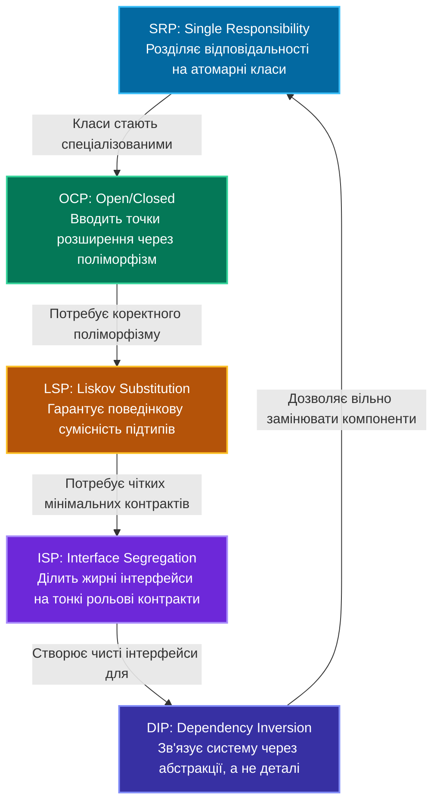
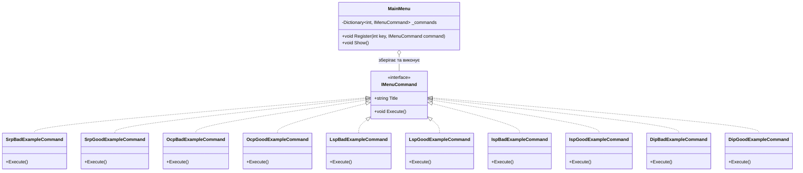

# Практичний курс з об'єктно-орієнтованого проектування: Принципи SOLID у C# .NET

Ласкаво просимо до повного практичного курсу з принципів **SOLID** — фундаментального набору рекомендацій та патернів архітектури програмного забезпечення, що лежить в основі розробки надійних, масштабованих та тестованих систем.

Цей репозиторій створено у форматі інтерактивного навчального посібника («живого підручника») для розробників, студентів та інженерів. Кожен принцип проілюстровано парними прикладами: **проблемною реалізацією (Bad)**, яка демонструє типові антипатерни реальних проектів, та **еталонною архітектурою (Good)**, побудованою за канонічними інженерними підходами на платформі .NET.

---

## Зміст курсу та швидка навігація

| Літера | Назва принципу | Фокус проектування | Повна лекція курсу | Поганий код (Bad) | Еталонний код (Good) |
|:---:|:---|:---|:---:|:---:|:---:|
| **S** | **Single Responsibility (SRP)** | Єдина зона відповідальності, висока когезія | [01_Single_Responsibility.md](OOP%20-%20SOLID/Docs/01_Single_Responsibility_Principle.md) | [👉 `OrderProcessorBad.cs`](OOP%20-%20SOLID/S/OrderProcessorBad.cs) | [👉 `OrderProcessorGood.cs`](OOP%20-%20SOLID/S/OrderProcessorGood.cs) |
| **O** | **Open/Closed (OCP)** | Відкритість до розширення, закритість для змін | [02_Open_Closed.md](OOP%20-%20SOLID/Docs/02_Open_Closed_Principle.md) | [👉 `PaymentProcessorBad.cs`](OOP%20-%20SOLID/O/PaymentProcessorBad.cs) | [👉 `PaymentProcessorGood.cs`](OOP%20-%20SOLID/O/PaymentProcessorGood.cs) |
| **L** | **Liskov Substitution (LSP)** | Надійність підстановки підтипів, контракти | [03_Liskov_Substitution.md](OOP%20-%20SOLID/Docs/03_Liskov_Substitution_Principle.md) | [👉 `BirdBad.cs`](OOP%20-%20SOLID/L/LSPBadExample/BirdBad.cs) | [👉 `BirdGood.cs`](OOP%20-%20SOLID/L/LSPGoodExample/BirdGood.cs) |
| **I** | **Interface Segregation (ISP)** | Розділення інтерфейсів, рольові контракти | [04_Interface_Segregation.md](OOP%20-%20SOLID/Docs/04_Interface_Segregation_Principle.md) | [👉 `IWorkerBad.cs`](OOP%20-%20SOLID/I/ISPBadExample/IWorkerBad.cs) | [👉 `RobotWorkerGood.cs`](OOP%20-%20SOLID/I/ISPGoodExample/RobotWorkerGood.cs) |
| **D** | **Dependency Inversion (DIP)** | Інверсія залежностей, абстракції | [05_Dependency_Inversion.md](OOP%20-%20SOLID/Docs/05_Dependency_Inversion_Principle.md) | [👉 `UserServiceBad.cs`](OOP%20-%20SOLID/D/DIPBadExample/UserServiceBad.cs) | [👉 `UserServiceGood.cs`](OOP%20-%20SOLID/D/DIPGoodExample/UserServiceGood.cs) |
| **D+**| **DIP ➔ IoC ➔ DI ➔ Container** | Еволюційний практикум (Abstract Factory, Pure DI, Lifetimes) | [06_DIP_IoC_DI_Containers_DeepDive.md](OOP%20-%20SOLID/Docs/06_DIP_IoC_DI_Containers_DeepDive.md) | [👉 `UserServiceWithFactory.cs`](OOP%20-%20SOLID/DIP_IoC_DI_Evolution/Step2_AbstractFactory_IoC/UserServiceWithFactory.cs) | [👉 `UserServiceWithDI.cs`](OOP%20-%20SOLID/DIP_IoC_DI_Evolution/Step3_DependencyInjection/UserServiceWithDI.cs)<br/>[👉 `SimpleContainer.cs`](OOP%20-%20SOLID/DIP_IoC_DI_Evolution/Step4_IoCContainer/MiniContainer/SimpleContainer.cs) |

---

## 1. Вступ та історія: Навіщо потрібен SOLID?

Акронім **SOLID** був уведений Майклом Фізерсом (Michael Feathers) на початку 2000-х років для систематизації п'яти фундаментальних принципів, сформульованих Робертом С. Мартіном («Дядько Боб», Robert C. Martin).

У реальних проектах програмне забезпечення рідко залишається статичним. Бізнес-вимоги змінюються, додаються нові платіжні системи, методи сповіщень, сховища даних та правила валідації. Якщо дизайн системи не підготовлений до змін, виникає явище, відоме як **деградація архітектури (Architectural Decay / Software Rot)**.

### Симптоми «гниючого коду» (Code Rot):

1. **Жорсткість (Rigidity)**:
   - Зміна в одному модулі спричиняє лавину вимушених правок у багатьох залежних компонентах. Навіть дрібна зміна оцінюється як тривала та ризикована задача.
2. **Крихкість (Fragility)**:
   - Внесення змін ламає функціональність у місцях, концептуально взагалі не пов'язаних із місцем модифікації (ефект метелика).
3. **Немобільність (Immobility)**:
   - Неможливість повторно використати корисний фрагмент коду в іншій частині програми або в іншому проекті, оскільки він занадто сильно «прив'язаний» до поточного оточення.
4. **В'язкість (Viscosity)**:
   - Архітектурно «правильне» рішення настільки громіздке й незручне для впровадження, що розробник обирає шлях «костилів» і швидких хаків, чим ще сильніше руйнує систему.

**Принципи SOLID є цілісною вакциною проти цих симптомів.**

---

## 2. Синергія принципів SOLID

Початківці часто розглядають п'ять принципів окремо один від одного. Проте справжня сила архітектурного проектування виникає саме тоді, коли принципи працюють **у синергії**:



### Як принципи взаємодоповнюють один одного:
1. **SRP** визначає **межі відповідальності** класів. Замість монолітів ми отримуємо компактні, сфокусовані компоненти.
2. **OCP** показує, як зробити ці класи відкритими до майбутнього, замінюючи каскадні перевірки `switch/if` на **поліморфізм**.
3. **LSP** гарантує, що класи-спадкоємці поліморфного ланцюжка **не порушать очікувань клієнта** та не призведуть до раптових винятків типу `NotSupportedException`.
4. **ISP** захищає клієнтський код від надлишкових обов'язків, формуючи **вузькоспеціалізовані інтерфейси**.
5. **DIP** збирає всю систему разом: високорівнева бізнес-логіка перестає залежати від SQL-баз, сокетів чи файлової системи, а оперує виключно **контрактами (абстракціями)**.

---

## 3. Огляд прикладів репозиторію

Репозиторій структуровано за п'ятьма відповідними папками:

```
OOP - SOLID/
│
├── S/                       # Single Responsibility Principle
│   ├── SRPGoodExample/      # Виокремлені сервіси: Order, OrderRepository, EmailService, InvoiceGenerator
│   ├── OrderProcessorBad.cs # Монолітний антипатерн God Object
│   ├── OrderProcessorGood.cs# Елегантна оркестрація через композицію
│   ├── SrpBadExampleCommand.cs
│   ├── SrpGoodExampleCommand.cs
│   └── README.md            # Вичерпна лекція з теорії, діаграм та метрик SRP
│
├── O/                       # Open/Closed Principle
│   ├── OCPGoodExample/      # Контракт IPaymentMethod та реалізації (CreditCard, PayPal, Crypto)
│   ├── PaymentProcessorBad.cs # Жорсткий розгалужувач switch/case
│   ├── PaymentProcessorGood.cs# Відкрита до розширення система
│   ├── OcpBadExampleCommand.cs
│   ├── OcpGoodExampleCommand.cs
│   └── README.md            # Вичерпна лекція з патернами Strategy, Factory, Decorator
│
├── L/                       # Liskov Substitution Principle
│   ├── LSPBadExample/       # Парадокс нелітаючих птахів (Ostrich / Penguin)
│   ├── LSPGoodExample/      # Коректна ієрархія: IBird, IFlyingBird, Sparrow, Penguin
│   ├── LspBadExampleCommand.cs
│   ├── LspGoodExampleCommand.cs
│   └── README.md            # Лекція: Design by Contract, перед- та післяумови, інваріанти
│
├── I/                       # Interface Segregation Principle
│   ├── ISPBadExample/       # Жирний інтерфейс IMultiFunctionDevice з NotImplementedException
│   ├── ISPGoodExample/      # Рольові інтерфейси IPrinter, IScanner, IFax, ICopier
│   ├── IspBadExampleCommand.cs
│   ├── IspGoodExampleCommand.cs
│   └── README.md            # Лекція: Історія Xerox, компонування пристроїв, адаптери
│
├── D/                       # Dependency Inversion Principle
│   ├── DIPBadExample/       # Жорстке інстанціювання new SqlDatabase(), new SmtpEmailService()
│   ├── DIPGoodExample/      # Інверсія залежностей: IDatabase, IEmailNotificationService
│   ├── DipBadExampleCommand.cs
│   ├── DipGoodExampleCommand.cs
│   └── README.md            # Лекція: IoC-контейнери, життєві цикли (Transient/Scoped/Singleton)
│
├── IMenuCommand.cs          # Інтерфейс патерну Command для консольного термінала
├── Program.cs               # Головне меню програми та реєстрація демонстраційних команд
└── README.md                # Головний навчальний силабус (цей файл)
```

---

## 4. Патерн проектування Command в інтерактивній оболонці

Точка входу програми (`Program.cs`) спроектована з використанням класичного патерну проектування **Command (Команда)**. Замість монолітної конструкції `switch-case` в меню вибору, кожна демонстрація інкапсульована в окремому об'єкті, що реалізує інтерфейс `IMenuCommand`:

```csharp
public interface IMenuCommand
{
    string Title { get; }
    void Execute();
}
```

Клас `MainMenu` реєструє команди у словнику та викликає їх поліморфно:



Такий підхід демонструє дотримання **OCP** та **SRP** вже на рівні самої програми: додавання нової демонстрації не вимагає переписування коду навігації в меню.

---

## 5. Інструкція із запуску та роботи

Для запуску демонстраційної консольної програми потрібен встановлений SDK **.NET 9.0** (або новішої версії).

### Крок 1: Клонування або перехід до каталогу проекту
```bash
cd "OOP - SOLID/OOP - SOLID"
```

### Крок 2: Збірка проекту
Переконайтеся, що всі залежності зібрані коректно (0 помилок, 0 попереджень):
```bash
dotnet build
```

### Крок 3: Запуск інтерактивного меню
```bash
dotnet run
```

### Крок 4: Вибір розділу для тестування
Консольний інтерфейс запропонує зручне меню:
```text
=== ДЕМОНСТРАЦІЯ SOLID ПРИНЦИПІВ ===
1. S - Поганий приклад (Порушення SRP)
2. S - Гарний приклад (Дотримання SRP)
3. O - Поганий приклад (Порушення OCP)
4. O - Гарний приклад (Дотримання OCP)
5. L - Поганий приклад (Порушення LSP)
6. L - Гарний приклад (Дотримання LSP)
7. I - Поганий приклад (Порушення ISP)
8. I - Гарний приклад (Дотримання ISP)
9. D - Поганий приклад (Порушення DIP)
10. D - Гарний приклад (Дотримання DIP)
0. Вихід
```

---

## 6. Баланс між SOLID та прагматизмом: Уникнення Overengineering

Застосування принципів SOLID є ознакою високої культури інженерії, однак досвідчений архітектор завжди пам'ятає про баланс:

> «Абстракція без необхідності — це технічний борг, створений наперед.»

### Інженерна тріада поруч із SOLID:
1. **KISS (Keep It Simple, Stupid)**: Найпростіше робоче рішення часто є найкращим. Не створюйте фабрику фабрик або 15 шарів абстракцій там, де достатньо одного простого класу.
2. **YAGNI (You Aren't Gonna Need It)**: Не впроваджуйте точки розширення OCP під сценарії, які існують лише у вашій уяві. Розширюйте систему тоді, коли з'являється реальна бізнес-вимога.
3. **DRY (Don't Repeat Yourself)**: Усувайте дублювання знань, але не плутайте випадкову схожість коду зі справжнім дублюванням бізнес-логіки.

### Матриця прийняття рішень:
- **Утиліти, скрипти міграції, внутрішні хелпери**: Мінімальна абстракція, максимальна простота (KISS).
- **Core бізнес-домен (Domain Layer), платіжні шлюзи, інтеграції зі сторонніми API**: Повна відповідність усім принципам SOLID для захисту ядра системи від зовнішніх коливань.

---

## 7. Рекомендована література та першоджерела

1. **Роберт С. Мартін (Uncle Bob)**: *Clean Architecture: A Craftsman's Guide to Software Structure and Design*. Prentice Hall, 2017.
2. **Роберт С. Мартін**: *Agile Software Development, Principles, Patterns, and Practices*. Prentice Hall, 2002.
3. **Еріх Гамма, Річард Гелм, Ральф Джонсон, Джон Вліссідіс (GoF)**: *Design Patterns: Elements of Reusable Object-Oriented Software*. Addison-Wesley, 1994.
4. **Мартін Фаулер**: *Refactoring: Improving the Design of Existing Code (2nd Edition)*. Addison-Wesley, 2018.
5. **Барбара Лісков, Жанетт Вінг**: *A Behavioral Notion of Subtyping*. ACM Transactions on Programming Languages and Systems, 1994.

---
*Матеріали підготовлено як комплексний академічно-практичний довідник для вивчення та щоденного застосування в комерційній .NET розробці.*
