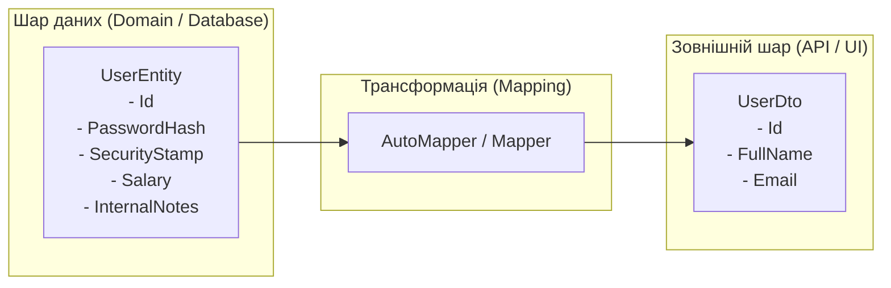

# Патерн DTO (Data Transfer Object) та трансформація об'єктів

## Вступ
У сучасній розробці корпоративних додатків неприпустимо безпосередньо віддавати доменні сутності (Entities) або моделі бази даних (EF Core) у клієнтський інтерфейс чи API. Для передачі даних між шарами архітектури використовується патерн **DTO (Data Transfer Object)**.

---

## 1. Навіщо потрібен патерн DTO?



### Ключові причини використання DTO:
1. **Безпека (Security & Over-Posting):** Приховування конфіденційних полів (хеші паролів, внутрішні ідентифікатори, зарплатні відомості). Захист від масового присвоєння (Mass Assignment / Over-Posting vulnerability), коли зловмисник передає зайві поля, такі як `IsAdmin = true`.
2. **Розв'язання циклічних посилань:** Доменні сутності часто мають двонаправлені зв'язки (`Order -> Customer -> Orders`). Спроба їх прямої серіалізації в JSON призводить до виключення `JsonException: A possible object cycle was detected`.
3. **Оптимізація трафіку:** DTO містить лише ті дані, які необхідні конкретному екрану користувача, заощаджуючи мережевий трафік.
4. **Стабільність API-контрактів:** Внутрішня структура таблиць БД може змінюватися в процесі рефакторингу, але публічний DTO контракт залишається незмінним.

---

## 2. Ручний мапінг (Manual Mapping) проти автоматизованого

Ручний мапінг:
```csharp
public static UserDto ToDto(User user)
{
    return new UserDto
    {
        Id = user.Id,
        FullName = $"{user.FirstName} {user.LastName}",
        Email = user.Email
    };
}
```
- **Переваги:** Максимальна швидкість виконання, явність, відсутність сторонніх залежностей.
- **Недоліки:** Величезна кількість рутинного шаблонного коду (Boilerplate). При зміні властивостей потрібно вручну оновлювати всі методи мапінгу; висока ймовірність забути скопіювати нове поле.

---

## 3. Проекти для практики

- [AutoMapperDemo - ManualMappingFeature](file:///05-Architecture-And-Patterns/02-AutoMapper-And-DTO/AutoMapperDemo/Features/ManualMappingFeature.cs) — Детальний розбір ручного мапінгу сутностей у DTO, порівняння трудовитрат та підводних каменів.
