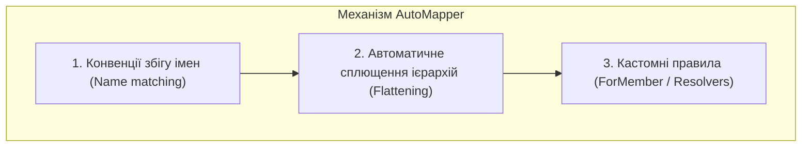

# AutoMapper: Профілі, Конвенції та Розширена Конфігурація

## Вступ
**AutoMapper** — це бібліотека об'єктно-орієнтованого мапінгу (Object-to-Object Mapper), яка використовує рефлексію під час ініціалізації та генерує динамічні дерева виразів (Expression Trees) для високоефективного копіювання даних між типами.

---

## 1. Створення профілю (MappingProfile)

Конфігурація мапінгу інкапсулюється в класи, похідні від `Profile`:

```csharp
public class MappingProfile : Profile
{
    public MappingProfile()
    {
        // 1. Базовий двонаправлений мапінг за конвенціями імен
        CreateMap<Customer, CustomerDto>().ReverseMap();

        // 2. Сплющення (Flattening): AutoMapper автоматично мапить
        //    властивість order.Customer.Name у orderDto.CustomerName!
        CreateMap<Order, OrderDto>();

        // 3. Ручне налаштування окремих членів через ForMember
        CreateMap<Employee, EmployeeDto>()
            .ForMember(dest => dest.FullName, opt => opt.MapFrom(src => $"{src.FirstName} {src.LastName}"))
            .ForMember(dest => dest.SecretToken, opt => opt.Ignore())
            .ForMember(dest => dest.Bonus, opt => opt.Condition(src => src.YearsOfExperience > 3));
    }
}
```



---

## 2. Інтеграція з Dependency Injection

У сучасному .NET 10 AutoMapper реєструється в контейнері служб через Generic Host або WebApplication:
```csharp
services.AddAutoMapper(typeof(MappingProfile).Assembly);
```

Впровадження здійснюється через інтерфейс `IMapper`:
```csharp
public class UserService
{
    private readonly IMapper _mapper;

    public UserService(IMapper mapper)
    {
        _mapper = mapper;
    }

    public UserDto GetUserDto(User user)
    {
        return _mapper.Map<UserDto>(user);
    }
}
```

---

## 3. Проекти для практики

- [AutoMapperDemo - MappingProfile](file:///05-Architecture-And-Patterns/02-AutoMapper-And-DTO/AutoMapperDemo/Mapping/MappingProfile.cs) — Центральний профіль з повним набором конфігурацій.
- [AutoMapperDemo - BasicMappingFeature](file:///05-Architecture-And-Patterns/02-AutoMapper-And-DTO/AutoMapperDemo/Features/BasicMappingFeature.cs) — Базовий мапінг сутностей.
- [AutoMapperDemo - CollectionsFeature](file:///05-Architecture-And-Patterns/02-AutoMapper-And-DTO/AutoMapperDemo/Features/CollectionsFeature.cs) — Трансформація колекцій, масивів та списків об'єктів.
- [AutoMapperDemo - ComplexMappingFeature](file:///05-Architecture-And-Patterns/02-AutoMapper-And-DTO/AutoMapperDemo/Features/ComplexMappingFeature.cs) — Сплющення складних графів зв'язаних об'єктів.
- [AutoMapperDemo - ConditionalMappingFeature](file:///05-Architecture-And-Patterns/02-AutoMapper-And-DTO/AutoMapperDemo/Features/ConditionalMappingFeature.cs) — Умовний мапінг значень на основі предикатів.
- [AutoMapperDemo - AdvancedFeature](file:///05-Architecture-And-Patterns/02-AutoMapper-And-DTO/AutoMapperDemo/Features/Advanced/AdvancedFeature.cs) — Використання користувацьких резолверів (`IValueResolver`).
