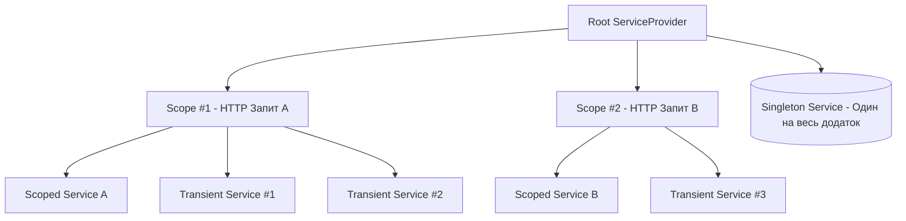

# Розділ 1: Принципи Dependency Injection та Життєві Цикли Сервісів

## Вступ: Від SOLID до IoC-контейнерів
Принцип інверсії залежностей (**Dependency Inversion Principle - DIP**), що є п'ятим стовпом SOLID, стверджує:
1. Модулі вищого рівня не повинні залежати від модулів нижчого рівня. Обидва повинні залежати від абстракцій.
2. Абстракції не повинні залежати від деталей. Деталі повинні залежати від абстракцій.

**Inversion of Control (IoC)** — це ширший архітектурний шаблон, де управління виконанням програми та зв'язуванням залежностей передається зовнішньому фреймворку.
**Dependency Injection (DI)** — це конкретний патерн реалізації IoC, коли екземпляри залежностей передаються класу ззовні (зазвичай через конструктор), а не створюються ним напряму за допомогою оператора `new`.

---

## 1. Життєві цикли сервісів у Microsoft.Extensions.DependencyInjection

Вбудований IoC-контейнер .NET пропонує три фундаментальні часи життя (Service Lifetimes):

| Життєвий цикл | Метод реєстрації | Поведінка екземпляра | Типове застосування |
| :--- | :--- | :--- | :--- |
| **Transient** | `AddTransient<TInterface, TImpl>()` | Створюється новий екземпляр при **кожному** запиті з контейнера. | Легковажні сервіси без стану (stateless), утиліти, калькулятори, валідатори. |
| **Scoped** | `AddScoped<TInterface, TImpl>()` | Створюється **один екземпляр на межах одного scope** (`IServiceScope`). У веб-додатках scope створюється на кожен HTTP-запит. | Контексти баз даних (`DbContext`), сесії користувача, Unit of Work, репозиторії. |
| **Singleton** | `AddSingleton<TInterface, TImpl>()` | Створюється **один-єдиний екземпляр** при першому запиті і живе протягом усього часу роботи додатку. | Кеш у пам'яті, клієнти з пулом з'єднань (`HttpClient`, Redis-клієнт), конфігурація. |

### Візуалізація життєвих циклів


---

## 2. Антипатерн Captive Dependency (Захоплена залежність)

### У чому полягає небезпека?
Коли сервіс із **довшим** життєвим циклом (наприклад, `Singleton`) захоплює у своєму конструкторі сервіс із **коротшим** життєвим циклом (наприклад, `Scoped` або `Transient`).

```csharp
// АНТИПАТЕРН: Singleton тримає посилання на Scoped об'єкт назавжди!
public class BadCacheService
{
    private readonly ApplicationDbContext _db; // Scoped DbContext!

    public BadCacheService(ApplicationDbContext db)
    {
        _db = db; // DbContext ніколи не буде звільнено (Memory Leak + Concurrency Exception)
    }
}
```

### Наслідки Captive Dependency:
1. **Витік пам'яті (Memory Leak):** Об'єкт, що мав звільнитися після завершення HTTP-запиту, ніколи не буде зібраний GC.
2. **Багатопотокові гонки (Concurrency Bugs):** `DbContext` не є потокобезпечним. Якщо декілька потоків одночасно звертаються до Singleton, вони отримають `InvalidOperationException: A second operation was started on this context instance before a previous operation completed`.
3. **Застарілі дані:** Контекст не бачитиме нових змін, закешованих у локальному Change Tracker.

### Захист у .NET:
Завжди вмикайте валідацію контейнера при створенні:
```csharp
var options = new ServiceProviderOptions
{
    ValidateScopes = true, // Забороняє Singleton резолвити Scoped
    ValidateOnBuild = true  // Перевіряє дерево залежностей під час BuildServiceProvider()
};
var provider = services.BuildServiceProvider(options);
```

### Правильний патерн: `IServiceScopeFactory`
Якщо Singleton-сервісу дійсно потрібно виконати операцію з Scoped-ресурсом, він повинен самостійно керувати межами scope:
```csharp
public class SafeBackgroundProcessor
{
    private readonly IServiceScopeFactory _scopeFactory;

    public SafeBackgroundProcessor(IServiceScopeFactory scopeFactory)
    {
        _scopeFactory = scopeFactory;
    }

    public async Task ProcessNextAsync()
    {
        using var scope = _scopeFactory.CreateScope();
        var db = scope.ServiceProvider.GetRequiredService<ApplicationDbContext>();
        await db.Orders.ToListAsync();
    }
}
```

---

## 3. Ключові сервіси (Keyed Services у .NET 8+)

До появи .NET 8 розрізнення декількох реалізацій одного інтерфейсу вимагало створення фабрик або сторонніх бібліотек. Починаючи з .NET 8, підтримка **Keyed Services** вбудована в ядро:

```csharp
// Реєстрація з ключем:
services.AddKeyedSingleton<IPaymentGateway, StripePaymentGateway>("stripe");
services.AddKeyedSingleton<IPaymentGateway, LiqPayPaymentGateway>("liqpay");

// Отримання через атрибут [FromKeyedServices]:
public class OrderCheckoutHandler
{
    private readonly IPaymentGateway _gateway;

    public OrderCheckoutHandler([FromKeyedServices("liqpay")] IPaymentGateway gateway)
    {
        _gateway = gateway;
    }
}

// Пряме отримання за ключем:
var stripe = serviceProvider.GetRequiredKeyedService<IPaymentGateway>("stripe");
```

---

## 4. Очищення ресурсів: `IDisposable` та `IAsyncDisposable`

Контейнер бере на себе повну відповідальність за виклик `Dispose()` або `DisposeAsync()` для створених ним екземплярів:
- **Transient та Scoped:** викликаються автоматично при виклику `scope.Dispose()`.
- **Singleton:** викликається при знищенні кореневого `ServiceProvider` під час завершення роботи додатку.
- **Порядок звільнення:** ресурси звільняються у зворотному порядку (LIFO).
