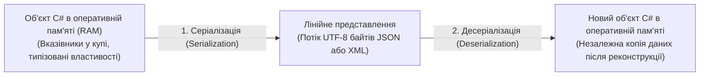

# 01. Фундаментальні основи серіалізації JSON та XML у .NET

> **Базові проєкти**:
> - [`19-SerializationBasicsJsonDemo`](../19-SerializationBasicsJsonDemo/Program.cs) — Структура, атрибути та базове розуміння `System.Text.Json`.
> - [`20-SerializationBasicsXmlDemo`](../20-SerializationBasicsXmlDemo/Program.cs) — Структура, атрибути та базове розуміння `XmlSerializer` і `XDocument`.  
> **Офіційна документація**: [Serialization in .NET (Microsoft Learn)](https://learn.microsoft.com/en-us/dotnet/standard/serialization/)

Перш ніж працювати зі складними потоковими конвеєрами та створювати власні рефлексивні рушії серіалізації, необхідно досконало опанувати будову та налаштування двох головних текстових форматів обміну даними: **JSON** та **XML**.

---

## 1. Що таке Серіалізація та Десеріалізація?

В оперативній пам'яті (RAM) об'єкти C# зберігаються у вигляді нелінійного графа вказівників у керованій купі (Managed Heap). Ми не можемо просто скопіювати сирі байти об'єкта з оперативної пам'яті і передати їх по мережі іншому комп'ютеру, бо адреси пам'яті там будуть недійсними.



- **Серіалізація (Serialization)** — процес перетворення стану об'єкта (або цілого дерева пов'язаних об'єктів) у лінійний текстовий або бінарний формат для збереження у файл, базу даних або передачі по HTTP/мережі.
- **Десеріалізація (Deserialization)** — зворотний процес лексичного та синтаксичного розбору тексту зі створенням і заповненням живих екземплярів об'єктів C# у пам'яті.

---

## 2. Порівняння анатомії JSON та XML

| Характеристика | Формат JSON (JavaScript Object Notation) | Формат XML (eXtensible Markup Language) |
| :--- | :--- | :--- |
| **Синтаксична основа** | Пари `"ключ": значення` всередині фігурних дужок `{ }` | Ієрархічне дерево відкриваючих `<Tag>` та закриваючих `</Tag>` тегів |
| **Кореневий елемент** | Безіменний об'єкт `{ ... }` або масив `[ ... ]` | Зобов'язаний мати рівно один іменований кореневий тег (наприклад, `<LibraryBook>`) |
| **Способи запису властивості** | Завжди як пара `"ключ": значення` | Два способи: вкладений тег `<Year>2024</Year>` або атрибут тегу `<Book year="2024">` |
| **Типізація значень у тексті** | Розрізняє рядки `"abc"`, числа `94.5`, логічні `true`/`false`, масиви `[]` та `null` | Усі значення у тексті є рядками (вимагає XSD-схеми або знання цільового типу C#) |
| **Підтримка просторів імен** | Не підтримується | Повна підтримка (`xmlns:xsi="..."`) для уникнення колізій імен |
| **Керуючі атрибути в .NET** | `[JsonPropertyName]`, `[JsonIgnore]`, `[JsonInclude]`, `[JsonRequired]` | `[XmlRoot]`, `[XmlElement]`, `[XmlAttribute]`, `[XmlArray]`, `[XmlIgnore]` |
| **Основна сфера застосування** | REST API, мікросервіси, SPA-фронтенд, `appsettings.json`, NoSQL | Файли `.csproj`, банківські шлюзи (ISO 20022), платіжні системи, SOAP, SVG |

---

## 3. Налаштування `System.Text.Json`: `JsonSerializerOptions` та Атрибути

Стандартний серіалізатор `System.Text.Json` спроєктований з акцентом на максимальну продуктивність та мінімальні алокації пам'яті (працює напряму з байтами UTF-8 через `Span<byte>`).

### 3.1. Декларативне керування моделлю через атрибути (див. [`19-SerializationBasicsJsonDemo/Program.cs`](../19-SerializationBasicsJsonDemo/Program.cs))

```csharp
using System.Text.Json;
using System.Text.Json.Serialization;

public sealed class DeveloperProfile
{
    [JsonPropertyOrder(-1)] // Гарантує, що поле id буде першим у JSON
    [JsonPropertyName("developer_id")]
    public int Id { get; init; }

    [JsonRequired] // Викине JsonException під час десеріалізації, якщо поле відсутнє у JSON
    public string FullName { get; init; } = string.Empty;

    [JsonConverter(typeof(JsonStringEnumConverter))] // Серіалізує enum як рядок "Senior", а не число 2
    public SeniorityLevel Level { get; init; }

    [JsonIgnore] // Конфіденційне поле ніколи не потрапить у вихідний JSON
    public string InternalPasswordHash { get; init; } = string.Empty;

    [JsonIgnore(Condition = JsonIgnoreCondition.WhenWritingNull)]
    public string? GitHubUrl { get; init; }
}
```

### 3.2. Глобальні опції `JsonSerializerOptions` та повторне використання (Кешування)

> [!IMPORTANT]
> **Завжди кешуйте екземпляр `JsonSerializerOptions` у статичному полі `static readonly`!** Під час першого виклику `Serialize` об'єкт `JsonSerializerOptions` будує і кешує внутрішні таблиці метаданих для типів. Створення `new JsonSerializerOptions()` на кожному виклику знищує цей кеш і уповільнює серіалізацію в десятки разів.

```csharp
private static readonly JsonSerializerOptions DefaultJsonOptions = new()
{
    WriteIndented = true, // Форматування з відступами для читабельності людиною
    PropertyNamingPolicy = JsonNamingPolicy.CamelCase, // FullName -> fullName (або SnakeCaseLower у .NET 8+)
    PropertyNameCaseInsensitive = true, // Дозволяє читати "fullname" або "FULLNAME" при десеріалізації
    DefaultIgnoreCondition = JsonIgnoreCondition.WhenWritingNull, // Пропускати null-поля
    ReferenceHandler = ReferenceHandler.IgnoreCycles, // Захист від нескінченної рекурсії A -> B -> A
    Encoder = JavaScriptEncoder.UnsafeRelaxedJsonEscaping // Коректний вивід кирилиці без \u04XX
};
```

---

## 4. Основи XML-серіалізації (`XmlSerializer`)

На відміну від JSON, в XML кожне поле об'єкта може бути представлене або як **атрибут відкриваючого тегу**, або як **вкладений дочірній тег** (див. [`20-SerializationBasicsXmlDemo/Program.cs`](../20-SerializationBasicsXmlDemo/Program.cs)):

```csharp
using System.Xml.Serialization;

[XmlRoot("LibraryBook")]
public class BookRecord
{
    [XmlAttribute("isbn")] // Стане атрибутом: <LibraryBook isbn="978-0-13-235088-4">
    public string Isbn { get; set; } = string.Empty;

    [XmlElement("BookTitle")] // Стане вкладеним тегом: <BookTitle>Clean Code</BookTitle>
    public string Title { get; set; } = string.Empty;

    [XmlArray("Categories")]
    [XmlArrayItem("Tag")] // <Categories><Tag>OOP</Tag><Tag>Architecture</Tag></Categories>
    public List<string> Tags { get; set; } = new();

    [XmlIgnore] // Ігнорується серіалізатором XML
    public decimal InternalCost { get; set; }
}
```

> **Вимога `XmlSerializer`:** Цільовий клас обов'язково повинен бути `public` і мати відкритий конструктор без параметрів (`public BookRecord() { }`).

---

## 5. Довідник ключових властивостей і методів DOM-аналізу (`JsonDocument` та `XDocument`)

Коли структура вхідного документа заздалегідь невідома або потрібно витягти лише одне поле з великого пакета без створення C#-класів, використовують дерева DOM у пам'яті:

### Властивості класів DOM-аналізу JSON та XML (Properties)

| Властивість | Сигнатура | Опис призначення | Приклад у коді | Документація MSDN |
| :--- | :--- | :--- | :--- | :--- |
| **`RootElement`** | `JsonElement RootElement { get; }` | Кореневий вузол розпарсеного JSON-документа | [19-SerializationBasicsJsonDemo/Program.cs](../19-SerializationBasicsJsonDemo/Program.cs#L58) | [JsonDocument.RootElement](https://learn.microsoft.com/en-us/dotnet/api/system.text.json.jsondocument.rootelement) |
| **`ValueKind`** | `JsonValueKind ValueKind { get; }` | Тип вузла JSON (`Object`, `Array`, `String`, `Number`, `True`, `False`, `Null`) | [19-SerializationBasicsJsonDemo/Program.cs](../19-SerializationBasicsJsonDemo/Program.cs#L59) | [JsonElement.ValueKind](https://learn.microsoft.com/en-us/dotnet/api/system.text.json.jsonelement.valuekind) |
| **`Root`** | `XElement? Root { get; }` | Кореневий XML-елемент документа `XDocument` | [20-SerializationBasicsXmlDemo/Program.cs](../20-SerializationBasicsXmlDemo/Program.cs#L58) | [XDocument.Root](https://learn.microsoft.com/en-us/dotnet/api/system.xml.linq.xdocument.root) |
| **`HasElements`** | `bool HasElements { get; }` | Визначає, чи містить поточний XML-тег вкладені дочірні теги | [20-SerializationBasicsXmlDemo/Program.cs](../20-SerializationBasicsXmlDemo/Program.cs#L72) | [XElement.HasElements](https://learn.microsoft.com/en-us/dotnet/api/system.xml.linq.xelement.haselements) |

### Методи стандартної роботи з JSON та XML (Methods)

| Метод | Сигнатура | Опис призначення | Приклад у коді | Документація MSDN |
| :--- | :--- | :--- | :--- | :--- |
| **`JsonSerializer.Serialize`** | `static string Serialize<TValue>(TValue value, JsonSerializerOptions? options)` | Перетворює об'єкт у рядок формату JSON | [19-SerializationBasicsJsonDemo/Program.cs](../19-SerializationBasicsJsonDemo/Program.cs#L43) | [JsonSerializer.Serialize](https://learn.microsoft.com/en-us/dotnet/api/system.text.json.jsonserializer.serialize) |
| **`JsonSerializer.Deserialize`** | `static TValue? Deserialize<TValue>(string json, JsonSerializerOptions? options)` | Відновлює типізований об'єкт із рядка JSON | [19-SerializationBasicsJsonDemo/Program.cs](../19-SerializationBasicsJsonDemo/Program.cs#L72) | [JsonSerializer.Deserialize](https://learn.microsoft.com/en-us/dotnet/api/system.text.json.jsonserializer.deserialize) |
| **`JsonDocument.Parse`** | `static JsonDocument Parse(string json)` | Будує read-only дерево вузлів JSON у пам'яті (реалізує `IDisposable`, бо використовує `ArrayPool`) | [19-SerializationBasicsJsonDemo/Program.cs](../19-SerializationBasicsJsonDemo/Program.cs#L56) | [JsonDocument.Parse](https://learn.microsoft.com/en-us/dotnet/api/system.text.json.jsondocument.parse) |
| **`XmlSerializer.Serialize`** | `void Serialize(TextWriter textWriter, object? o)` | Серіалізує об'єкт у потік XML з урахуванням XML-атрибутів | [20-SerializationBasicsXmlDemo/Program.cs](../20-SerializationBasicsXmlDemo/Program.cs#L41) | [XmlSerializer.Serialize](https://learn.microsoft.com/en-us/dotnet/api/system.xml.serialization.xmlserializer.serialize) |
| **`XDocument.Parse`** | `static XDocument Parse(string text)` | Будує DOM-дерево XML для аналізу атрибутів та дочірніх тегів через LINQ | [20-SerializationBasicsXmlDemo/Program.cs](../20-SerializationBasicsXmlDemo/Program.cs#L57) | [XDocument.Parse](https://learn.microsoft.com/en-us/dotnet/api/system.xml.linq.xdocument.parse) |
