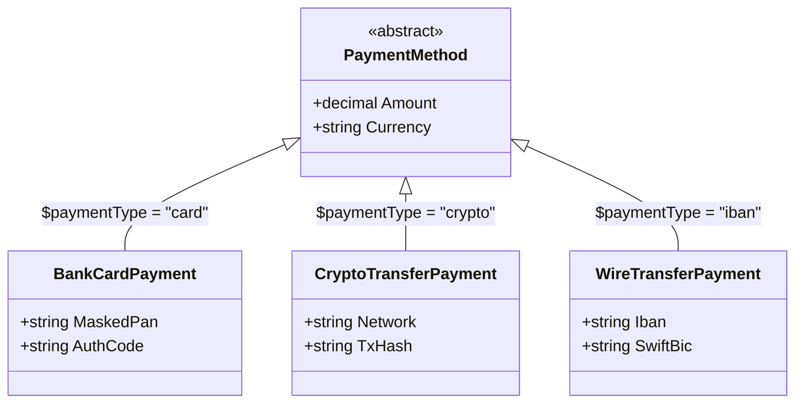

# 02. Потокова серіалізація JSON, поліморфізм ООП та XML / LINQ to XML

> **Базові проєкти**:
> - [`19-SerializationBasicsJsonDemo`](../19-SerializationBasicsJsonDemo/Program.cs) — Базовий `JsonSerializer` та `JsonDocument`.
> - [`19.1-JsonStreamsAndPolymorphismDemo`](../19.1-JsonStreamsAndPolymorphismDemo/Program.cs) — Асинхронні потоки, `[JsonPolymorphic]` та `Utf8JsonWriter`.
> - [`20-SerializationBasicsXmlDemo`](../20-SerializationBasicsXmlDemo/Program.cs) — `XmlSerializer`, `XDocument` (LINQ to XML) та безпечний `XmlReader`.

Цей гайд доповнює базові можливості `System.Text.Json` та `XmlSerializer` промисловими сценаріями роботи з потоками (`Stream`), ієрархіями успадкування ООП, низькорівневими UTF-8 парсерами та деревами `XDocument`.

---

## 1. Потокова серіалізація напряму у `FileStream` (Zero-String Allocation)

У навчальних прикладах часто зустрічається антипатерн: спочатку серіалізувати великий об'єкт у рядок `string`, а потім записати цей рядок у файл через `File.WriteAllText`.
Чому це небезпечно для високонавантаженого сервера?
1. Рядок `string` у .NET зберігається у кодуванні **UTF-16** (2 байти на символ). При серіалізації звіту на 50 МБ виділяється неперервний блок на 100 МБ у **Large Object Heap (LOH)**, що провокує дорогі паузи збирача сміття (Full GC Generation 2).
2. Під час запису на диск цей UTF-16 рядок знову перекодовується у байти **UTF-8**.

У промислових сервісах об'єкти серіалізують та десеріалізують **напряму в асинхронний потік байтів UTF-8**:

```csharp
// Погано: подвійна алокація у LOH (UTF-8 -> UTF-16 string -> UTF-8 файл)
string hugeJson = JsonSerializer.Serialize(invoice, options);
await File.WriteAllTextAsync("invoice.json", hugeJson);

// Добре: потокова серіалізація чанками UTF-8 напряму у FileStream (O(1) пам'яті в купі)
await using FileStream writeStream = File.Create("invoice.json");
await JsonSerializer.SerializeAsync(writeStream, invoice, options);

// Асинхронне потокове читання з диска без завантаження всього файлу в string
await using FileStream readStream = File.OpenRead("invoice.json");
Invoice? restored = await JsonSerializer.DeserializeAsync<Invoice>(readStream, options);
```

---

## 2. Поліморфна серіалізація ієрархій класів (`[JsonPolymorphic]`, `[JsonDerivedType]`)

Одна з класичних пасток ООП при серіалізації: якщо ми маємо колекцію базового абстрактного типу `List<PaymentMethod>`, в якій лежать похідні класи `BankCardPayment`, `CryptoTransferPayment` та `WireTransferPayment`, то за замовчуванням `JsonSerializer` запише у JSON **лише властивості базового класу** (всі специфічні поля похідних класів будуть втрачені, а десеріалізація впаде з помилкою, бо неможливо створити екземпляр `abstract class PaymentMethod`).

Починаючи з .NET 7+, для збереження поліморфної ієрархії базовий тип декорують атрибутами **дискримінатора типу** (див. [`19.1-JsonStreamsAndPolymorphismDemo/Program.cs`](../19.1-JsonStreamsAndPolymorphismDemo/Program.cs)):



```csharp
[JsonPolymorphic(TypeDiscriminatorPropertyName = "$paymentType")]
[JsonDerivedType(typeof(BankCardPayment), typeDiscriminator: "card")]
[JsonDerivedType(typeof(CryptoTransferPayment), typeDiscriminator: "crypto")]
[JsonDerivedType(typeof(WireTransferPayment), typeDiscriminator: "iban")]
public abstract record PaymentMethod(decimal Amount, string Currency);

public sealed record BankCardPayment(decimal Amount, string Currency, string MaskedPan, string AuthCode)
    : PaymentMethod(Amount, Currency);

public sealed record CryptoTransferPayment(decimal Amount, string Currency, string Network, string TxHash)
    : PaymentMethod(Amount, Currency);
```

Під час серіалізації у кожен об'єкт автоматично додається службове поле `"$paymentType": "card"`, за яким десеріалізатор точно знає, який саме похідний клас потрібно створити!

---

## 3. Низькорівневі `Utf8JsonWriter` та `Utf8JsonReader`

Коли потрібно згенерувати JSON із максимальною можливою швидкістю взагалі без рефлексії та без проміжних DTO-об'єктів (наприклад, у власних `JsonConverter<T>` або метриках телеметрії), використовують `Utf8JsonWriter`:

```csharp
await using var stream = new MemoryStream();
await using (var writer = new Utf8JsonWriter(stream, new JsonWriterOptions { Indented = true }))
{
    writer.WriteStartObject();
    writer.WriteString("service", "BillingEngine"u8); // Літерал ReadOnlySpan<byte> UTF-8!
    writer.WriteNumber("processedCount", 15420);
    writer.WriteStartArray("tags"u8);
    writer.WriteStringValue("production"u8);
    writer.WriteStringValue("net10"u8);
    writer.WriteEndArray();
    writer.WriteEndObject();
}
```

---

## 4. `XmlSerializer` проти `XDocument` (LINQ to XML) та безпечний `XmlReader`

У екосистемі .NET існують три основні інструменти для роботи з XML (див. [`20-SerializationBasicsXmlDemo/Program.cs`](../20-SerializationBasicsXmlDemo/Program.cs)):

| Інструмент | Модель роботи | Головні переваги | Коли обирати |
| :--- | :--- | :--- | :--- |
| **`XmlSerializer`** | Автоматичний мапінг XML <-> C# клас за атрибутами `[XmlElement]`, `[XmlAttribute]` | Не потрібно вручну обходити теги; підтримує генерацію за XSD | Коли є чітка C#-модель контракту (SOAP, банківські виписки) |
| **`XDocument` / `XElement`** | Дерево в пам'яті (DOM), інтегроване з LINQ to XML | Виразне конструювання та пошук через `.Descendants()`, `.Elements()`, `.Where()` | Коли потрібно динамічно побудувати або трансформувати складний XML або `.csproj` |
| **`XmlReader` / `XmlWriter`** | Однопрохідний курсор (Forward-only Pull Parser) | Споживає кілька кілобайтів пам'яті на файлах розміром у десятки гігабайтів | Потокове читання гігантських XML-дампів і каталогів товарів |

### Приклад запиту LINQ to XML (`XDocument`) та безпечного налаштування `XmlReaderSettings`

```csharp
// 1. Безпечний парсинг із явною забороною DTD (захист від XML External Entity / XXE атак)
var readerSettings = new XmlReaderSettings
{
    DtdProcessing = DtdProcessing.Prohibit,
    XmlResolver = null
};

using XmlReader safeReader = XmlReader.Create(new StringReader(xmlContent), readerSettings);
XDocument doc = XDocument.Load(safeReader);

// 2. Виразний пошук через LINQ to XML
var expensiveBooks = doc.Root!
    .Elements("Book")
    .Where(b => (decimal?)b.Element("Price") >= 500m)
    .Select(b => new
    {
        Isbn  = (string?)b.Attribute("isbn"),
        Title = (string?)b.Element("Title")
    })
    .ToList();
```

---

## Матриця проєктів

| Проєкт | Призначення та ключові концепції | Вихідний код |
| :--- | :--- | :--- |
| **`19-SerializationBasicsJsonDemo`** | Основи формату JSON, `JsonSerializer`, `JsonDocument`, `[JsonPropertyName]`, `[JsonIgnore]` | [`Program.cs`](../19-SerializationBasicsJsonDemo/Program.cs) |
| **`19.1-JsonStreamsAndPolymorphismDemo`** | Асинхронний запис/читання у `FileStream`, поліморфна ієрархія `[JsonPolymorphic]` та `Utf8JsonWriter` | [`Program.cs`](../19.1-JsonStreamsAndPolymorphismDemo/Program.cs) |
| **`20-SerializationBasicsXmlDemo`** | `XmlSerializer`, атрибути XML, `XDocument` (LINQ to XML) та безпечний `XmlReader` | [`Program.cs`](../20-SerializationBasicsXmlDemo/Program.cs) |
