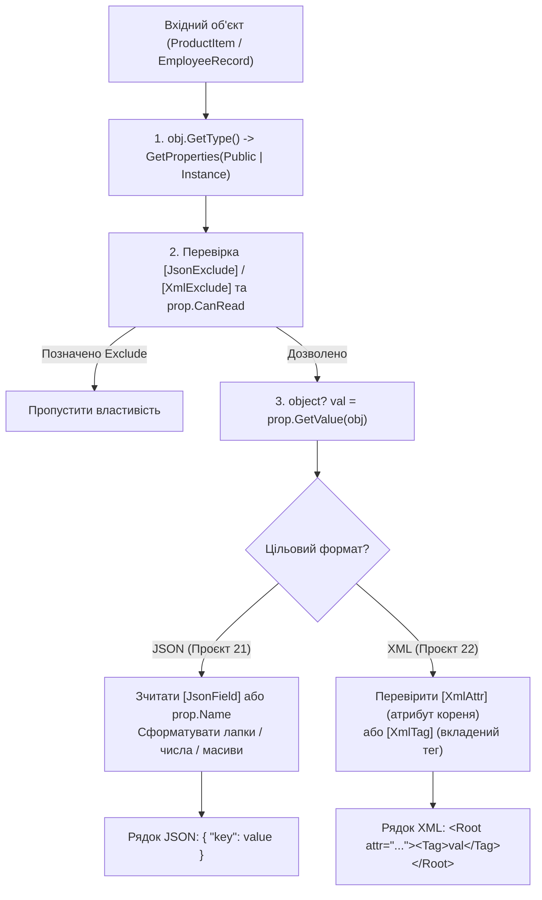
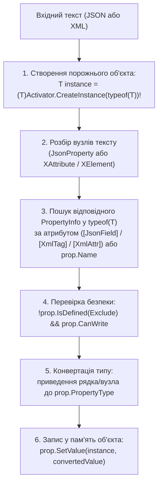

# 03. Рефлексивна серіалізація та десеріалізація JSON і XML (Власні рушії під капотом)

> **Практичні проєкти розділу**:
> - [`21-JsonSerializationDemo`](../21-JsonSerializationDemo/Program.cs) — Власний рефлексивний JSON-серіалізатор ([`ReflectionJsonSerializer.cs`](../21-JsonSerializationDemo/ReflectionJsonSerializer.cs)).
> - [`22-XmlSerializationDemo`](../22-XmlSerializationDemo/Program.cs) — Власний рефлексивний XML-серіалізатор ([`ReflectionXmlSerializer.cs`](../22-XmlSerializationDemo/ReflectionXmlSerializer.cs)).
> - [`23-JsonDeserializationDemo`](../23-JsonDeserializationDemo/Program.cs) — Власний рефлексивний JSON-десеріалізатор ([`ReflectionJsonDeserializer.cs`](../23-JsonDeserializationDemo/ReflectionJsonDeserializer.cs)).
> - [`24-XmlDeserializationDemo`](../24-XmlDeserializationDemo/Program.cs) — Власний рефлексивний XML-десеріалізатор ([`ReflectionXmlDeserializer.cs`](../24-XmlDeserializationDemo/ReflectionXmlDeserializer.cs)).  
> **Ключові класи**: `System.Type`, `System.Reflection.PropertyInfo`, `System.Activator`, `System.Convert`

Цей документ пояснює внутрішню механіку того, як промислові бібліотеки (на кшталт `Newtonsoft.Json`, `System.Text.Json` або `XmlSerializer`) використовують **Рефлексію (`System.Reflection`)** та **Власні Атрибути (`Custom Attributes`)** для автоматичного перетворення будь-яких об'єктів C# у текст і назад.

---

## 1. Архітектура рефлексивної СЕРІАЛІЗАЦІЇ (Проєкти 21 та 22)

Під час серіалізації ми отримуємо на вхід невідомий заздалегідь об'єкт `object obj` і повинні динамічно проінспектувати його метадані, відфільтрувати службові поля та зчитати значення через `PropertyInfo.GetValue`:



### Покроковий розбір коду `ReflectionJsonSerializer` (див. [`21-JsonSerializationDemo/ReflectionJsonSerializer.cs`](../21-JsonSerializationDemo/ReflectionJsonSerializer.cs))

```csharp
// 1. Оголошуємо власні керуючі атрибути метаданих
[AttributeUsage(AttributeTargets.Property)]
public sealed class JsonFieldAttribute(string fieldName) : Attribute
{
    public string FieldName { get; } = fieldName;
}

[AttributeUsage(AttributeTargets.Property)]
public sealed class JsonExcludeAttribute : Attribute;

// 2. Ядро рефлексивного JSON-серіалізатора
public static string Serialize(object obj)
{
    Type type = obj.GetType();
    PropertyInfo[] properties = type.GetProperties(BindingFlags.Public | BindingFlags.Instance);
    var entries = new List<string>();

    foreach (PropertyInfo prop in properties)
    {
        // Пропускаємо властивості без get або позначені [JsonExclude]
        if (!prop.CanRead || prop.IsDefined(typeof(JsonExcludeAttribute), inherit: true))
            continue;

        // Визначаємо ім'я ключа JSON: з атрибута [JsonField] або оригінальне ім'я властивості C#
        JsonFieldAttribute? fieldAttr = prop.GetCustomAttribute<JsonFieldAttribute>();
        string jsonKey = fieldAttr?.FieldName ?? prop.Name;

        // Витягуємо значення властивості з конкретного екземпляра об'єкта у пам'яті
        object? rawValue = prop.GetValue(obj);
        string formattedValue = FormatJsonValue(rawValue);

        entries.Add($"  \"{jsonKey}\": {formattedValue}");
    }

    return "{\n" + string.Join(",\n", entries) + "\n}";
}
```

---

## 2. Архітектура рефлексивної ДЕСЕРІАЛІЗАЦІЇ (Проєкти 23 та 24)

Під час десеріалізації ми маємо лише сирий текст (JSON або XML) та цільовий тип `T`. Наш рушій повинен динамічно створити порожній екземпляр `T`, зіставити ключі тексту з властивостями `PropertyInfo`, привести типи та записати їх у пам'ять через `PropertyInfo.SetValue`:



### Покроковий розбір коду `ReflectionXmlDeserializer` (див. [`24-XmlDeserializationDemo/ReflectionXmlDeserializer.cs`](../24-XmlDeserializationDemo/ReflectionXmlDeserializer.cs))

```csharp
public static T Deserialize<T>(string xml) where T : new()
{
    Type targetType = typeof(T);
    // 1. Динамічно інстанціюємо цільовий об'єкт через рефлексію
    T instance = (T)Activator.CreateInstance(targetType)!;

    XDocument doc = XDocument.Parse(xml);
    XElement root = doc.Root ?? throw new InvalidOperationException("Відсутній кореневий тег XML.");

    PropertyInfo[] properties = targetType.GetProperties(BindingFlags.Public | BindingFlags.Instance);

    foreach (PropertyInfo prop in properties)
    {
        // Захист: ніколи не записуємо у властивості, позначені [XmlExclude], або без сеттера
        if (!prop.CanWrite || prop.IsDefined(typeof(XmlExcludeAttribute), inherit: true))
            continue;

        // 2. Перевіряємо, чи прив'язана властивість до XML-атрибута ([XmlAttr])
        XmlAttrAttribute? attrMeta = prop.GetCustomAttribute<XmlAttrAttribute>();
        if (attrMeta is not null)
        {
            XAttribute? xmlAttr = root.Attribute(attrMeta.AttributeName);
            if (xmlAttr is not null)
            {
                object converted = Convert.ChangeType(xmlAttr.Value, prop.PropertyType, CultureInfo.InvariantCulture);
                prop.SetValue(instance, converted);
            }
            continue;
        }

        // 3. Інакше шукаємо вкладений XML-тег за [XmlTag] або prop.Name
        XmlTagAttribute? tagMeta = prop.GetCustomAttribute<XmlTagAttribute>();
        string tagName = tagMeta?.TagName ?? prop.Name;
        XElement? element = root.Element(tagName);

        if (element is not null)
        {
            object converted = ConvertElementValue(element, prop.PropertyType);
            prop.SetValue(instance, converted);
        }
    }

    return instance;
}
```

---

## 3. Властивості, задіяні в серіалізації та десеріалізації (Properties)

| Властивість | Сигнатура | Опис призначення | Приклад у коді | Документація MSDN |
| :--- | :--- | :--- | :--- | :--- |
| **`PropertyType`** | `Type PropertyType { get; }` | Визначає точний тип властивості C# (`int`, `double`, `bool`, `string[]`), у який потрібно сконвертувати текст при десеріалізації | [23-JsonDeserializationDemo/ReflectionJsonDeserializer.cs](../23-JsonDeserializationDemo/ReflectionJsonDeserializer.cs#L61) | [PropertyInfo.PropertyType](https://learn.microsoft.com/en-us/dotnet/api/system.reflection.propertyinfo.propertytype) |
| **`CanRead`** | `bool CanRead { get; }` | Перевіряє наявність аксесора `get` перед зчитуванням властивості у серіалізаторі | [21-JsonSerializationDemo/ReflectionJsonSerializer.cs](../21-JsonSerializationDemo/ReflectionJsonSerializer.cs#L29) | [PropertyInfo.CanRead](https://learn.microsoft.com/en-us/dotnet/api/system.reflection.propertyinfo.canread) |
| **`CanWrite`** | `bool CanWrite { get; }` | Перевіряє наявність аксесора `set` перед записом значення у десеріалізаторі | [23-JsonDeserializationDemo/ReflectionJsonDeserializer.cs](../23-JsonDeserializationDemo/ReflectionJsonDeserializer.cs#L52) | [PropertyInfo.CanWrite](https://learn.microsoft.com/en-us/dotnet/api/system.reflection.propertyinfo.canwrite) |
| **`Name`** | `string Name { get; }` | Ім'я властивості чи класу за замовчуванням, якщо не вказано перейменовуючий атрибут | [22-XmlSerializationDemo/ReflectionXmlSerializer.cs](../22-XmlSerializationDemo/ReflectionXmlSerializer.cs#L20) | [MemberInfo.Name](https://learn.microsoft.com/en-us/dotnet/api/system.reflection.memberinfo.name) |

---

## 4. Методи, задіяні в серіалізації та десеріалізації (Methods)

| Метод | Сигнатура | Опис призначення | Приклад у коді | Документація MSDN |
| :--- | :--- | :--- | :--- | :--- |
| **`GetProperties`** | `PropertyInfo[] GetProperties(BindingFlags bindingAttr)` | Повертає всі публічні властивості екземпляра для серіалізації або зіставлення ключів | [21-JsonSerializationDemo/ReflectionJsonSerializer.cs](../21-JsonSerializationDemo/ReflectionJsonSerializer.cs#L18) | [Type.GetProperties](https://learn.microsoft.com/en-us/dotnet/api/system.type.getproperties) |
| **`GetValue`** | `object? GetValue(object? obj)` | Витягує значення властивості з об'єкта під час JSON та XML серіалізації | [22-XmlSerializationDemo/ReflectionXmlSerializer.cs](../22-XmlSerializationDemo/ReflectionXmlSerializer.cs#L43) | [PropertyInfo.GetValue](https://learn.microsoft.com/en-us/dotnet/api/system.reflection.propertyinfo.getvalue) |
| **`SetValue`** | `void SetValue(object? obj, object? value)` | Записує відновлене значення у відповідну властивість створеного об'єкта при десеріалізації | [24-XmlDeserializationDemo/ReflectionXmlDeserializer.cs](../24-XmlDeserializationDemo/ReflectionXmlDeserializer.cs#L46) | [PropertyInfo.SetValue](https://learn.microsoft.com/en-us/dotnet/api/system.reflection.propertyinfo.setvalue) |
| **`CreateInstance`** | `static object? CreateInstance(Type type)` | Динамічно інстанціює цільовий клас `T` перед початком заповнення його властивостей | [23-JsonDeserializationDemo/ReflectionJsonDeserializer.cs](../23-JsonDeserializationDemo/ReflectionJsonDeserializer.cs#L18) | [Activator.CreateInstance](https://learn.microsoft.com/en-us/dotnet/api/system.activator.createinstance) |
| **`ChangeType`** | `static object? ChangeType(object? value, Type conversionType, IFormatProvider? provider)` | Універсально приводить рядкове представлення значення до цільового типу властивості | [24-XmlDeserializationDemo/ReflectionXmlDeserializer.cs](../24-XmlDeserializationDemo/ReflectionXmlDeserializer.cs#L95) | [Convert.ChangeType](https://learn.microsoft.com/en-us/dotnet/api/system.convert.changetype) |
