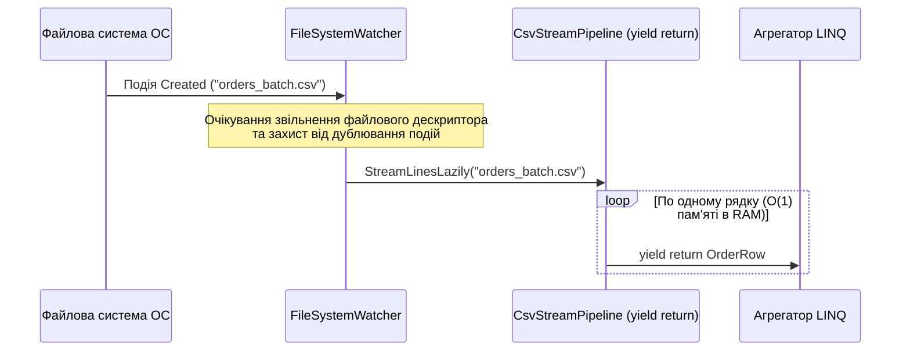

# 04. Декоратори потоків: Стиснення (GZip / Brotli), ZIP-архіви та реактивний FileSystemWatcher

> **Практичні проєкти розділу**:
> - [`25-CompressionAndZipArchivesDemo`](../25-CompressionAndZipArchivesDemo/Program.cs) — Потокове стиснення `GZipStream` і `BrotliStream` та робота з `ZipArchive`.
> - [`26-FileSystemWatcherAndCsvPipelineDemo`](../26-FileSystemWatcherAndCsvPipelineDemo/Program.cs) — Реактивний моніторинг директорії `FileSystemWatcher` та лінивий конвеєр обробки CSV.  
> **Ключові простори імен**: `System.IO`, `System.IO.Compression`

Цей розділ показує, як архітектура потоків `System.IO.Stream` реалізує класичний патерн проєктування **Decorator (Обгортка)** для стиснення даних на льоту, пакетування звітів у багатофайлові ZIP-архіви та побудови реактивних конвеєрів імпорту файлів.

---

## 1. Патерн Decorator у потоках: `GZipStream` та `BrotliStream`

Оскільки і базові сховища (`FileStream`, `MemoryStream`, `NetworkStream`), і потоки стиснення (`GZipStream`, `BrotliStream`, `DeflateStream`) успадковують єдиний абстрактний клас `Stream`, їх можна вкладати один в одного як матрьошки без зміни коду серіалізатора:


### Порівняння алгоритмів стиснення у `System.IO.Compression`

| Характеристика | `GZipStream` (RFC 1952) | `BrotliStream` (RFC 7932) |
| :--- | :--- | :--- |
| **Словник та алгоритм** | Класичний LZ77 + код Гаффмана (вікно 32 КБ) | LZ77 + контекстне моделювання 2-го порядку + вбудований словник популярних слів вебу/JSON |
| **Коефіцієнт стиснення JSON / XML** | Гарний (зазвичай стискає текст у **4–5 разів**) | Відмінний (стискає текст у **6–9 разів**, на 20–30% компактніше за GZip) |
| **Швидкість розархівування** | Дуже висока | Дуже висока (на рівні GZip) |
| **Рівні стиснення (`CompressionLevel`)** | `Fastest`, `Optimal`, `SmallestSize`, `NoCompression` | `Fastest` (рівень 1), `Optimal` (рівень 4), `SmallestSize` (рівень 11) |
| **Сумісність** | Абсолютна (усі утиліти Linux/Windows `.gz`, старі клієнти) | Усі сучасні браузери (`Content-Encoding: br`), gRPC, .NET мікросервіси |

### Потокова серіалізація одразу у стиснений потік (див. [`25-CompressionAndZipArchivesDemo/Program.cs`](../25-CompressionAndZipArchivesDemo/Program.cs))

```csharp
// 1. Запис: JsonSerializer -> BrotliStream -> MemoryStream (або FileStream)
using var compressedMemory = new MemoryStream();
await using (var brotliOut = new BrotliStream(compressedMemory, CompressionLevel.Optimal, leaveOpen: true))
{
    await JsonSerializer.SerializeAsync(brotliOut, telemetryBatch, jsonOptions);
} // Важливо: при закритті brotliOut скидає фінальний блок стиснення, але leaveOpen: true залишає MemoryStream відкритим!

// 2. Читання: Перемотуємо потік на початок і розпаковуємо на льоту
compressedMemory.Position = 0;
await using var brotliIn = new BrotliStream(compressedMemory, CompressionMode.Decompress);
var restoredBatch = await JsonSerializer.DeserializeAsync<List<TelemetryRecord>>(brotliIn, jsonOptions);
```

---

## 2. Багатофайлові архіви `ZipArchive` без тимчасових папок на диску

Клас `ZipArchive` дозволяє формувати, доповнювати (`ZipArchiveMode.Update`) та читати (`ZipArchiveMode.Read`) `.zip`-архіви безпосередньо в пам'яті або файловому потоці. Кожен віртуальний файл усередині архіву представлений об'єктом `ZipArchiveEntry`, метод `entry.Open()` якого повертає звичайний `Stream`:

```csharp
await using FileStream zipFileStream = File.Create("monthly_export.zip");
using (var archive = new ZipArchive(zipFileStream, ZipArchiveMode.Create, leaveOpen: false))
{
    // Додаємо перший файл у віртуальну підпапку архіву: reports/summary.json
    ZipArchiveEntry jsonEntry = archive.CreateEntry("reports/summary.json", CompressionLevel.Optimal);
    await using (Stream entryStream = jsonEntry.Open())
    {
        await JsonSerializer.SerializeAsync(entryStream, summaryDto);
    }

    // Додаємо другий текстовий файл: README.txt
    ZipArchiveEntry readmeEntry = archive.CreateEntry("README.txt", CompressionLevel.Fastest);
    await using (var writer = new StreamWriter(readmeEntry.Open(), Encoding.UTF8))
    {
        await writer.WriteLineAsync($"Архів згенеровано автоматично: {DateTime.UtcNow:O}");
    }
}
```

---

## 3. Реактивний `FileSystemWatcher` та лінивий конвеєр обробки CSV

У інтеграційних B2B-системах зовнішні партнери часто вивантажують прайс-листи або банківські виписки у спеціальну директорію (`DropFolder`). Замість опитування папки за таймером, клас **`FileSystemWatcher`** підписується безпосередньо на події файлової системи ядра ОС (`Created`, `Changed`, `Renamed`, `Deleted`).



### Особливості промислового використання `FileSystemWatcher` та потокового CSV (див. [`26-FileSystemWatcherAndCsvPipelineDemo/Program.cs`](../26-FileSystemWatcherAndCsvPipelineDemo/Program.cs))

1. **Проблема блокування файлу та подвійних подій**: коли великий файл копіюється у папку, ОС генерує подію `Created` в мить створення заголовка файлу (коли інший процес ще дописує байти всередину!), а потім ще кілька подій `Changed`. Тому перед відкриттям файлу використовують дедуплікацію за шляхом та безпечний цикл очікування доступу `FileShare.Read`.
2. **Лінивий парсинг гігабайтних CSV через `yield return`**: замість `File.ReadAllLines()`, який завантажує мільйон рядків у масив `string[]`, використовується потоковий ітератор `IEnumerable<CsvOrderRecord>`:

```csharp
public static IEnumerable<CsvOrderRecord> ReadOrdersLazily(string filePath)
{
    using var reader = new StreamReader(filePath, Encoding.UTF8);
    string? header = reader.ReadLine(); // Пропускаємо рядок заголовків CSV

    string? line;
    while ((line = reader.ReadLine()) is not null)
    {
        if (string.IsNullOrWhiteSpace(line)) continue;

        string[] parts = line.Split(';');
        yield return new CsvOrderRecord(
            OrderId: int.Parse(parts[0], CultureInfo.InvariantCulture),
            Customer: parts[1],
            Amount: decimal.Parse(parts[2], CultureInfo.InvariantCulture));
    }
}
```

Завдяки `yield return` в оперативній пам'яті в кожен момент часу перебуває **лише один рядок CSV**, що дозволяє обробляти файли будь-якого розміру з константним споживанням пам'яті `O(1)`.

---

## Матриця проєктів

| Проєкт | Призначення та ключові концепції | Вихідний код |
| :--- | :--- | :--- |
| **`25-CompressionAndZipArchivesDemo`** | Стиснення JSON-потоків через `GZipStream` та `BrotliStream`, створення та читання `ZipArchive` | [`Program.cs`](../25-CompressionAndZipArchivesDemo/Program.cs) |
| **`26-FileSystemWatcherAndCsvPipelineDemo`** | Відстеження нових файлів через `FileSystemWatcher` та потоковий парсинг CSV через `yield return` + LINQ | [`Program.cs`](../26-FileSystemWatcherAndCsvPipelineDemo/Program.cs) |
