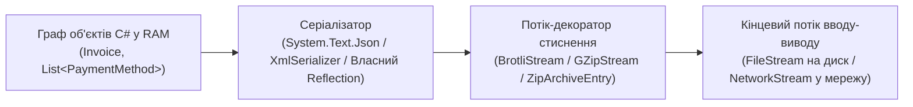
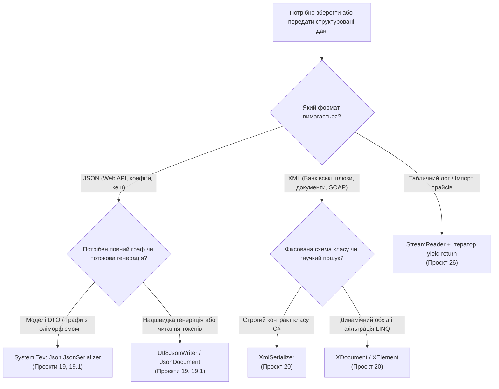

# Підмодуль 02: Серіалізація, формати даних (JSON / XML / CSV), стиснення потоків та архіви

Цей підмодуль логічно продовжує роботу з файлами та потоками (`01-Files-And-Streams`), піднімаючись від сирих байтів і кодувань до **серіалізації графів об'єктів**, **поліморфного JSON**, **XML / LINQ to XML**, **власних рефлексивних серіалізаторів** та **потокового стиснення GZip/Brotli, ZIP-архівів і реактивних файлових конвеєрів**.

---

## Архітектура конвеєра серіалізації та стиснення у .NET

У сучасних розподілених системах серіалізатори працюють безпосередньо поверх абстракції `System.IO.Stream`, дозволяючи комбінувати перетворення об'єктів у JSON/XML зі стисненням даних або шифруванням на льоту без створення проміжних рядків у оперативній пам'яті:



---

## Навігація по навчальних матеріалах (`Docs`)

1. **[01. Фундаментальні основи серіалізації JSON та XML](Docs/01_Json_And_Xml_Serialization_Fundamentals.md)**
   - Анатомія форматів JSON та XML, конфігурація `JsonSerializerOptions`, політики іменування (`CamelCase`, `SnakeCaseLower`), обробка циклічних посилань, керуючі атрибути та DOM-інспекція через `JsonDocument` і `XDocument`.
2. **[02. Потокова серіалізація JSON, поліморфізм ООП та XML / LINQ to XML](Docs/02_Json_Streams_Polymorphism_And_Xml.md)**
   - Асинхронна серіалізація напряму у `FileStream` (`SerializeAsync`), дискримінатори типів `[JsonPolymorphic]` / `[JsonDerivedType]`, низькорівневі `Utf8JsonWriter` / `Utf8JsonReader`, порівняння `XmlSerializer` із `XDocument` (LINQ to XML) та захист від XXE-атак.
3. **[03. Як працюють серіалізатори під капотом: Власний JSON та XML рушій на базі Рефлексії](Docs/03_Custom_Reflection_Serializers_Under_The_Hood.md)**
   - Покроковий розбір власних класів `ReflectionJsonSerializer`, `ReflectionXmlSerializer`, `ReflectionJsonDeserializer` та `ReflectionXmlDeserializer` із використанням `GetProperties`, власних атрибутів, `Activator.CreateInstance` та `Convert.ChangeType`.
4. **[04. Декоратори потоків: Стиснення (GZip / Brotli), ZIP-архіви та реактивний FileSystemWatcher](Docs/04_Stream_Compression_Zip_And_FileSystemWatcher.md)**
   - Патерн Decorator у `System.IO.Compression`, порівняння `GZipStream` та `BrotliStream`, робота з багатофайловими архівами `ZipArchive`, обробка дубльованих подій `FileSystemWatcher` (Debouncing) та потоковий парсинг CSV (`yield return`).

---

## Структура Solution-тек у рішенні `OOP-Serialization-And-Data-Formats.sln`

| Solution-тека | Проєкт | Ключові концепції та API | Вихідний код |
| :--- | :--- | :--- | :--- |
| **`01. Серіалізація JSON (System.Text.Json, Streams, Polymorphism)`** | `00-Shared` | Спільні доменні класи та моделі | [`Car.cs`](00-Shared/Common/Car.cs) |
| **`01. Серіалізація JSON (System.Text.Json, Streams, Polymorphism)`** | `19-SerializationBasicsJsonDemo` | `JsonSerializer`, `JsonDocument`, `[JsonPropertyName]`, `[JsonIgnore]` | [`Program.cs`](19-SerializationBasicsJsonDemo/Program.cs) |
| **`01. Серіалізація JSON (System.Text.Json, Streams, Polymorphism)`** | `19.1-JsonStreamsAndPolymorphismDemo` | Асинхронний запис/читання у `FileStream`, поліморфізм `[JsonPolymorphic]`/`[JsonDerivedType]`, `Utf8JsonWriter` | [`Program.cs`](19.1-JsonStreamsAndPolymorphismDemo/Program.cs) |
| **`02. Серіалізація XML та LINQ to XML (XmlSerializer, XDocument)`** | `20-SerializationBasicsXmlDemo` | `XmlSerializer`, `[XmlElement]`, `[XmlAttribute]`, `XDocument` (LINQ to XML), безпечний `XmlReader` | [`Program.cs`](20-SerializationBasicsXmlDemo/Program.cs) |
| **`03. Власні серіалізатори та десеріалізатори під капотом (Reflection)`** | `21-JsonSerializationDemo` | Власний JSON-серіалізатор через `GetProperties` та атрибути `[JsonField]`, `[JsonExclude]` | [`Program.cs`](21-JsonSerializationDemo/Program.cs) |
| **`03. Власні серіалізатори та десеріалізатори під капотом (Reflection)`** | `22-XmlSerializationDemo` | Власний XML-серіалізатор через `[XmlRootTag]`, `[XmlAttr]`, `[XmlTag]` | [`Program.cs`](22-XmlSerializationDemo/Program.cs) |
| **`03. Власні серіалізатори та десеріалізатори під капотом (Reflection)`** | `23-JsonDeserializationDemo` | Власний JSON-десеріалізатор через `Activator.CreateInstance` та `PropertyInfo.SetValue` | [`Program.cs`](23-JsonDeserializationDemo/Program.cs) |
| **`03. Власні серіалізатори та десеріалізатори під капотом (Reflection)`** | `24-XmlDeserializationDemo` | Власний XML-десеріалізатор із розбором атрибутів/тегів та `Convert.ChangeType` | [`Program.cs`](24-XmlDeserializationDemo/Program.cs) |
| **`04. Стиснення потоків (GZip, Brotli), ZIP-архіви та FileSystemWatcher`** | `25-CompressionAndZipArchivesDemo` | Декоратори `GZipStream` і `BrotliStream` поверх `MemoryStream`/`FileStream`, пакетування `ZipArchive` | [`Program.cs`](25-CompressionAndZipArchivesDemo/Program.cs) |
| **`04. Стиснення потоків (GZip, Brotli), ZIP-архіви та FileSystemWatcher`** | `26-FileSystemWatcherAndCsvPipelineDemo` | Реактивний моніторинг `FileSystemWatcher` та лінивий потоковий парсинг CSV (`StreamReader` + `yield return`) | [`Program.cs`](26-FileSystemWatcherAndCsvPipelineDemo/Program.cs) |

---

## Карта вибору інструменту серіалізації в .NET 10



---

## Збірка та запуск

```powershell
# Компіляція всього рішення
dotnet build "05-Files-Streams-And-Serialization/02-Serialization-And-Data-Formats/OOP-Serialization-And-Data-Formats.sln" -c Release

# Запуск ключових демонстраційних проєктів
dotnet run --project "05-Files-Streams-And-Serialization/02-Serialization-And-Data-Formats/19-SerializationBasicsJsonDemo/19-SerializationBasicsJsonDemo.csproj"
dotnet run --project "05-Files-Streams-And-Serialization/02-Serialization-And-Data-Formats/19.1-JsonStreamsAndPolymorphismDemo/19.1-JsonStreamsAndPolymorphismDemo.csproj"
dotnet run --project "05-Files-Streams-And-Serialization/02-Serialization-And-Data-Formats/20-SerializationBasicsXmlDemo/20-SerializationBasicsXmlDemo.csproj"
dotnet run --project "05-Files-Streams-And-Serialization/02-Serialization-And-Data-Formats/25-CompressionAndZipArchivesDemo/25-CompressionAndZipArchivesDemo.csproj"
dotnet run --project "05-Files-Streams-And-Serialization/02-Serialization-And-Data-Formats/26-FileSystemWatcherAndCsvPipelineDemo/26-FileSystemWatcherAndCsvPipelineDemo.csproj"
```
