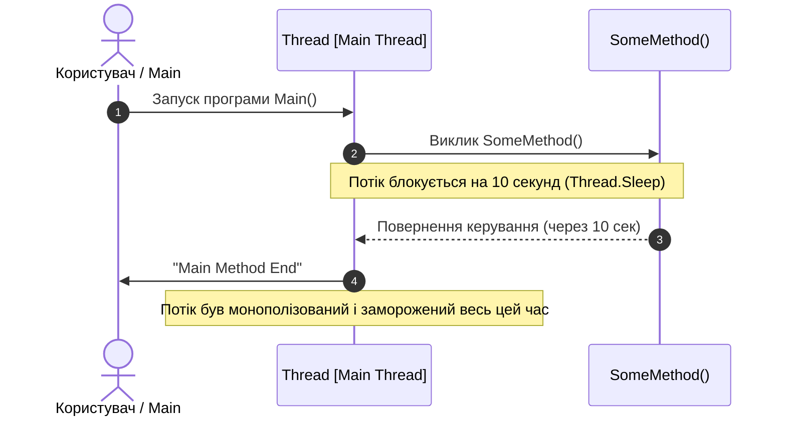

# 01. Синхронне блокування потоку (The Problem: Synchronous Blocking)

## 📌 Теоретичний огляд

В основі багатопотокового середовища .NET лежить пул потоків (**ThreadPool**). Кожен потік операційної системи — це дорогий ресурс:
- Виділення пам'яті під стек (за замовчуванням ~1 МБ на потік).
- Витрати процесорного часу на перемикання контексту (**Context Switching**).

У синхронній моделі, коли викликається метод `Thread.Sleep()` або блокуючий I/O (читання з диску чи мережі через `.Wait()` / `.Result`), потік переходить у стан блокування (**Blocked / Waiting**). Він утримується за поточним завданням, не роблячи жодної корисної роботи, і не може повертатися в пул для обробки інших користувачів або подій інтерфейсу.

---

## 📊 Візуалізація: Синхронний потік виконання



---

## 🔍 Розбір коду

```csharp
// Синхронний виклик блокує викликаючий потік:
public static void SomeMethod()
{
    Console.WriteLine("Some Method Started......");
    
    // Потік ОС призупиняє роботу і споживає пам'ять стеку марно
    Thread.Sleep(TimeSpan.FromSeconds(10));
    
    Console.WriteLine("Some Method End");
}
```

### Наслідки такого підходу:
1. **У настільних та мобільних застосунках (WPF, WinForms, MAUI):**
   Головний UI-потік замерзає, вікно не реагує на події миші та клавіатури, з'являється статус «Програма не відповідає».
2. **У серверних застосунках (ASP.NET Core):**
   При високому навантаженні всі потоки пулу вичерпуються (**Thread Pool Starvation**). Нові HTTP-запити стають у чергу, час відповіді (latency) зростає до таймауту, а сервер відмовляє в обслуговуванні.

---

## 💡 Рішення в сучасному .NET
Заміна блокуючих викликів на асинхронні еквіваленти:
- `Thread.Sleep(...)` ➡️ `await Task.Delay(...)`
- `FileStream.Read(...)` ➡️ `await FileStream.ReadAsync(...)`
- `HttpClient.GetString(...)` ➡️ `await HttpClient.GetStringAsync(...)`
