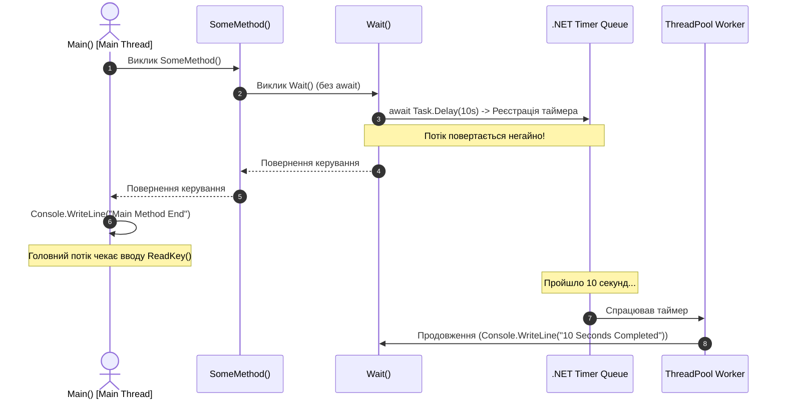

# 02. Створення завдань, Task.Delay та поведінка "Fire-and-Forget"

## 📌 Теоретичний огляд

Ключова відмінність між `Thread.Sleep` та `Task.Delay`:
- `Thread.Sleep` — блокує потік ОС і змушує його чекати.
- `Task.Delay` — реєструє системний таймер у рантаймі .NET і негайно **звільняє поточний потік**. Коли таймер закінчується, продовження методу підхоплюється вільним потоком із пулу (`ThreadPool`).

### Небезпека `async void` (Fire-and-Forget)
У цьому проекті метод `Wait()` та `SomeMethod()` мають тип повернення `void`:
1. **Неможливо очікувати результат:** Той, хто викликав метод, не має об'єкта `Task`, щоб написати `await SomeMethod()`.
2. **Неконтрольовані винятки:** Якщо всередині `async void` виникає помилка, вона не може бути перехоплена звичайним блоком `try/catch` на рівні виклику — виняток викидається безпосередньо в контекст синхронізації, що часто призводить до аварійного завершення всього процесу (**Process Crash**).

---

## 📊 Візуалізація: Неблокуюче очікування та Fire-and-Forget



---

## 🔍 Розбір коду

```csharp
// 1. Fire-and-Forget виклик
public async static void SomeMethod()
{
    Console.WriteLine("Some Method Started......");

    Wait(); // ПОМИЛКА/АНТИПАТТЕРН: виклик без await ігнорує завершення задачі

    Console.WriteLine("Some Method End");
}

// 2. Асинхронний метод із поверненням void
private static async void Wait()
{
    await Task.Delay(TimeSpan.FromSeconds(10)); // Звільнення потоку
    Console.WriteLine("\n10 Seconds wait Completed\n");
}
```

---

## 💡 Modern .NET Best Practices

| Антипаттерн у прикладі | Сучасна практика (.NET 10) | Чому це важливо |
| :--- | :--- | :--- |
| `public static async void SomeMethod()` | `public static async Task SomeMethodAsync()` | Дозволяє вызываючому коду написати `await`, дізнатися про завершення або перехопити помилку. |
| `static void Main(string[] args)` | `static async Task Main(string[] args)` | Асинхронна точка входу (з C# 7.1) усуває потребу блокування через `Console.ReadKey()` або `.Wait()`. |
| `Wait();` без await | `await WaitAsync();` | Гарантує строгий порядок виконання операцій без гонок (race conditions). |
