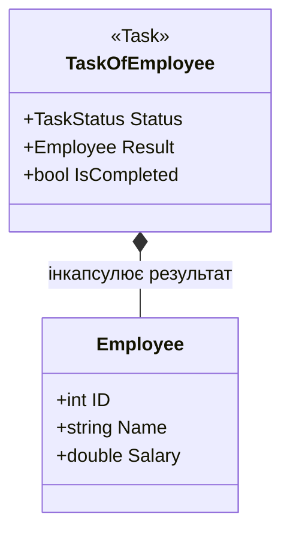
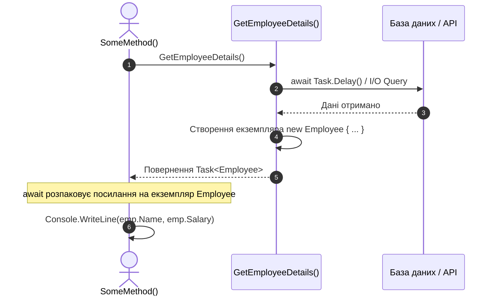

# 03. Повернення складних користувацьких типів із Task<T> (ReturnComplexTypeValueFromTask)

## 📌 Теоретичний огляд

В асинхронній моделі C# дженерик-тип `Task<T>` не обмежується простими примітивами на кшталт `string`, `int` чи `bool`.
Параметром типу `T` може виступати будь-який тип .NET:
- Класи доменної моделі (Domain Entities)
- Об'єкти передачі даних (DTO / Records)
- Колекції (`List<T>`, `IReadOnlyList<T>`)
- Кортежі (Tuples `(int count, string status)`)

Компілятор інкапсулює повернений об'єкт у поле результату структури задачі, забезпечуючи сувору строгу типізацію при виклику `await`.

---

## 📊 Візуалізація: Повернення об'єкта через Task<Employee>





---

## 🔍 Розбір коду

```csharp
// 1. Асинхронний метод створює або завантажує екземпляр класу
static async Task<Employee> GetEmployeeDetails()
{
    await Task.Delay(100); // Імітація читання з БД
    return new Employee { ID = 101, Name = "James", Salary = 10000 };
}

// 2. Викликаючий метод розпаковує сутність через await
Employee emp = await GetEmployeeDetails();
Console.WriteLine($"ID: {emp.ID}, Name: {emp.Name}");
```

---

## 💡 Modern .NET Best Practices

1. **`record` для незмінних DTO:**
   У сучасному C# (C# 9+) для DTO-моделей замість звичайного класу часто використовують позиційні рекорди:
   ```csharp
   public record EmployeeDto(int Id, string Name, decimal Salary);
   ```
2. **`ValueTask<T>` при кешуванні результатів:**
   Якщо метод часто повертає вже готовий результат із пам'яті (in-memory cache) без реального асинхронного очікування, використання `ValueTask<Employee>` дозволяє уникнути виділення пам'яті в купі під об'єкт `Task`.
