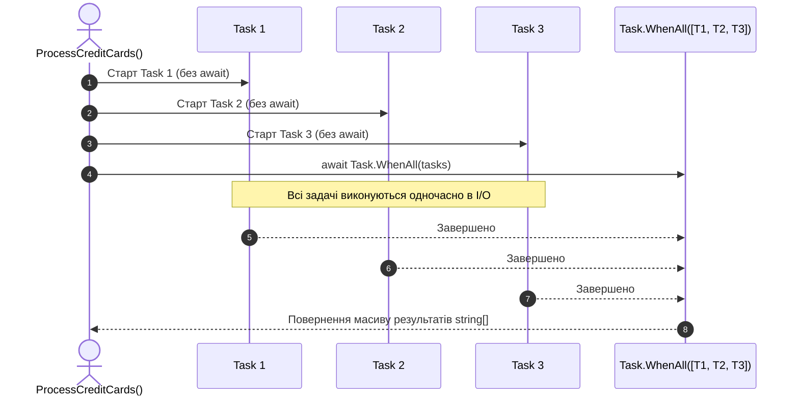

# 04. Синхронізація завдань через Task.WhenAll (ExecuteMultipleTasks-Task.WhenAll)

## 📌 Теоретичний огляд

В асинхронному програмуванні поширеною помилкою є розміщення виклику `await` всередині звичайного циклу `foreach`:
```csharp
// ПОМИЛКА: Послідовне очікування
foreach (var item in items)
{
    await ProcessAsync(item); // Кожна ітерація блокує запуск наступної!
}
```
Якщо операція займає 1 секунду, а елементів 10, загальний час складе **10 секунд**.

### Комбінатор `Task.WhenAll`
`Task.WhenAll` приймає колекцію завдань `IEnumerable<Task<T>>` і повертає єдиний `Task<T[]>`, який переходить у стан `RanToCompletion` лише тоді, коли **всі** передані задачі завершені.
Оскільки всі операції ініціюються одночасно, вони виконуються конкурентно, і 10 операцій завершуються приблизно за **1 секунду** (час найповільнішої задачі).

---

## 📊 Візуалізація: Послідовне vs Паралельне виконання (WhenAll)

```mermaid
gantt
    title Порівняння часу виконання (10 задач по 1 сек)
    dateFormat  X
    axisFormat %s с

    section Послідовний await (Всього: 10 сек)
    Задача 1 : 0, 1
    Задача 2 : 1, 2
    Задача 3 : 2, 3
    Задача 4 : 3, 4
    Задача 5 : 4, 5

    section Task.WhenAll (Всього: ~1 сек)
    Задача 1 : 0, 1
    Задача 2 : 0, 1
    Задача 3 : 0, 1
    Задача 4 : 0, 1
    Задача 5 : 0, 1
```





---

## 💡 Поведінка винятків у Task.WhenAll
Якщо одна або кілька задач завершуються з помилкою:
- Об'єкт `Task.WhenAll` агрегує всі помилки в `allTasks.Exception` (`AggregateException`).
- Проте простий виклик `await Task.WhenAll(tasks)` розгортає і викидає **лише перше** виникле виключення. Для отримання всіх помилок звертаються до `Task.WhenAll(tasks).Exception.InnerExceptions` (детально показано в `EX_05-exceptions`).
