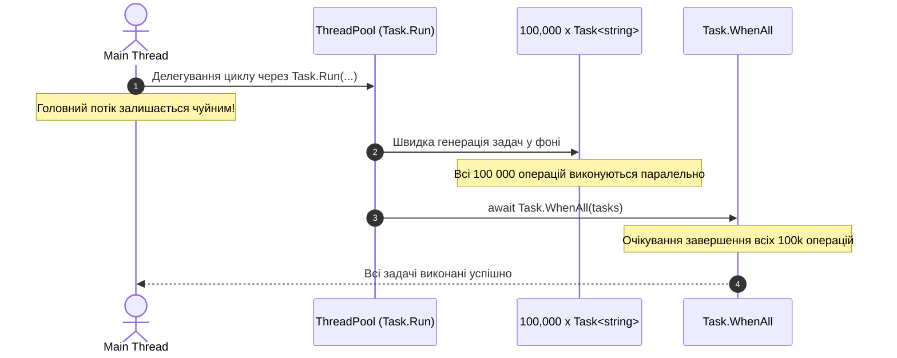

# 04. Множинні задачі та розвантаження потоку (ExecuteMultipleTasks)

## 📌 Теоретичний огляд

Коли програма має обробити великий обсяг незалежних I/O операцій (наприклад, 100,000 карток або веб-запитів):
1. **Ініціалізація задач:** Сама по собі ініціалізація та додавання 100 000 об'єктів `Task` до колекції — це суто процесорна (CPU-bound) робота.
2. Якщо виконувати цей цикл у головному (UI або Main) потоці, інтерфейс відчутно «зависає» ще до того, як відправиться перший мережевий запит.

### Патерн Offloading (Task.Run)
Для розвантаження викликаючого потоку процесорно-містке створення завдань виноситься у пул потоків:
```csharp
await Task.Run(() =>
{
    foreach (var item in largeCollection)
    {
        tasks.Add(ProcessItemAsync(item));
    }
});
```

---

## 📊 Візуалізація: Створення задач та розвантаження пулу



---

## 💡 Modern .NET Best Practices

- **Увага до споживання оперативної пам'яті:**
  Одночасне створення 100 000 екземплярів `Task` виділяє значний обсяг пам'яті в купі (Heap). Якщо кількість операцій необмежена, обов'язково слід застосовувати **пакетну обробку (batching)** або **обмеження паралелізму (`SemaphoreSlim`)**, які детально розглядаються у наступному проекті `05-LimitTheNumberOfConcurrentTasks`.
