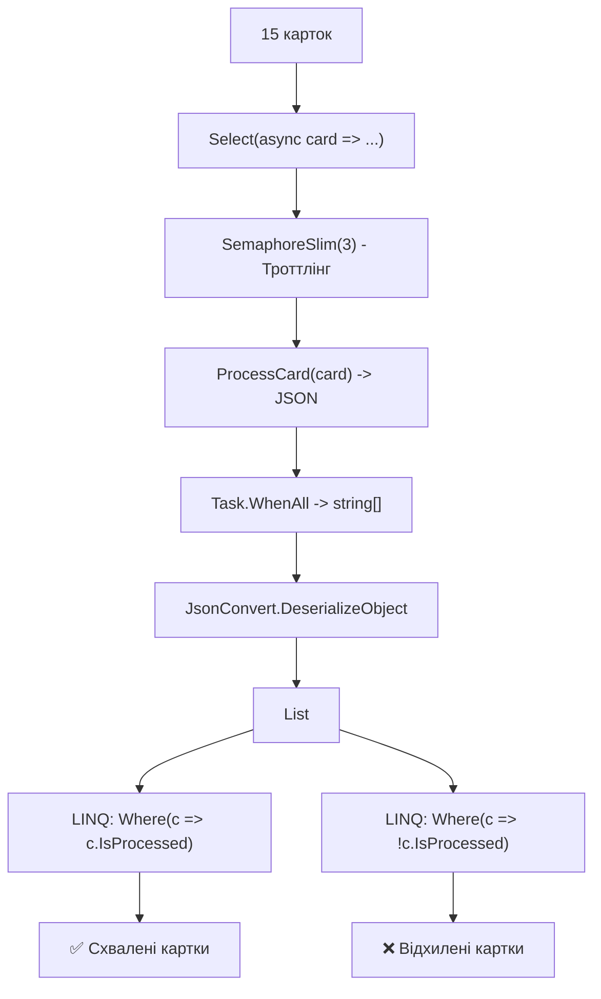

# 06. Обробка та агрегація відповідей множинних задач (HandleResponseWhenExecutingMultipleTasks)

## 📌 Теоретичний огляд

У практичних системах мало просто паралельно виконати задачі — потрібно:
1. Зібрати всі результати в єдиний контекст.
2. Десеріалізувати дані (наприклад, JSON-відповіді від сторонніх API або мікросервісів).
3. Згрупувати або відфільтрувати результати за бізнес-правилами (успішні, відхилені, помилкові).

Цей проект поєднує:
- Троттлінг через `SemaphoreSlim` (захист від навантаження).
- Паралельний комбінатор `Task.WhenAll`.
- Потокову десеріалізацію та LINQ-фільтрацію готового набору даних.

---

## 📊 Візуалізація: Конвеєр відправки, очікування та десеріалізації

---

## 💡 Modern .NET Best Practices

1. **`System.Text.Json` замість `Newtonsoft.Json`:**
   У сучасному .NET для максимальної швидкодії та низького виділення пам'яті (zero-allocation) використовують вбудований `System.Text.Json.JsonSerializer`.
2. **Пряме повернення DTO замість JSON:**
   Якщо внутрішній метод `ProcessCard` працює в межах одного застосунку, йому краще відразу повертати `Task<CreditCardResponse>`, уникаючи зайвих циклів серіалізації/десеріалізації.
3. **Обробка по мірі готовності (`Task.WhenAny` / `IAsyncEnumerable`):**
   Якщо не потрібно чекати всі 15 карток, а хочеться виводити статус на екран миттєво по мірі відповіді кожної картки, застосовують або `await foreach` з `IAsyncEnumerable`, або цикл із видаленням завершених задач через `Task.WhenAny`.
