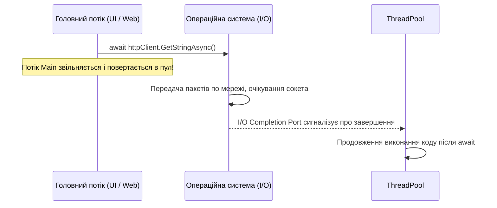

# Архітектура Async / Await та кінцевий автомат Task

## Вступ
Асинхронне програмування в C# побудоване навколо патерна **TAP (Task-based Asynchronous Pattern)** та ключових слів `async` і `await`. Воно призначене для ефективного використання системних ресурсів під час операцій введення/виведення (I/O-bound: робота з мережею, базою даних або диском), звільняючи потік виконання на час очікування відповіді від апаратного забезпечення.

---

## 1. Асинхронність проти Багатопоточності

| Характеристика | Асинхронність (I/O-Bound) | Багатопоточність (CPU-Bound) |
| :--- | :--- | :--- |
| **Основна мета** | Звільнити поточний потік, доки зовнішній пристрій виконує операцію | Задіяти кілька ядер CPU для одночасних математичних розрахунків |
| **Споживання потоків**| **0 потоків** під час очікування завершення I/O-запиту в ОС | 1 або більше постійно активних потоків з навантаженням на процесор |
| **Приклади** | HTTP-запити, читання файлу, SQL-запити | Обробка зображень, криптографія, фізичні симуляції |

---

## 2. Як працює компілятор: Генерація IAsyncStateMachine

Коли метод позначається модифікатором `async`:
1. Компілятор перетворює метод на структуру, що реалізує інтерфейс `IAsyncStateMachine`.
2. Код методу розбивається на кроки (стани).
3. При досягненні `await task`:
   - Якщо завдання вже завершене (`task.IsCompleted == true`), виконання продовжується синхронно без перемикання контексту.
   - Якщо ні, реєструється колбек продовження (`awaiter.UnsafeOnCompleted`), а метод негайно повертає незавершений `Task` тому, хто його викликав.

---

## 3. Типи повернення асинхронних методів

- `Task`: Метод виконує дію асинхронно і не повертає значення (асинхронний еквівалент `void`).
- `Task<T>`: Метод повертає значення типу `T` асинхронно.
- `ValueTask<T>`: Легка структура для високонавантажених сценаріїв, де результат часто доступний синхронно (уникає алокації `Task` у Heap).
- `async void`: **Категорично заборонено** використовувати в бізнес-коді! Будь-яке необроблене виключення в `async void` методі неможливо перехопити через `try-catch` ззовні, що призводить до негайного краху всього процесу. Дозволяється виключно для обробників подій UI (`button_Click`).

---

## 4. Проекти для практики

- [01-AsyncAndAwait](file:///06-Advanced-DotNet/01-Asynchronous-Programming/01-AsyncAndAwait/Program.cs) — Перший виклик асинхронного методу та відмінність від синхронного блокування.
- [02-Tasks](file:///06-Advanced-DotNet/01-Asynchronous-Programming/02-Tasks/Program.cs) — Створення та запуск завдань `Task.Run`.
- [03-ReturnAValueFromTask-Console](file:///06-Advanced-DotNet/01-Asynchronous-Programming/03-ReturnAValueFromTask-Console/Program.cs) — Отримання значення з `Task<T>` через `await`.
- [EX_01_async_await](file:///06-Advanced-DotNet/01-Asynchronous-Programming/EX_01_async_await/Program.cs) — Базова поведінка очікування.
- [EX_02_async_await](file:///06-Advanced-DotNet/01-Asynchronous-Programming/EX_02_async_await/Program.cs) — Класичний приклад приготування асинхронного сніданку (Asynchronous Breakfast).
