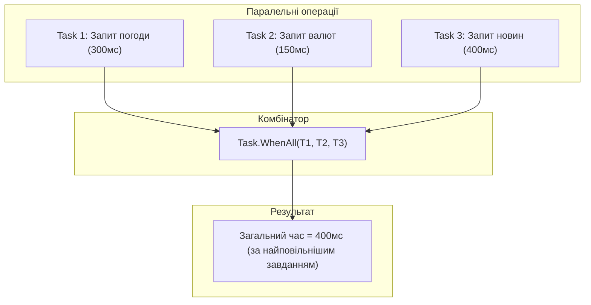

# Координація завдань, комбінатори Task.WhenAll та троттлінг через SemaphoreSlim

## Вступ
При одночасному виконанні множини асинхронних операцій критично важливо правильно координувати їхнє завершення та контролювати навантаження на зовнішні ресурси.

---

## 1. Комбінатори завдань: Task.WhenAll та Task.WhenAny



### Застосування Task.WhenAll:
```csharp
Task<string> weatherTask = GetWeatherAsync();
Task<decimal> ratesTask = GetExchangeRatesAsync();

// Чекаємо завершення обох операцій паралельно
await Task.WhenAll(weatherTask, ratesTask);

string weather = await weatherTask;
decimal rate = await ratesTask;
```

---

## 2. Троттлінг: Обмеження паралелізму через SemaphoreSlim

Якщо потрібно завантажити 10 000 файлів або відправити 5 000 HTTP-запитів, прямий виклик `Task.WhenAll` призведе до вичерпання пулу сокетів (Socket Exhaustion) або блокування базою даних.

Для обмеження кількості одночасних операцій використовується `SemaphoreSlim`:
```csharp
var semaphore = new SemaphoreSlim(initialCount: 5); // Максимум 5 одночасних завдань
var tasks = urls.Select(async url =>
{
    await semaphore.WaitAsync(); // Чекаємо дозволу
    try
    {
        return await client.GetStringAsync(url);
    }
    finally
    {
        semaphore.Release(); // Звільняємо слот для іншого завдання
    }
});

string[] results = await Task.WhenAll(tasks);
```

---

## 3. Проекти для практики

- [04-ExecuteMultipleTasks](file:///06-Advanced-DotNet/01-Asynchronous-Programming/04-ExecuteMultipleTasks/Program.cs) — Запуск кількох незалежних завдань без блокування головного потоку.
- [04-ExecuteMultipleTasks-Task.WhenAll](file:///06-Advanced-DotNet/01-Asynchronous-Programming/04-ExecuteMultipleTasks-Task.WhenAll/Program.cs) — Координація масиву завдань через `Task.WhenAll`.
- [05-LimitTheNumberOfConcurrentTasks](file:///06-Advanced-DotNet/01-Asynchronous-Programming/05-LimitTheNumberOfConcurrentTasks/Program.cs) — Обмеження пулу одночасних завдань за допомогою семафора.
- [06-HandleResponseWhenExecutingMultipleTasks](file:///06-Advanced-DotNet/01-Asynchronous-Programming/06-HandleResponseWhenExecutingMultipleTasks/Program.cs) — Обробка результатів кожного завдання в міру їхньої готовності.
