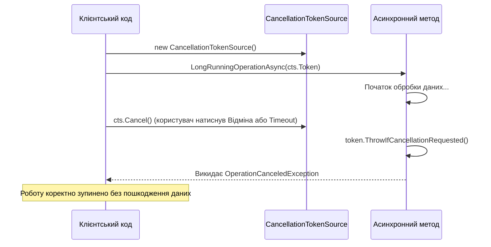

# Кооперативне скасування операцій: CancellationToken та CancellationTokenSource

## Вступ
У сучасній багатопотоковій та асинхронній моделі .NET примусове знищення потоків (як застарілий `Thread.Abort()`) суворо заборонене, оскільки воно залишає пам'ять та ресурси процесу в невизначеному стані. Замість цього використовується патерн **кооперативного скасування (Cooperative Cancellation)**.

---

## 1. Механізм взаємодії

Кооперативне скасування передбачає двосторонню домовленість:
1. **Ініціатор (Caller):** Створює джерело токенів `CancellationTokenSource` і передає токен `cts.Token` у метод. При необхідності викликає `cts.Cancel()`.
2. **Виконавець (Worker):** Періодично опитує переданий токен на наявність сигналу скасування.



---

## 2. Практичний шаблон реалізації

```csharp
public async Task DownloadFileAsync(string url, CancellationToken ct = default)
{
    using var client = new HttpClient();
    
    // Передаємо токен скасування у всі внутрішні асинхронні API
    using var response = await client.GetAsync(url, HttpCompletionOption.ResponseHeadersRead, ct);
    
    // Ручна перевірка в довготривалих циклах
    while (hasMoreData)
    {
        ct.ThrowIfCancellationRequested(); // Кине OperationCanceledException, якщо Cancel() викликано
        // Обробка чергової порції даних...
    }
}
```

### Автоматичне скасування за таймаутом:
```csharp
// Скасувати операцію автоматично через 5 секунд:
using var cts = new CancellationTokenSource(TimeSpan.FromSeconds(5));
try
{
    await DownloadFileAsync("https://example.com/bigfile.iso", cts.Token);
}
catch (OperationCanceledException)
{
    Console.WriteLine("Операцію скасовано через перевищення ліміту часу (Timeout)!");
}
```

---

## 3. Проекти для практики

- [CancellationTokenToCancelATask](file:///06-Advanced-DotNet/01-Asynchronous-Programming/CancellationTokenToCancelATask/Program.cs) — Створення `CancellationTokenSource`, передача токена та коректна реакція на скасування.
