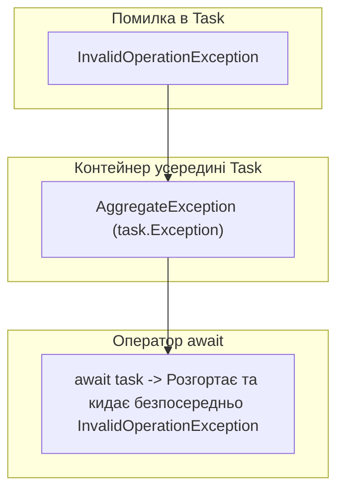

# Обробка виключень в асинхронному коді: Розгортання AggregateException

## Вступ
Асинхронні операції виконуються в іншому контексті або потоці, тому класична обробка виключень вимагає розуміння того, як `Task` інкапсулює помилки і як оператор `await` розгортає їх.

---

## 1. Як Task зберігає виключення: AggregateException

Коли в асинхронному методі виникає виключення, потік не падає негайно. Замість цього `Task` переходить у стан `Faulted`, а об'єкт виключення огортається в контейнер `AggregateException` і зберігається у властивості `task.Exception`.



### Магія оператора await:
Якщо звертатися до завдання через блокуючі властивості `task.Wait()` або `task.Result`, ви отримаєте `AggregateException`.
Але якщо використовувати **`await task`**, компілятор автоматично розпаковує перше виключення зі списку, дозволяючи використовувати звичайні типізовані блоки `catch`:

```csharp
try
{
    await FailingMethodAsync();
}
catch (HttpRequestException ex) // Працює напряму без AggregateException!
{
    Console.WriteLine($"Перехоплено мережеву помилку: {ex.Message}");
}
```

---

## 2. Множинні виключення у Task.WhenAll

Якщо ви запускаєте декілька завдань через `Task.WhenAll`, і кілька з них зазнають аварії:
- Оператор `await Task.WhenAll(...)` кине **лише перше** виключення.
- Щоб отримати доступ до всіх помилок одночасно, необхідно зберегти посилання на завдання комбінатора:

```csharp
Task allTasks = Task.WhenAll(task1, task2, task3);
try
{
    await allTasks;
}
catch
{
    // Отримуємо повний список усіх виключень, що сталися в усіх паралельних завданнях
    foreach (var innerEx in allTasks.Exception!.InnerExceptions)
    {
        Console.WriteLine($"Помилка: {innerEx.Message}");
    }
}
```

---

## 3. Проекти для практики

- [03-ReturnAValueFromTask-ConsolewithERROR](file:///06-Advanced-DotNet/01-Asynchronous-Programming/03-ReturnAValueFromTask-ConsolewithERROR/Program.cs) — Демонстрація помилки при асинхронному обчисленні.
- [EX_05-exceptions](file:///06-Advanced-DotNet/01-Asynchronous-Programming/EX_05-exceptions/Program.cs) — Комплексна обробка виключень у групах асинхронних завдань.
