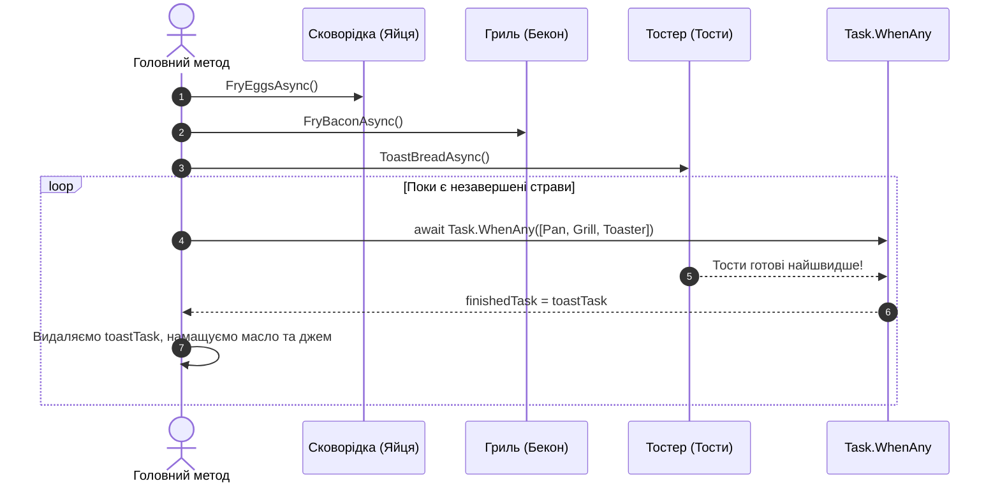

# EX_02. Асинхронний сніданок: Task.WhenAny (EX_02_async_await)

## 📌 Теоретичний огляд

Метафора «Приготування сніданку» — це найвідоміший приклад асинхронності в документації Microsoft .NET:
- **Синхронний підхід:** Повар ставить каву і стоїть дивиться на неї 3 хвилини. Потім ставить сковорідку і чекає 3 хвилини. Потім смажить яйця, тости, бекон... В результаті сніданок готується 20 хвилин, а кава встигає повністю охолонути.
- **Асинхронний підхід:** Повар запускає тривалі процеси (нагрівання тостера, смаження яєць, бекон) паралельно, а сам тим часом наливає сік та каву.

### Патерн `Task.WhenAny` у циклі:
У цьому проекті продемонстровано патерн черги подій:
1. Запускаються задачі `eggsTask`, `baconTask`, `toastTask`.
2. Метод `await Task.WhenAny(breakfastTasks)` пробуджується в момент, коли завершується **найперша готова страва**.
3. Завершена задача обробляється, видаляється зі списку, і цикл переходить до очікування наступної страви.

---

## 📊 Візуалізація: Синхронне проти паралельного приготування

```mermaid
gantt
    title Хронологія приготування страв (Секунди)
    dateFormat  X
    axisFormat %s с

    section Синхронно (Послідовно ~18 сек)
    Кава               : 0, 1
    Розігрів та яєчня  : 1, 7
    Смаження бекону    : 7, 13
    Тости + масло+джем : 13, 17
    Сік                : 17, 18

    section Асинхронно (Конкурентно ~6 сек)
    Кава               : 0, 1
    Яєчня (Task)       : 1, 7
    Бекон (Task)       : 1, 7
    Тости (Task)       : 1, 5
    Сік                : 5, 6
```

---

## 💡 Чому саме Task.WhenAny?
На відміну від `Task.WhenAll` (який чекає завершення всіх страв відразу), `Task.WhenAny` дозволяє **негайно взаємодіяти з проміжними результатами**. Наприклад, намастити тост маслом, поки він ще гарячий, не чекаючи, поки закінчить смажитися бекон.
