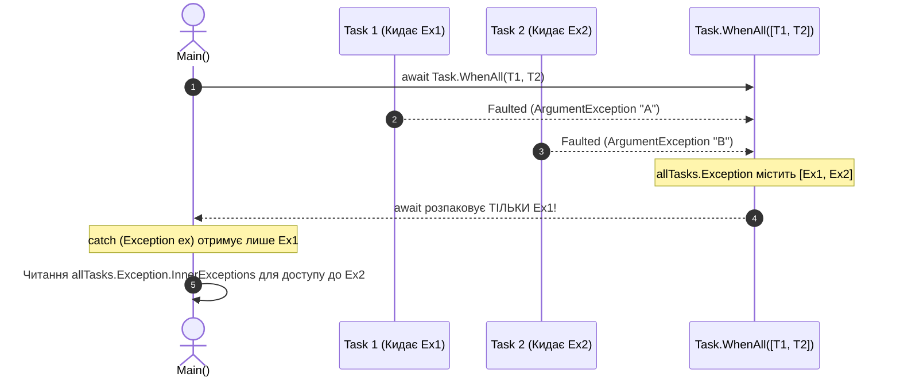

# EX_05. Обробка винятків в асинхронному коді (EX_05-exceptions)

## 📌 Теоретичний огляд

Обробка винятків в асинхронному коді суттєво відрізняється від синхронного через наявність об'єкта `Task` та кінцевого автомата `IAsyncStateMachine`:

1. **Інкапсуляція помилки:**
   Коли в асинхронному методі виникає `throw new Exception()`, виняток перехоплюється стейт-машиною, зберігається у властивості `task.Exception` (тип `AggregateException`), а статус задачі стає `TaskStatus.Faulted` (`task.IsFaulted == true`).
2. **Розгортання оператором `await`:**
   Коли ми викликаємо `await task`, .NET розгортає `AggregateException` і повторно викидає **перший внутрішній виняток** (`InnerException`), що дозволяє писати зручний `catch (SpecificException ex)`.
3. **Множинні помилки у `Task.WhenAll`:**
   Якщо 5 паралельних задач впали з помилкою, `await Task.WhenAll(tasks)` викине **тільки одну** (першу за часом). Решта 4 винятки не губляться, але залишаються доступними лише через колекцію `allTasks.Exception.InnerExceptions`.
4. **Небезпека `async void`:**
   Оскільки об'єкт `Task` відсутній, виняток викидається безпосередньо в активний контекст синхронізації (`SynchronizationContext`). Зовнішній блок `try { MethodAsyncVoid(); } catch` **не може** його перехопити. У більшості випадків це призводить до аварійного завершення всього процесу застосунку.

---

## 📊 Візуалізація: Розгортання винятків у Task.WhenAll

---

## 🔍 Порівняльна таблиця поведінки винятків

| Сигнатура методу | Спосіб виклику | Де опиняється виняток | Чи ловиться зовнішнім `try/catch`? |
| :--- | :--- | :--- | :---: |
| `async Task` | `await DoWorkAsync()` | У `Task.Exception`, розгортається оператором `await` | ✅ **Так**, стандартний `catch` |
| `async Task` | `DoWorkAsync();` (без await) | Залишається «похованим» у невичитаному `Task` (Unobserved Task Exception) | ❌ **Ні** |
| `async void` | `DoWorkAsync();` | Викидається в потік ThreadPool / SynchronizationContext | ❌ **Ні** (Process Crash) |
| `async void` | `DoWorkAsync();` | Перехоплюється **всередині** самого `async void` методу | ✅ **Так**, якщо `try/catch` всередині |
| `Task.WhenAll` | `await allTasks;` | Розгортається перший виняток, решта в `allTasks.Exception.InnerExceptions` | ✅ **Так** (для всіх через цикл) |
