# Навчальний план і дорожня карта (Curriculum & Roadmap): Рефлексія та метадані в .NET

Цей документ формує повний понятійний фундамент та послідовність викладу матеріалу: від базових понять про те, що таке метадані і звідки вони беруться в скомпільованих збірках, до практичної реалізації власного контейнера інверсії керування (IoC/DI).

---

## 1. Понятійний апарат курсу (Фундаментальні визначення)

Перед вивченням практичних прикладів необхідно чітко розмежувати базові терміни та концепції, якими оперує платформа .NET:

### 1.1. Що таке метадані (Metadata)?
* **Визначення**: Метадані — це структурована двійкова інформація, що описує всі сутності програми: типи (класи, структури, інтерфейси, перерахування, делегати), їхні члени (методи, поля, властивості, події, конструктори), параметри методів, модифікатори доступу, залежності збірки та користувацькі атрибути. Простими словами, метадані — це вичерпний «паспорт» програми, вбудований безпосередньо у скомпільований файл.
* **Звідки беруться метадані?** Під час компіляції вихідного коду C# компілятор Roslyn (`csc`) розбирає код і формує дві складові: інструкції проміжної мови (IL-код) та реляційні таблиці метаданих. Обидва елементи зберігаються у фізичному файлі збірки (`.dll` або `.exe`) відповідно до стандарту ECMA-335.
* **Навіщо вони потрібні?** На відміну від мов без повних метаданих (як класичний C++), де після компіляції імена полів і типи стираються, середовище виконання .NET (CLR) використовує метадані для валідації безпеки типів, роботи збирача сміття (GC), взаємодії між мовами (Cross-Language Interoperability) та динамічної інспекції коду.

### 1.2. Що таке двійковий блоб (#Blob) та потоки метаданих?
* **Визначення**: Двійковий блоб (Binary Large Object, потік `#Blob`) — це область пам'яті у файлі збірки, призначена для компактного зберігання довільних двійкових даних змінної довжини (наприклад, скомпільованих сигнатур методів, параметрів атрибутів або значень за замовчуванням).
* **Навіщо потрібен?** Таблиці метаданих мають фіксовані розміри стовпчиків. Щоб не витрачати зайву пам'ять на складні сигнатури чи довільні масиви аргументів атрибутів, таблиці зберігають лише зміщення (індекси) у гнучкий потік `#Blob`.

### 1.3. Що таке рефлексія (Reflection)?
* **Визначення**: Рефлексія — це механізм платформи .NET, який надає програмному коду можливість під час виконання (runtime) динамічно читати метадані збірок, досліджувати внутрішню структуру типів, створювати екземпляри об'єктів за їхніми текстовими або динамічними описами та викликати методи в обхід статичної типізації компілятора.
* **Як контактувати з метаданими?** Через простір імен `System.Reflection` та базовий клас `System.Type`.

### 1.4. Раннє зв'язування (Early Binding) проти Пізнього зв'язування (Late Binding)
* **Раннє зв'язування (Early Binding)**:
  * **Визначення**: Спосіб взаємодії з кодом, коли тип, метод, властивість та їхнє розташування в пам'яті або таблиці віртуальних методів (VTable) відомі та жорстко перевірені компілятором ДО запуску програми.
  * **Навіщо потрібно**: Забезпечує максимальну швидкодію, 100% перевірку помилок на етапі збірки, підтримку автодоповнення в IDE (IntelliSense) та можливість інлайнінгу коду JIT-компілятором.
* **Пізнє зв'язування (Late Binding)**:
  * **Визначення**: Спосіб взаємодії з кодом, коли асоціація між викликом операції та конкретною реалізацією типу встановлюється динамічно під час виконання програми (наприклад, за текстовим ім'ям класу чи конфігураційним файлом).
  * **Навіщо потрібно**: Дозволяє створювати архітектуру незалежних модулів і плагінів, завантажувати зовнішні компоненти без перезапуску та перекомпільовування ядра системи, а також будувати універсальні фреймворки (IoC-контейнери, ORM, серіалізатори).

### 1.5. Що таке інверсія керування (IoC) та впровадження залежностей (DI)?
* **Інверсія керування (Inversion of Control - IoC)**: Архітектурний патерн, за якого керування створенням об'єктів і життєвим циклом передається від залежного класу до зовнішнього каркаса (контейнера). Клас більше не пише `new Service()`, а декларує свої потреби у конструкторі.
* **Впровадження залежностей (Dependency Injection - DI)**: Конкретний механізм передачі залежностей у конструктор або властивість об'єкта під час його інстанціювання за допомогою рефлексії.

---

## 2. Логічна послідовність викладу матеріалу (Solution-теги та послідовність)

Навчальний процес структуровано у **20 послідовних проєктів**, згрупованих за **6 Solution-тегами (Solution Folders)** у рішенні `OOP - Reflection.sln`:

```mermaid
flowchart TD
    subgraph S1["01. Type System & Metadata Inspection"]
        P0["00-Shared: Доменні типи"] --> P1["01-TypeofDemo: Compile-time typeof"]
        P1 --> P2["02-ObjectGetTypeDemo: Runtime поліморфізм"]
        P2 --> P3["03-TypeGetTypeDemo: Рядковий пошук"]
        P3 --> P4["04-TypePropertiesDemo: Прапорці типу"]
        P4 --> P5["05-AssemblyDemo: Дослідження збірок"]
        P5 --> P6["06-GetInterfacesDemo: Інтерфейси та мапінг"]
    end

    subgraph S2["02. Members & Encapsulation"]
        P6 --> P7["07-GetFieldsPropertiesDemo: Поля та властивості"]
        P7 --> P8["08-GetMethodsDemo: Методи та виклики"]
        P8 --> P9["09-GetParameterInfoDemo: Параметри методів"]
        P9 --> P10["10-GetConstructorInfoDemo: Конструктори"]
        P10 --> P11["11-GetEventsDemo: Події та динамічна підписка"]
    end

    subgraph S3["03. Generics Reflection"]
        P11 --> P12["12-GenericsReflectionDemo: Дженерики у типах і методах"]
        P12 --> P13["13-OpenGenericsAndVarianceDemo: Відкриті типи та коваріантність"]
    end

    subgraph S4["04. Dynamic Execution & Performance"]
        P13 --> P14["14-LateBindingDemo: Activator та DLR пізнє зв'язування"]
        P14 --> P15_0["15.0-ExpressionTreesBasicsDemo: Код як дані та анатомія AST"]
        P15_0 --> P15_1["15.1-ExpressionTreesBuildingDemo: Ручне конструювання формул та умов"]
        P15_1 --> P15_2["15.2-ExpressionTreesMemberAccessDemo: Швидкі геттери, виклики та фабрики"]
        P15_2 --> P15_3["15.3-ReflectionPerformanceDemo: Бенчмарк швидкодії та бустінг"]
        P15_3 --> P16["16-UnsafeAccessorDemo: JIT Intrinsic доступ до private"]
    end

    subgraph S5["05. Attributes & Serialization"]
        P16 --> P17["17-CreateCustomAttributes: Декларативна валідація"]
        P17 --> P18["18-SerializationDeserialization: Рефлексивний XML"]
    end

    subgraph S6["06. Frameworks & Dependency Injection"]
        P18 --> P19["19-DependencyInjection: Повний власний IoC/DI контейнер"]
    end
```

---

## 3. Узагальнююча таблиця навчальних проєктів у розрізі Solution-тегів

| № | Solution-тег (Папка) | Проєкт | Ключові концепції та API | Посилання на приклад коду | Рівень |
| :-: | :--- | :--- | :--- | :--- | :-: |
| **00** | `01. Type System & Metadata Inspection` | `00-Shared` | Доменні сутності (`Car`, `SportsCar`, `ICar`) для дослідження | [00-Shared/Common/Car.cs](../00-Shared/Common/Car.cs) | Базовий |
| **01** | `01. Type System & Metadata Inspection` | `01-TypeofDemo` | Оператор `typeof`, відкриті/закриті дженерики, токени CLR | [01-TypeofDemo/Program.cs](../01-TypeofDemo/Program.cs) | Базовий |
| **02** | `01. Type System & Metadata Inspection` | `02-ObjectGetTypeDemo` | Рантайм-тип `GetType()`, поліморфізм, поведінка boxing для struct | [02-ObjectGetTypeDemo/Program.cs](../02-ObjectGetTypeDemo/Program.cs) | Базовий |
| **03** | `01. Type System & Metadata Inspection` | `03-TypeGetTypeDemo` | Динамічний пошук за ім'ям `Type.GetType`, `AssemblyQualifiedName` | [03-TypeGetTypeDemo/Program.cs](../03-TypeGetTypeDemo/Program.cs) | Базовий |
| **04** | `01. Type System & Metadata Inspection` | `04-TypePropertiesDemo` | Прапорці `IsClass`, `IsValueType`, `IsInterface`, `IsAbstract`, `BaseType` | [04-TypePropertiesDemo/Program.cs](../04-TypePropertiesDemo/Program.cs) | Базовий |
| **05** | `01. Type System & Metadata Inspection` | `05-AssemblyDemo` | Завантаження збірок (`Assembly.Load`), `GetTypes`, маніфест | [05-AssemblyDemo/Program.cs](../05-AssemblyDemo/Program.cs) | Базовий |
| **06** | `01. Type System & Metadata Inspection` | `06-GetInterfacesDemo` | Контракти `GetInterfaces`, сумісність `IsAssignableFrom`, `GetInterfaceMap` | [06-GetInterfacesDemo/Program.cs](../06-GetInterfacesDemo/Program.cs) | Середній |
| **07** | `02. Members & Encapsulation` | `07-GetFieldsPropertiesDemo` | Поля `FieldInfo`, властивості `PropertyInfo`, гетери/сетери, `BindingFlags` | [07-GetFieldsPropertiesDemo/Program.cs](../07-GetFieldsPropertiesDemo/Program.cs) | Середній |
| **08** | `02. Members & Encapsulation` | `08-GetMethodsDemo` | Методи `MethodInfo`, динамічний виклик `Invoke`, розв'язання перевантажень | [08-GetMethodsDemo/Program.cs](../08-GetMethodsDemo/Program.cs) | Середній |
| **09** | `02. Members & Encapsulation` | `09-GetParameterInfoDemo` | Параметри `ParameterInfo`, `ref`/`out`/`in`, опціональні значення | [09-GetParameterInfoDemo/Program.cs](../09-GetParameterInfoDemo/Program.cs) | Середній |
| **10** | `02. Members & Encapsulation` | `10-GetConstructorInfoDemo` | Конструктори `ConstructorInfo`, параметри ctor, вибір конструктора | [10-GetConstructorInfoDemo/Program.cs](../10-GetConstructorInfoDemo/Program.cs) | Середній |
| **11** | `02. Members & Encapsulation` | `11-GetEventsDemo` | Події `EventInfo`, методи `add`/`remove`, динамічна підписка делегатів | [11-GetEventsDemo/Program.cs](../11-GetEventsDemo/Program.cs) | Середній |
| **12** | `03. Generics Reflection` | `12-GenericsReflectionDemo` | Узагальнення: `MakeGenericType`, `MakeGenericMethod`, обмеження типів | [12-GenericsReflectionDemo/Program.cs](../12-GenericsReflectionDemo/Program.cs) | Просунутий |
| **13** | `03. Generics Reflection` | `13-OpenGenericsAndVarianceDemo` | Відкриті типи в DI (`IRepository<>`), коваріантність (`out`), контраваріантність (`in`) | [13-OpenGenericsAndVarianceDemo/Program.cs](../13-OpenGenericsAndVarianceDemo/Program.cs) | Просунутий |
| **14** | `04. Dynamic Execution & Performance` | `14-LateBindingDemo` | Пізнє зв'язування `Activator.CreateInstance`, `GetUninitializedObject` | [14-LateBindingDemo/Program.cs](../14-LateBindingDemo/Program.cs) | Середній |
| **15.0** | `04. Dynamic Execution & Performance` | `15.0-ExpressionTreesBasicsDemo` | Дерева виразів (AST): різниця між `Func` та `Expression`, розбір вузлів, `.Compile()` | [15.0-ExpressionTreesBasicsDemo/Program.cs](../15.0-ExpressionTreesBasicsDemo/Program.cs) | Середній |
| **15.1** | `04. Dynamic Execution & Performance` | `15.1-ExpressionTreesBuildingDemo` | Ручна побудова AST: `Expression.Parameter`, `Multiply`, `Add`, `Condition` (if-else) | [15.1-ExpressionTreesBuildingDemo/Program.cs](../15.1-ExpressionTreesBuildingDemo/Program.cs) | Просунутий |
| **15.2** | `04. Dynamic Execution & Performance` | `15.2-ExpressionTreesMemberAccessDemo` | Бустінг рефлексії: `Expression.Property` (геттери), `Call` (методи), `New` (фабрики) | [15.2-ExpressionTreesMemberAccessDemo/Program.cs](../15.2-ExpressionTreesMemberAccessDemo/Program.cs) | Просунутий |
| **15.3** | `04. Dynamic Execution & Performance` | `15.3-ReflectionPerformanceDemo` | Порівняння швидкодії: Direct Call vs Delegates vs Expressions vs Invoke | [15.3-ReflectionPerformanceDemo/Program.cs](../15.3-ReflectionPerformanceDemo/Program.cs) | Експертний |
| **16** | `04. Dynamic Execution & Performance` | `16-UnsafeAccessorDemo` | JIT Intrinsic `[UnsafeAccessor]` (.NET 8+): прямий доступ до private без оверхеду | [16-UnsafeAccessorDemo/Program.cs](../16-UnsafeAccessorDemo/Program.cs) | Експертний |
| **17** | `05. Attributes & Serialization` | `17-CreateCustomAttributes` | Власні атрибути `AttributeUsage`, валідація, потік `#Blob` | [17-CreateCustomAttributes/Program.cs](../17-CreateCustomAttributes/Program.cs) | Просунутий |
| **18** | `05. Attributes & Serialization` | `18-SerializationDeserialization` | Рефлексивний обхід графу властивостей, зіставлення та XML-серіалізація | [18-SerializationDeserialization/Program.cs](../18-SerializationDeserialization/Program.cs) | Просунутий |
| **19** | `06. Frameworks & Dependency Injection` | `19-DependencyInjection` | **Фінальний проєкт**: повнофункціональний IoC/DI контейнер (Lifetimes, Cycles, Greedy Ctor) | [19-DependencyInjection/Program.cs](../19-DependencyInjection/Program.cs) | Експертний |

---

## 4. Навігація по розділах документації

1. [01. Дослідження системи типів та інспекція метаданих](01_Type_System_And_Metadata_Inspection.md) — Детальний розбір класів `Type`, `Assembly`, `MemberInfo` з таблицями методів.
2. [02. Члени типу, параметри та бітові прапорці BindingFlags](02_Members_And_BindingFlags.md) — Дослідження `FieldInfo`, `PropertyInfo`, `MethodInfo`, `ConstructorInfo`, `ParameterInfo`.
3. [03. Пізнє зв'язування, активація та дженерики](03_Late_Binding_And_Generics.md) — `Activator`, dynamic invoke, динамічне конструювання узагальнених типів та методів.
4. [04. Метадані, атрибути та валідаційні рушії](04_Attributes_And_Metadata_Validation.md) — Декларативне програмування, користувацькі атрибути, серіалізація.
5. [05. Дерева виразів (Expression Trees) та динамічна компіляція в .NET](05_Expression_Trees_Deep_Dive.md) — Детальний розбір концепції «код як дані», конструювання AST та прискорення рефлексії.
6. [06. Продуктивність рефлексії, UnsafeAccessor та Native AOT](06_Performance_Optimization_And_Native_AOT.md) — Аналіз вузьких місць `Invoke`, бенчмарки, `[UnsafeAccessor]` та Native AOT Trimming.
7. [07. Власний IoC/DI Контейнер: Повний розбір архітектури](07_IoC_Container_Deep_Dive.md) — Повне керівництво з побудови промислового міні-IoC контейнера.
