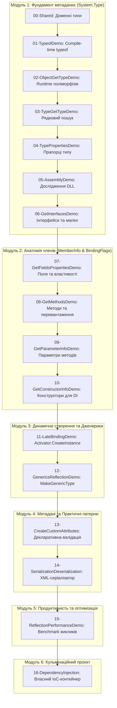

# Навчальний план і дорожня карта (Curriculum & Roadmap): Рефлексія та метадані в .NET

Цей документ формує повний понятійний фундамент та послідовність викладу матеріалу: від базових понять про те, що таке метадані і звідки вони беруться в скомпільованих збірках, до практичної реалізації власного контейнера інверсії керування (IoC/DI).

---

## 1. Понятійний апарат курсу (Фундаментальні визначення)

Перед вивченням практичних прикладів необхідно чітко розмежувати базові терміни та концепції, якими оперує платформа .NET:

### 1.1. Що таке метадані (Metadata)?
* **Визначення**: Метадані — це структурована двійкова інформація, що описує всі сутності програми: типи (класи, структури, інтерфейси, перерахування, делегати), їхні члени (методи, поля, властивості, події, конструктори), параметри методів, модифікатори доступу, залежності збірки та користувацькі атрибути. Простими словами, метадані — це вичерпний «паспорт» програми, вбудований безпосередньо у скомпільований файл.
* **Звідки беруться метадані?** Під час компіляції вихідного коду C# компілятор Roslyn (`csc`) розбирає код і формує дві складові: інструкції проміжної мови (IL-код) та реляційні таблиці метаданих. Обидва елементи зберігаються у фізичному файлі збірки (`.dll` або `.exe`) відповідно до стандарту ECMA-335.
* **Навіщо вони потрібні?** На відміну від мов без повних метаданих (як класичний C++), де після компіляції імена полів і типи стираються, середовище виконання .NET (CLR) використовує метадані для валідації безпеки типів, роботи збирача сміття (GC), взаємодії між мовами (Cross-Language Interoperability) та динамічної інспекції коду.

### 1.2. Що таке двійковий блоб (#Blob) та потоки метаданих?
* **Визначення**: Двійковий блоб (Binary Large Object, потік `#Blob`) — це область пам'яті у файлі збірки, призначена для компактного зберігання довільних двійкових даних змінної довжини (наприклад, скомпільованих сигнатур методів, параметрів атрибутів або значень за замовчуванням).
* **Навіщо потрібен?** Таблиці метаданих мають фіксовані розміри стовпчиків. Щоб не витрачати зайву пам'ять на складні сигнатури чи довільні масиви аргументів атрибутів, таблиці зберігають лише зміщення (індекси) у гнучкий потік `#Blob`.

### 1.3. Що таке рефлексія (Reflection)?
* **Визначення**: Рефлексія — це механізм платформи .NET, який надає програмному коду можливість під час виконання (runtime) динамічно читати метадані збірок, досліджувати внутрішню структуру типів, створювати екземпляри об'єктів за їхніми текстовими або динамічними описами та викликати методи в обхід статичної типізації компілятора.
* **Як контактувати з метаданими?** Через простір імен `System.Reflection` та базовий клас `System.Type`.

### 1.4. Раннє зв'язування (Early Binding) проти Пізнього зв'язування (Late Binding)
* **Раннє зв'язування (Early Binding)**:
  * **Визначення**: Спосіб взаємодії з кодом, коли тип, метод, властивість та їхнє розташування в пам'яті або таблиці віртуальних методів (VTable) відомі та жорстко перевірені компілятором ДО запуску програми.
  * **Навіщо потрібно**: Забезпечує максимальну швидкодію, 100% перевірку помилок на етапі збірки, підтримку автодоповнення в IDE (IntelliSense) та можливість інлайнінгу коду JIT-компілятором.
* **Пізнє зв'язування (Late Binding)**:
  * **Визначення**: Спосіб взаємодії з кодом, коли асоціація між викликом операції та конкретною реалізацією типу встановлюється динамічно під час виконання програми (наприклад, за текстовим ім'ям класу чи конфігураційним файлом).
  * **Навіщо потрібно**: Дозволяє створювати архітектуру незалежних модулів і плагінів, завантажувати зовнішні компоненти без перезапуску та перекомпільовування ядра системи, а також будувати універсальні фреймворки (IoC-контейнери, ORM, серіалізатори).

### 1.5. Що таке інверсія керування (IoC) та впровадження залежностей (DI)?
* **Інверсія керування (Inversion of Control - IoC)**: Архітектурний патерн, за якого керування створенням об'єктів і життєвим циклом передається від залежного класу до зовнішнього каркаса (контейнера). Клас більше не пише `new Service()`, а декларує свої потреби у конструкторі.
* **Впровадження залежностей (Dependency Injection - DI)**: Конкретний механізм передачі залежностей у конструктор або властивість об'єкта під час його інстанціювання за допомогою рефлексії.

---

## 2. Логічна послідовність викладу матеріалу

Навчальний процес структуровано у **16 послідовних кроків**, згрупованих у 6 логічних блоків за принципом «від вивчення структури до побудови повноцінного фреймворку»:

---

## 3. Узагальнююча таблиця навчальних проєктів

| № | Етап / Тема | Ключові концепції та класи | Папка / Проєкт у рішенні | Посилання на приклад коду | Рівень |
| :-: | :--- | :--- | :--- | :-: | :-: |
| **00** | **Спільні доменні типи** | Класи `Car`, `SportsCar`, інтерфейс `ICar` для інспекції | `00-Shared` | [00-Shared/Common/Car.cs](../00-Shared/Common/Car.cs) | Базовий |
| **01** | **Компіляційний Type** | Оператор `typeof`, відкриті/закриті дженерики, метадані CLR | `01-TypeofDemo` | [01-TypeofDemo/Program.cs](../01-TypeofDemo/Program.cs) | Базовий |
| **02** | **Поліморфний рантайм-тип** | `object.GetType()`, точний тип vs інтерфейс/базовий клас | `02-ObjectGetTypeDemo` | [02-ObjectGetTypeDemo/Program.cs](../02-ObjectGetTypeDemo/Program.cs) | Базовий |
| **03** | **Динамічний пошук за іменем** | `Type.GetType(string)`, AssemblyQualifiedName | `03-TypeGetTypeDemo` | [03-TypeGetTypeDemo/Program.cs](../03-TypeGetTypeDemo/Program.cs) | Базовий |
| **04** | **Анатомія та прапорці Type** | `IsClass`, `IsValueType`, `IsInterface`, `IsAbstract`, `BaseType` | `04-TypePropertiesDemo` | [04-TypePropertiesDemo/Program.cs](../04-TypePropertiesDemo/Program.cs) | Базовий |
| **05** | **Інспекція збірок (.dll)** | `Assembly`, `GetExecutingAssembly()`, `GetTypes()`, ресурси | `05-AssemblyDemo` | [05-AssemblyDemo/Program.cs](../05-AssemblyDemo/Program.cs) | Базовий |
| **06** | **Інтерфейси та диспетчеризація** | `Type.GetInterfaces()`, `IsAssignableFrom()`, `GetInterfaceMap()` | `06-GetInterfacesDemo` | [06-GetInterfacesDemo/Program.cs](../06-GetInterfacesDemo/Program.cs) | Середній |
| **07** | **Поля, властивості та інкапсуляція** | `FieldInfo`, `PropertyInfo`, `GetValue`, `SetValue`, `BindingFlags` | `07-GetFieldsPropertiesDemo` | [07-GetFieldsPropertiesDemo/Program.cs](../07-GetFieldsPropertiesDemo/Program.cs) | Середній |
| **08** | **Методи та їх перевантаження** | `MethodInfo`, `Invoke`, пошук перевантажень за типами аргументів | `08-GetMethodsDemo` | [08-GetMethodsDemo/Program.cs](../08-GetMethodsDemo/Program.cs) | Середній |
| **09** | **Параметри методів** | `ParameterInfo`, `ref`/`out`/`in`, опціональні значення `DefaultValue` | `09-GetParameterInfoDemo` | [09-GetParameterInfoDemo/Program.cs](../09-GetParameterInfoDemo/Program.cs) | Середній |
| **10** | **Аналіз та виклик конструкторів** | `ConstructorInfo`, параметри ctor, вибір конструктора для DI | `10-GetConstructorInfoDemo` | [10-GetConstructorInfoDemo/Program.cs](../10-GetConstructorInfoDemo/Program.cs) | Середній |
| **11** | **Пізнє зв'язування та активація** | `Activator.CreateInstance`, динамічний виклик, перехоплення помилок | `11-LateBindingDemo` | [11-LateBindingDemo/Program.cs](../11-LateBindingDemo/Program.cs) | Середній |
| **12** | **Рефлексія дженериків** | `MakeGenericType`, `MakeGenericMethod`, обмеження типів | `12-GenericsReflectionDemo` | [12-GenericsReflectionDemo/Program.cs](../12-GenericsReflectionDemo/Program.cs) | Просунутий |
| **13** | **Користувацькі атрибути** | `AttributeUsage`, валідація сутностей, `CustomAttributeData` | `13-CreateCustomAttributes` | [13-CreateCustomAttributes/Program.cs](../13-CreateCustomAttributes/Program.cs) | Просунутий |
| **14** | **Рефлексивна серіалізація** | Обхід графу властивостей, зіставлення XML/JSON, ігнорування | `14-SerializationDeserialization` | [14-SerializationDeserialization/Program.cs](../14-SerializationDeserialization/Program.cs) | Просунутий |
| **15** | **Продуктивність та оптимізація** | `MethodInfo.Invoke` vs `dynamic` vs `Delegate` vs `Expression Trees` | `15-ReflectionPerformanceDemo` | [15-ReflectionPerformanceDemo/Program.cs](../15-ReflectionPerformanceDemo/Program.cs) | Експертний |
| **16** | **Фінальний проєкт: IoC/DI Контейнер** | Життєві цикли (Transient/Singleton), Constructor & Property Injection, Цикли | `16-DependencyInjection` | [16-DependencyInjection/Program.cs](../16-DependencyInjection/Program.cs) | Експертний |

---

## 4. Навігація по розділах документації

1. [01. Дослідження системи типів та інспекція метаданих](01_Type_System_And_Metadata_Inspection.md) — Детальний розбір класів `Type`, `Assembly`, `MemberInfo` з таблицями методів.
2. [02. Члени типу, параметри та бітові прапорці BindingFlags](02_Members_And_BindingFlags.md) — Дослідження `FieldInfo`, `PropertyInfo`, `MethodInfo`, `ConstructorInfo`, `ParameterInfo`.
3. [03. Пізнє зв'язування, активація та дженерики](03_Late_Binding_And_Generics.md) — `Activator`, dynamic invoke, динамічне конструювання узагальнених типів та методів.
4. [04. Метадані, атрибути та валідаційні рушії](04_Attributes_And_Metadata_Validation.md) — Декларативне програмування, користувацькі атрибути, серіалізація.
5. [05. Продуктивність рефлексії та скомпільовані дерева виразів](05_Performance_Optimization_And_Compiled_Expressions.md) — Аналіз вузьких місць, порівняння швидкості, оптимізація через Expression Trees.
6. [06. Власний IoC/DI Контейнер: Повний розбір архітектури](06_IoC_Container_Deep_Dive.md) — Повне керівництво з побудови промислового міні-IoC контейнера.
