# 🧭 Навчальний план і дорожня карта (Curriculum & Roadmap): Рефлексія та метадані в .NET

Цей документ формує **послідовність викладу матеріалу** від фундаментальних концепцій рантайм-метаданих до розробки власного контейнера інверсії керування (IoC/DI).

---

## 🎯 Педагогічна мета модуля

1. Сформувати глибоке розуміння того, як **Common Language Runtime (CLR)** зберігає та надає інформацію про типи, збірки, методи та поля.
2. Навчити впевнено здійснювати інспекцію, пізнє зв'язування та модифікацію стану об'єктів під час виконання.
3. Опанувати роботу з **генериками**, **користувацькими атрибутами** та **бітовими масками (`BindingFlags`)**.
4. Зрозуміти ціну продуктивності рефлексії та техніки оптимізації (делегати, дерева виразів).
5. Створити завершений, архітектурно зрілий **IoC/DI-контейнер**, який узагальнює всі вивчені техніки.

---

## 📊 Узагальнююча таблиця навчального плану

| № | Етап / Тема | Ключові концепції та класи | Проект у репозиторії | Посилання на код | Рівень |
| :-: | :--- | :--- | :--- | :-: | :-: |
| **01** | **Компіляційний Type** | Оператор `typeof`, відкриті/закриті дженерики, метадані CLR | `TypeofDemo` |  | Базовий |
| **02** | **Поліморфний рантайм-тип** | `object.GetType()`, точний тип vs інтерфейс/базовий клас | `ObjectGetTypeDemo` |  | Базовий |
| **03** | **Динамічний пошук за іменем** | `Type.GetType(string)`, AssemblyQualifiedName | `TypeGetTypeDemo` |  | Базовий |
| **04** | **Анатомія та прапорці Type** | `IsClass`, `IsValueType`, `IsInterface`, `IsAbstract`, `BaseType` | `TypePropertiesDemo` |  | Базовий |
| **05** | **Інспекція збірок (.dll)** | `Assembly`, `GetExecutingAssembly()`, `GetTypes()`, ресурси | `AssemblyDemo` |  | Базовий |
| **06** | **Інтерфейси та диспетчеризація** | `Type.GetInterfaces()`, `IsAssignableFrom()`, `GetInterfaceMap()` | `GetInterfacesDemo` |  | Середній |
| **07** | **Поля, властивості та інкапсуляція** | `FieldInfo`, `PropertyInfo`, `GetValue`, `SetValue`, `BindingFlags` | `GetFieldsPropertiesDemo` |  | Середній |
| **08** | **Методи та їх перевантаження** | `MethodInfo`, `Invoke`, пошук перевантажень за типами аргументів | `GetMethodsDemo` |  | Середній |
| **09** | **Параметри методів** | `ParameterInfo`, `ref`/`out`/`in`, опціональні значення `DefaultValue` | `GetParameterInfoDemo` |  | Середній |
| **10** | **Аналіз та виклик конструкторів** | `ConstructorInfo`, параметри ctor, вибір конструктора для DI | `GetConstractorInfoDemo` |  | Середній |
| **11** | **Пізнє зв'язування та активація** | `Activator.CreateInstance`, динамічний виклик, перехоплення помилок | `LateBindingDemo` |  | Середній |
| **12** | **Рефлексія дженериків** | `MakeGenericType`, `MakeGenericMethod`, обмеження типів | `GenericsReflectionDemo` |  | Просунутий |
| **13** | **Користувацькі атрибути** | `AttributeUsage`, валідація сутностей, `CustomAttributeData` | `CreateCustomAttributes` |  | Просунутий |
| **14** | **Рефлексивна серіалізація** | Обхід графу властивостей, зіставлення XML/JSON, ігнорування | `SerializationDeserialization` |  | Просунутий |
| **15** | **Продуктивність та оптимізація** | `MethodInfo.Invoke` vs `dynamic` vs `Delegate` vs `Expression Trees` | `ReflectionPerformanceDemo` |  | Експертний |
| **16** | **Фінальний проєкт: IoC/DI Контейнер** | Життєві цикли (Transient/Singleton), Constructor & Property Injection, Цикли | `DependencyInjection` |  | Експертний |

---

## 🗺️ Графічна схема послідовності вивчення

```mermaid
flowchart TD
    subgraph M1["Модуль 1: Фундамент метаданих (System.Type)"]
        S1["01. typeof(T)<br/>Compile-time точність"] --> S2["02. obj.GetType()<br/>Runtime поліморфізм"]
        S2 --> S3["03. Type.GetType(str)<br/>Динамічне завантаження"]
        S3 --> S4["04. Характеристики Type<br/>IsClass, IsValueType..."]
        S4 --> S5["05. Збірки (Assembly)<br/>Пошук типів у .dll"]
        S5 --> S6["06. Інтерфейси<br/>GetInterfaceMap, IsAssignableFrom"]
    end

    subgraph M2["Модуль 2: Анатомія членів (MemberInfo & BindingFlags)"]
        S6 --> S7["07. Поля та властивості<br/>FieldInfo, PropertyInfo, злам інкапсуляції"]
        S7 --> S8["08. Методи та перевантаження<br/>MethodInfo, пошук за типами"]
        S8 --> S9["09. Параметри методів<br/>ParameterInfo, ref/out, defaults"]
        S9 --> S10["10. Конструктори<br/>ConstructorInfo, сигнатури для DI"]
    end

    subgraph M3["Модуль 3: Динамічне створення та Дженерики"]
        S10 --> S11["11. Пізнє зв'язування<br/>Activator.CreateInstance, Invoke"]
        S11 --> S12["12. Дженерики в рефлексії<br/>MakeGenericType, MakeGenericMethod"]
    end

    subgraph M4["Модуль 4: Метадані та Практичні патерни"]
        S12 --> S13["13. Атрибути та валідація<br/>AttributeUsage, рушій валідації"]
        S13 --> S14["14. Власний серіалізатор<br/>XML конвертер об'єктів"]
    end

    subgraph M5["Модуль 5: Продуктивність та оптимізація"]
        S14 --> S15["15. Benchmark продуктивності<br/>Invoke vs Dynamic vs Expression Trees"]
    end

    subgraph M6["Модуль 6: Кульмінаційний проєкт"]
        S15 --> S16["16. Власний IoC/DI Контейнер<br/>Синтез усіх знань: Lifetimes, Ctors, Circular Detection"]
    end

    style M1 fill:#e1f5fe,stroke:#0288d1,stroke-width:2px
    style M2 fill:#e8f5e9,stroke:#388e3c,stroke-width:2px
    style M3 fill:#fff3e0,stroke:#f57c00,stroke-width:2px
    style M4 fill:#f3e5f5,stroke:#7b1fa2,stroke-width:2px
    style M5 fill:#fffde7,stroke:#fbc02d,stroke-width:2px
    style M6 fill:#ffebee,stroke:#d32f2f,stroke-width:2px
```

---

## 📑 Опис модулів документації

1. [01. Дослідження системи типів та інспекція метаданих](01_Type_System_And_Metadata_Inspection.md) — Докладний розбір класів `Type`, `Assembly`, `MemberInfo` з таблицями методів.
2. [02. Члени типу, параметри та бітові прапорці BindingFlags](02_Members_And_BindingFlags.md) — Дослідження `FieldInfo`, `PropertyInfo`, `MethodInfo`, `ConstructorInfo`, `ParameterInfo`.
3. [03. Пізнє зв'язування, активація та дженерики](03_Late_Binding_And_Generics.md) — `Activator`, dynamic invoke, динамічне конструювання узагальнених типів та методів.
4. [04. Метадані, атрибути та валідаційні рушії](04_Attributes_And_Metadata_Validation.md) — Декларативне програмування, користувацькі атрибути, серіалізація.
5. [05. Продуктивність рефлексії та скомпільовані дерева виразів](05_Performance_Optimization_And_Compiled_Expressions.md) — Аналіз вузьких місць, порівняння швидкості, оптимізація через Expression Trees.
6. [06. Власний IoC/DI Контейнер: Повний розбір архітектури](06_IoC_Container_Deep_Dive.md) — Повне керівництво з побудови промислового міні-IoC контейнера.
