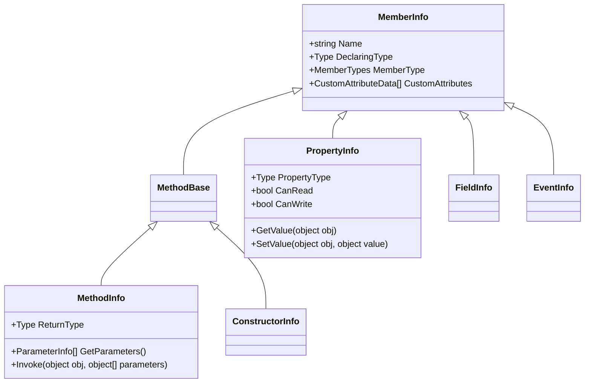

# Дослідження системи типів та інспекція метаданих (Metadata Inspection)

Рефлексія (**Reflection**) в .NET — це потужний механізм, який дозволяє програмі під час виконання (runtime) досліджувати власну структуру: збірки, модулі, типи (класи, структури, інтерфейси, делегати, перерахування), а також їхні члени (конструктори, методи, властивості, поля, події).

---

## 1. Фундаментальний клас `System.Type`

Клас `System.Type` є центральною точкою доступу до метаданих будь-якого типу в .NET.

### Способи отримання екземпляра `Type`:
1. **Оператор `typeof` (compile-time):**
   ```csharp
   Type carType = typeof(Car);
   ```
   Найшвидший та типобезпечний спосіб, коли тип відомий на етапі компіляції.
2. **Метод `GetType()` (runtime):**
   ```csharp
   object obj = new Car();
   Type objType = obj.GetType();
   ```
   Викликається на конкретному екземплярі об'єкта. Повертає реальний фактичний тип (навіть якщо змінна має тип базового класу або інтерфейсу).
3. **Статичний метод `Type.GetType(string typeName)` (динамічно):**
   ```csharp
   Type? dynamicType = Type.GetType("Shared.Common.Car, Shared");
   ```
   Дозволяє завантажити тип за його повним рядковим іменем (Assembly Qualified Name).

---

## 2. Ієрархія MemberInfo

Всі члени типу наслідуються від базового абстрактного класу `System.Reflection.MemberInfo`:



---

## 3. Дослідження властивостей і полів (`PropertyInfo`, `FieldInfo`)

Методи `GetProperties()` та `GetFields()` повертають колекції відкритих (або внутрішніх, залежно від `BindingFlags`) членів:

```csharp
Type type = typeof(Car);

// Отримання публічних властивостей
PropertyInfo[] properties = type.GetProperties();
foreach (PropertyInfo prop in properties)
{
    Console.WriteLine($"Властивість: {prop.Name}, Тип: {prop.PropertyType.Name}, Читання: {prop.CanRead}, Запис: {prop.CanWrite}");
}
```

### Використання `BindingFlags`:
Для пошуку непублічних або специфічних членів використовуються бітові прапорці:
```csharp
FieldInfo[] nonPublicFields = type.GetFields(
    BindingFlags.NonPublic | 
    BindingFlags.Instance | 
    BindingFlags.Static);
```

---

## 4. Конструктори та інспекція параметрів

За допомогою `ConstructorInfo` та `ParameterInfo` можна дізнатися, які конструктори визначені в типі та які аргументи вони очікують:

```csharp
ConstructorInfo[] constructors = type.GetConstructors();
foreach (ConstructorInfo ctor in constructors)
{
    ParameterInfo[] parameters = ctor.GetParameters();
    string paramList = string.Join(", ", parameters.Select(p => $"{p.ParameterType.Name} {p.Name}"));
    Console.WriteLine($"ctor({paramList})");
}
```

Цей механізм лежить в основі роботи будь-яких сучасних IoC / DI-контейнерів.
