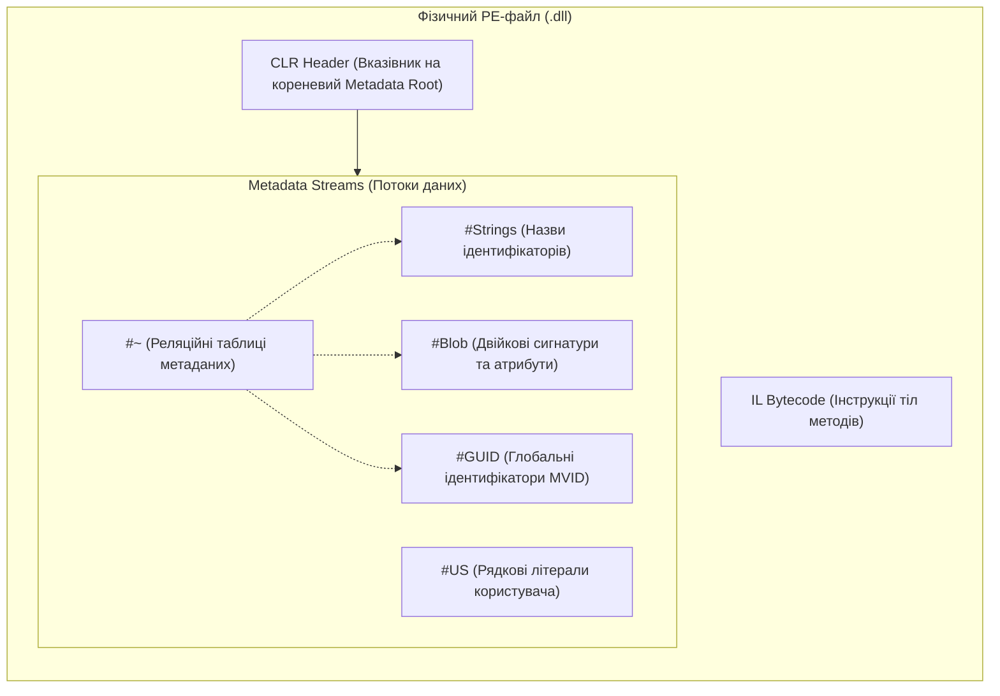

# 01. Дослідження системи типів та інспекція метаданих (CLR Type System & Metadata Internals)

Рефлексія (**Reflection**) в .NET — це механізм платформи, що надає керованому коду можливість під час виконання (runtime) досліджувати власну внутрішню структуру, читати метадані збірок, інспектувати типи даних, перевіряти сумісність інтерфейсів, створювати нові екземпляри та викликати довільні методи без необхідності мати статичну інформацію про них на етапі компіляції.

---

## 1. Понятійний апарат: Метадані в середовищі CLR

Щоб усвідомлено застосовувати рефлексію, необхідно володіти фундаментальними поняттями системи типів Common Language Runtime (CLR) та стандарту **ECMA-335 (Common Language Infrastructure)**.

### 1.1. Що таке метадані?
**Метадані (Metadata)** — це сукупність строго типізованих, структурованих двійкових описів, які супроводжують виконуваний проміжний код (Intermediate Language — IL) усередині .NET-модуля. Метадані вичерпно описують усе, що оголошено або використовується в коді:
- Каталог збірки (назва, версія, культура, відкритий ключ, залежності).
- Визначення всіх типів (класи, структури, інтерфейси, делегати, перерахування).
- Склад кожного типу (поля, конструктори, методи, властивості, події та їх модифікатори доступу).
- Сигнатури методів (кількість, порядок, типи параметрів і повернене значення).
- Декларативні атрибути користувача.

### 1.2. Звідки беруться метадані?
Метадані не виникають спонтанно під час роботи програми — вони **генеруються компілятором Roslyn** (`csc.exe`) на етапі збирання коду:
1. Розробник пише код мовою C#.
2. Компілятор проводить синтаксичний та семантичний аналіз коду.
3. Компілятор перетворює логіку методів у байт-код IL.
4. Одночасно компілятор заповнює реляційні таблиці метаданих і записує їх у спеціальну секцію виконуваного PE/COFF-файлу (зазвичай секція `.text`).
5. Збірка стає **самоописною (self-describing)**: їй не потрібні зовнішні заголовкові файли (`.h`), IDL-файли або реєстр операційної системи (на відміну від COM чи C++).

### 1.3. Навіщо потрібні метадані?
- **JIT-компіляція (Just-In-Time)**: JIT-компілятор використовує метадані для валідації типів, обчислення розмірів об'єктів у пам'яті та формування нативного машинного коду.
- **Типобезпека та верифікація**: CLR гарантує, що пам'ять не буде пошкоджена, оскільки кожен крок звіряється з метаданими.
- **Збирання сміття (Garbage Collection)**: GC дізнається, які зміщення всередині об'єкта містять посилання на інші об'єкти в купі.
- **Динамічний поліморфізм та диспетчеризація**: побудова таблиць віртуальних методів (VTable).
- **Міжмовна взаємодія**: сумісність типів за загальною системою типів (CTS — Common Type System).
- **Рефлексія, серіалізація та DI**: здатність бібліотек автоматично розпізнавати класи, читати поля та зв'язувати залежності.

### 1.4. Як взаємодіяти з метаданими?
Платформа .NET надає три рівні контакту з метаданими:
1. **Високорівневий (Reflection API — простір імен `System.Reflection`)**: класи `System.Type`, `Assembly`, `MethodInfo`, `PropertyInfo`. Найбільш зручний для прикладного коду, автоматично створює об'єкти-обгортки.
2. **Низькорівневий безалокаційний (`System.Reflection.Metadata`)**: класи `MetadataReader`, `PEReader`. Читає сирі байти таблиць напряму з потоку збірки без завантаження збірки в домен виконання. Використовується компілятором Roslyn та статичними аналізаторами.
3. **Низькорівневий COM/Unmanaged хостинг (`IMetaDataImport`)**: доступ до внутрішніх таблиць через нативні інтерфейси C++ у середовищі профілювальників та відлагоenvironment.

---

## 2. Фізична структура метаданих у PE/COFF-файлі (ECMA-335)

Будь-яка .NET-збірка (`.dll` або `.exe`) базується на форматі Portable Executable (PE), в який додано заголовок **CLR Header** та кореневий каталог метаданих, що складається з п'яти незалежних потоків:



### 2.1. Детальний опис потоків метаданих

| Назва потоку | Формат зберігання | Що містить і для чого використовується |
| :--- | :--- | :--- |
| **`#~` (або `#-`)** | Стиснені реляційні таблиці (Metadata Tables) | Головне реляційне сховище. Складається з десятків взаємопов'язаних таблиць: `TypeDef`, `TypeRef`, `MethodDef`, `MemberRef`, `FieldDef`, `Param`, `CustomAttribute` тощо. Рядки мають фіксовану довжину для швидкої бінарної індексації. |
| **`#Strings`** | Послідовність рядків UTF-8, завершених `\0` | Сховище імен сутностей: назви типів (`"Car"`), просторів імен (`"Shared.Common"`), полів та методів. Таблиці потоку `#~` зберігають не самі назви, а 4-байтні числові зміщення (offsets) у цей потік. |
| **`#US` (User Strings)** | Послідовність рядків UTF-16 | Сховище константних рядкових літералів, написаних розробником у лапках у коді C# (наприклад, `Console.WriteLine("Hello")`). Зчитується інструкцією IL `ldstr`. |
| **`#Blob`** | Двійкові масиви змінної довжини (Binary Large Objects) | **Що таке Blob?** Це неструктурований потік "сирих" байтів для зберігання складних метаданих змінної довжини: повних сигнатур методів (кількість і типи параметрів, конвенція виклику), сигнатур полів, а також серіалізованих аргументів користувацьких атрибутів. |
| **`#GUID`** | 128-бітні двійкові масиви | Зберігає GUID модуля (Module Version ID — MVID), збірки та типові бібліотеки COM. |

### 2.2. Що таке Metadata Token (`mdToken`)?
**Metadata Token** — це 32-бітне (4-байтне) ціле число, яке слугує первинним ключем для однозначної адресації будь-якого елемента у фізичному файлі збірки.

Структура токена:
$$\text{mdToken} = (\text{TableId} \ll 24) \mid \text{RID}$$

- **Старший байт (TableId, біти 24–31)**: номер таблиці метаданих у потоці `#~`.
  - `0x01` — `TypeRef` (посилання на тип в іншій збірці).
  - `0x02` — `TypeDef` (визначення типу в поточній збірці).
  - `0x04` — `FieldDef` (визначення поля).
  - `0x06` — `MethodDef` (визначення методу).
  - `0x08` — `Param` (параметр методу).
  - `0x0C` — `CustomAttribute` (екземпляр атрибута).
- **Молодші три байти (Record ID — RID, біти 0–23)**: 1-індексований номер рядка у відповідній таблиці.

Наприклад, токен `0x02000003` вказує на 3-й рядок таблиці `TypeDef` (визначення типу). Інструкція IL `ldtoken` завантажує такий токен у внутрішній дескриптор `RuntimeTypeHandle`.

---

## 3. Розгортання типу в оперативній пам'яті (Memory Layout)

Коли збірка зчитується середовищем виконання, завантажувач типів CLR (Class Loader) трансформує метадані з файлу в оперативні структури в пам'яті процесу.

### 3.1. Анатомія об'єкта в керованій купі (Heap Object Layout)
Кожен екземпляр посилального типу в 64-бітній системі (x64) має сувору структуру розміщення в пам'яті:

```
[Зміщення -8 байт]  SyncBlock Index   (8 байт) -> монітори синхронізації lock, системний хеш-код
[Зміщення  0 байт]  MethodTable Ptr   (8 байт) -> ВКАЗІВНИК НА СИСТЕМНИЙ ТИП (Type Handle)
[Зміщення +8 байт]  Поле 1 об'єкта    (8 байт) -> дані першого поля
[Зміщення +16...]   Поле 2 об'єкта    (8 байт) -> дані другого поля
```

- **`SyncBlock Index`**: 4 або 8 байт (вирівняно до розміру вказівника). Використовується оператором `lock(obj)` для блокування потоків, а також для збереження стабільного хеш-коду `GetHashCode()`, якщо він не був перевизначений.
- **`MethodTable Pointer`**: вказівник на структуру типу. Будь-який виклик `obj.GetType()` є операцією надшвидкого читання: CLR просто бере 8-байтну адресу за нульовим зміщенням і повертає відповідний екземпляр `System.RuntimeType`.

### 3.2. `MethodTable` проти `EEClass`
У пам'яті CLR розділяє метадані типу на "гарячі" та "холодні":
1. **`MethodTable` (Гаряча структура)**:
   - Розміщується поруч із кодом для мінімізації промахів процесорного кешу (CPU cache misses).
   - Містить розмір об'єкта, GC-дескриптор (карту розміщення посилальних полів для збирача сміття), карту інтерфейсів та **VTable (Virtual Method Table)** — масив прямих адрес скомпільованого машинного коду методів.
   - Використовується при кожному поліморфному виклику методу.
2. **`EEClass` (Execution Engine Class — Холодна структура)**:
   - Зберігає повний пасивний опис типу: список полів, назви, метадані-токени, розкладку зміщень полів (field layout).
   - Використовується лише під час JIT-компіляції нових методів або під час викликів рефлексії (`GetFields()`, `GetProperties()`).

---

## 4. Три фундаментальні шляхи отримання `System.Type`

Платформа .NET надає три способи отримати екземпляр опису типу `System.Type`. Кожен спосіб вирішує своє коло завдань і має принципові відмінності в продуктивності та безпеці.

| Спосіб | Механізм CLR | Етап визначення | Особливості та обмеження | Посилання на приклад |
| :--- | :--- | :--- | :--- | :--- |
| **`typeof(T)`** | Інструкція IL `ldtoken` + виклик `Type.GetTypeFromHandle()` | Compile-time | Найшвидший, 100% типобезпечний. Ім'я типу має бути відоме під час компіляції проекту. Дозволяє отримати відкриті узагальнені типи: `typeof(List<>)`. | [01-TypeofDemo/Program.cs](../01-TypeofDemo/Program.cs#L8-L23) |
| **`obj.GetType()`** | Невіртуальний системний виклик `call System.Object::GetType` | Runtime | Поліморфний спосіб: завжди повертає фактичний тип створеного об'єкта, навіть якщо змінна має тип базового класу або інтерфейсу. Для типів значень (`struct`) призводить до операції boxing! | [02-ObjectGetTypeDemo/Program.cs](../02-ObjectGetTypeDemo/Program.cs#L7-L25) |
| **`Type.GetType(string)`** | Пошук у внутрішніх таблицях експортованих типів завантажених збірок | Runtime | Динамічний пошук за рядковим ім'ям. Дозволяє завантажувати класи з конфігурацій (JSON, XML), баз даних або плагінів. Чутливий до синтаксичних помилок у рядку. | [03-TypeGetTypeDemo/Program.cs](../03-TypeGetTypeDemo/Program.cs#L8-L31) |

---

## 5. Довідник властивостей та методів класифікації `System.Type`

Клас `System.Type` є абстрактним представником типу даних у CLR (фактична рантайм-реалізація — внутрішній клас `System.RuntimeType`).

### 5.1. Властивості ідентифікації та класифікації

| Властивість | Тип | Опис та внутрішня поведінка CLR | Приклад у коді |
| :--- | :---: | :--- | :--- |
| `Name` | `string` | Коротка назва типу без простору імен (наприклад, `"Car"`). | [04-TypePropertiesDemo/Program.cs](../04-TypePropertiesDemo/Program.cs#L18-L22) |
| `FullName` | `string?` | Повна назва з простором імен (наприклад, `"Shared.Common.Car"`). Для відкритих узагальнених типів повертає `null`. | [04-TypePropertiesDemo/Program.cs](../04-TypePropertiesDemo/Program.cs#L19-L21) |
| `AssemblyQualifiedName` | `string?` | Повне кваліфіковане ім'я включно з назвою збірки, версією, культурою та токеном відкритого ключа. Необхідне для надійного пошуку через `Type.GetType(string)`. | [03-TypeGetTypeDemo/Program.cs](../03-TypeGetTypeDemo/Program.cs#L13-L17) |
| `Namespace` | `string?` | Простір імен, у якому задекларовано тип. | [04-TypePropertiesDemo/Program.cs](../04-TypePropertiesDemo/Program.cs#L18-L20) |
| `Assembly` | `Assembly` | Екземпляр збірки, в якій фізично розміщено даний тип. | [04-TypePropertiesDemo/Program.cs](../04-TypePropertiesDemo/Program.cs#L20-L22) |
| `BaseType` | `Type?` | Безпосередній базовий клас у ланцюжку успадкування. Для `System.Object` та інтерфейсів повертає `null`. | [04-TypePropertiesDemo/Program.cs](../04-TypePropertiesDemo/Program.cs#L22-L24) |
| `IsClass` | `bool` | `true`, якщо тип є посилальним класом (не є інтерфейсом чи структурою). | [04-TypePropertiesDemo/Program.cs](../04-TypePropertiesDemo/Program.cs#L25-L27) |
| `IsValueType` | `bool` | `true`, якщо тип є структурою (`struct`) або перерахуванням (`enum`), успадкованим від `System.ValueType`. | [04-TypePropertiesDemo/Program.cs](../04-TypePropertiesDemo/Program.cs#L25-L27) |
| `IsInterface` | `bool` | `true`, якщо тип оголошено як контракт `interface`. | [04-TypePropertiesDemo/Program.cs](../04-TypePropertiesDemo/Program.cs#L25-L27) |
| `IsAbstract` | `bool` | `true`, якщо тип абстрактний (включно зі статичними класами та інтерфейсами). | [04-TypePropertiesDemo/Program.cs](../04-TypePropertiesDemo/Program.cs#L26-L28) |
| `IsSealed` | `bool` | `true`, якщо заборонено успадкування від цього типу (модифікатор `sealed`). | [04-TypePropertiesDemo/Program.cs](../04-TypePropertiesDemo/Program.cs#L26-L28) |
| `IsGenericType` | `bool` | `true`, якщо тип має узагальнені параметри типів (як відкриті, так і закриті). | [12-GenericsReflectionDemo/Program.cs](../12-GenericsReflectionDemo/Program.cs#L8-L18) |

### 5.2. Методи перевірки сумісності типів та інтерфейсів

| Метод | Сигнатура | Призначення та відмінності | Посилання на приклад |
| :--- | :--- | :--- | :--- |
| `IsAssignableFrom` | `bool IsAssignableFrom(Type? c)` | Перевіряє, чи можна екземпляр переданого типу `c` безпечно присвоїти змінній поточного типу. Ключовий метод для IoC/DI контейнерів: `typeof(ICar).IsAssignableFrom(implType)`. Підтримує класи та інтерфейси. | [06-GetInterfacesDemo/Program.cs](../06-GetInterfacesDemo/Program.cs#L18-L22) |
| `IsSubclassOf` | `bool IsSubclassOf(Type c)` | Перевіряє, чи є поточний тип прямим або непрямим нащадком класу `c`. **Не підтримує перевірку інтерфейсів!** | [02-ObjectGetTypeDemo/Program.cs](../02-ObjectGetTypeDemo/Program.cs#L16-L19) |
| `GetInterfaces` | `Type[] GetInterfaces()` | Повертає масив усіх інтерфейсів, які явно чи неявно реалізує поточний тип (включно з інтерфейсами предків). | [06-GetInterfacesDemo/Program.cs](../06-GetInterfacesDemo/Program.cs#L10-L16) |
| `GetInterfaceMap` | `InterfaceMapping GetInterfaceMap(Type iface)` | Повертає структуру `InterfaceMapping`, яка зіставляє кожен метод інтерфейсу з конкретним методом реалізації в класі (незамінне при явній реалізації інтерфейсів `void ICar.Drive()`). | [06-GetInterfacesDemo/Program.cs](../06-GetInterfacesDemo/Program.cs#L24-L33) |

---

## 6. Інспекція збірок: `System.Reflection.Assembly`

Клас `Assembly` представляє скомпільовану одиницю розгортання та повторного використання коду в .NET.

```csharp
// 1. Отримання збірки через тип
Assembly sharedAssembly = typeof(Car).Assembly;

// 2. Отримання виконуваної збірки додатка
Assembly entryAssembly = Assembly.GetEntryAssembly()!;

// 3. Динамічне виявлення плагінів: пошук усіх класів, що реалізують ICar
var pluginTypes = sharedAssembly.GetTypes()
    .Where(t => typeof(ICar).IsAssignableFrom(t) && !t.IsInterface && !t.IsAbstract);
```

### 6.1. Довідник методів класу `Assembly`

| Метод | Призначення та поведінка | Посилання на приклад |
| :--- | :--- | :--- |
| `Assembly.GetExecutingAssembly()` | Повертає збірку методу, що виконується в даний момент. | [05-AssemblyDemo/Program.cs](../05-AssemblyDemo/Program.cs#L8-L10) |
| `Assembly.GetEntryAssembly()` | Повертає початкову збірку процесу (головний виконуваний файл із точкою входу `Main`). | [05-AssemblyDemo/Program.cs](../05-AssemblyDemo/Program.cs#L10-L13) |
| `Assembly.Load(AssemblyName)` | Завантажує збірку за її строгим ім'ям через стандартні контексти збирання CLR. | [05-AssemblyDemo/Program.cs](../05-AssemblyDemo/Program.cs#L14-L18) |
| `Assembly.LoadFrom(string path)` | Завантажує `.dll` файл за фізичним шляхом на диску (диск, папка плагінів). | [03-TypeGetTypeDemo/Program.cs](../03-TypeGetTypeDemo/Program.cs#L24-L31) |
| `assembly.GetTypes()` | Повертає абсолютно всі типи збірки (включно з внутрішніми `internal` та приватними вкладеними типами). | [05-AssemblyDemo/Program.cs](../05-AssemblyDemo/Program.cs#L20-L25) |
| `assembly.GetExportedTypes()` | Повертає виключно відкриті (`public`) типи, доступні для зовнішніх клієнтів збірки. | [05-AssemblyDemo/Program.cs](../05-AssemblyDemo/Program.cs#L26-L30) |
| `assembly.GetCustomAttributes()` | Повертає метадані рівня збірки (наприклад, `AssemblyTitleAttribute`, `AssemblyVersionAttribute`). | [05-AssemblyDemo/Program.cs](../05-AssemblyDemo/Program.cs#L35-L40) |
