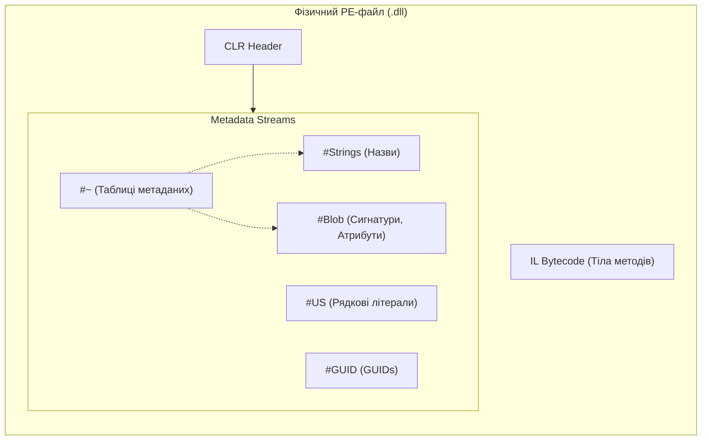

# 01. Дослідження системи типів та інспекція метаданих (CLR Type System & Metadata Internals)

Рефлексія (**Reflection**) в .NET — це фундаментальний компонент платформи, який дозволяє програмному коду під час виконання (runtime) досліджувати власні метадані, вивчати структуру компіляції, аналізувати типи, створювати нові екземпляри та викликати методи без статичного знання про них на етапі компіляції.

---

## 🔬 1. Внутрішній устрій метаданих CLR (ECMA-335 Under the Hood)

Щоб глибоко зрозуміти рефлексію, необхідно розглянути, як скомпільований код зберігається у файлі збірки (.dll / .exe) та розгортається в оперативній пам'яті середовища виконання **CoreCLR**.

### 1.1. Фізична структура метаданих у PE/COFF-файлі
Відповідно до стандарту **ECMA-335 (Common Language Infrastructure, Partition II)**, будь-яка .NET-збірка є стандартним виконуваним файлом Portable Executable (PE), в який додано спеціальну CLR-секцію (зазвичай `.text`), що містить:
1. **CLR Header**: вказівники на точку входу, ресурси та корінь сховища метаданих.
2. **Metadata Streams (Потоки метаданих)**:
   - `#~` (або `#-`): **Compressed Metadata Tables** — оптимізовані реляційні таблиці з описом типів, методів, полів, інтерфейсів та атрибутів.
   - `#Strings`: послідовність рядків із нульовим байтом-термінатором (UTF-8), що містить назви типів, методів та просторів імен.
   - `#US` (User Strings): рядкові літерали, оголошені у вихідному коді (UTF-16).
   - `#Blob`: двійкові дані довільної довжини (сигнатури методів, сигнатури полів, параметри користувацьких атрибутів за замовчуванням).
   - `#GUID`: 128-бітні глобальні унікальні ідентифікатори збірок та модулів.



### 1.2. Метадані-токени (`mdToken`)
Кожна сутність у збірці має унікальний 32-бітний числовий дескриптор — **Metadata Token** (`mdToken`). Токен складається з двох частин:
- **Старший байт (Таблиця)**: вказує тип сутності (наприклад, `0x02` — `TypeDef`, `0x01` — `TypeRef`, `0x06` — `MethodDef`, `0x04` — `FieldDef`, `0x0C` — `CustomAttribute`).
- **Молодші 3 байти (RID - Record ID)**: 1-індексований номер рядка у відповідній таблиці потоку `#~`.

Коли в C# викликається оператор `typeof(Car)`, компілятор генерує IL-інструкцію `ldtoken [Shared]Shared.Common.Car (0x02000002)`.

---

## 🧠 2. Розгортання типу в оперативній пам'яті (Memory Layout)

Коли збірка завантажується в пам'ять процесу, завантажувач класів CLR (Class Loader) розбирає таблиці метаданих і створює системні структури даних.

### 2.1. Анатомія об'єкта в керованій купі (Heap Object Anatomy)
Будь-який екземпляр посилального типу (наприклад, `new Car()`) у 64-бітній системі займає в пам'яті:

```
[Попереднє зміщення -8]  SyncBlock Index   (8 байт) -> монітори синхронізації lock, хеш-код
[Базове зміщення   0]  MethodTable Pointer (8 байт) -> ВКАЗІВНИК НА СИСТЕМНИЙ ТИП
[Зміщення +8 .. +N]    Дані полів об'єкта  (Fields Data)
```

> [!NOTE]
> Метод `obj.GetType()` працює миттєво, оскільки він просто зчитує 8-байтний вказівник на `MethodTable` за зміщенням `0` об'єкта у пам'яті та повертає обгортку `System.Type`!

### 2.2. `MethodTable` проти `EEClass`
CLR чітко розмежовує метадані на дві структури:
1. **`MethodTable` (Гарячі дані)**: структура, необхідна при кожному зверненні до об'єкта. Містить розмір об'єкта, карту інтерфейсів, GC-дескриптор та **VTable (Virtual Method Table)** — масив вказівників на скомпільований JIT-код методів.
2. **`EEClass` (Execution Engine Class — Холодні дані)**: зберігає статичні описи, необхідні переважно під час первинної JIT-компіляції та виконання рефлексії: список полів, метадані-токени, розкладку полів (field layout).

---

## 🔍 3. Три фундаментальні шляхи отримання `System.Type`

| Спосіб | Механізм CLR | Час виконання | Особливості та обмеження | Посилання на приклад |
| :--- | :--- | :--- | :--- | :---: |
| **`typeof(T)`** | Інструкція IL `ldtoken` + `Type.GetTypeFromHandle()` | Compile-time | Найшвидший, 100% типобезпечний. Дозволяє отримати відкриті дженерик-шаблони `typeof(List<>)`. | [](../01-TypeofDemo/Program.cs#L8-L23) |
| **`obj.GetType()`** | Невіртуальний виклик `call System.Object::GetType` | Runtime | Поліморфний: завжди повертає точний фактичний тип об'єкта, навіть якщо посилання збережено як `object` або інтерфейс `ICar`. Для типів значень викликає boxing! | [](../02-ObjectGetTypeDemo/Program.cs#L7-L25) |
| **`Type.GetType(string)`** | Пошук у таблицях експортованих типів завантажених збірок | Runtime | Динамічний пошук за текстовим ім'ям. Дозволяє завантажувати типи з конфігураційних файлів, JSON, бази даних. | [](../03-TypeGetTypeDemo/Program.cs#L8-L31) |

---

## 📋 4. Повний довідник властивостей та методів `System.Type`

### 4.1. Властивості ідентифікації та класифікації типу

| Властивість | Тип | Опис та внутрішня поведінка CLR | Приклад у коді |
| :--- | :---: | :--- | :---: |
| `Name` | `string` | Коротка назва типу без простору імен (наприклад, `"Car"`). | [](../04-TypePropertiesDemo/Program.cs#L18-L22) |
| `FullName` | `string?` | Повна назва з простором імен (наприклад, `"Shared.Common.Car"`). Для відкритих дженериків повертає `null`. | [](../04-TypePropertiesDemo/Program.cs#L19-L21) |
| `AssemblyQualifiedName` | `string?` | Повне унікальне ім'я типу включно з назвою збірки, версією, культурою та токеном публічного ключа. Необхідне для `Type.GetType(string)`. | [](../03-TypeGetTypeDemo/Program.cs#L13-L17) |
| `Namespace` | `string?` | Простір імен, у якому оголошено тип. | [](../04-TypePropertiesDemo/Program.cs#L18-L20) |
| `Assembly` | `Assembly` | Екземпляр збірки, в якій розміщено фізичний опис цього типу. | [](../04-TypePropertiesDemo/Program.cs#L20-L22) |
| `BaseType` | `Type?` | Безпосередній предок у ланцюжку спадкування. Для `System.Object` та інтерфейсів повертає `null`. | [](../04-TypePropertiesDemo/Program.cs#L22-L24) |
| `IsClass` | `bool` | `true`, якщо тип є посилальним класом (не інтерфейс і не структура). | [](../04-TypePropertiesDemo/Program.cs#L25-L27) |
| `IsValueType` | `bool` | `true`, якщо тип є структурою (`struct`) або перерахуванням (`enum`), похідним від `System.ValueType`. | [](../04-TypePropertiesDemo/Program.cs#L25-L27) |
| `IsInterface` | `bool` | `true`, якщо тип оголошено як контракт `interface`. | [](../04-TypePropertiesDemo/Program.cs#L25-L27) |
| `IsAbstract` | `bool` | `true`, якщо тип містить модифікатор `abstract` (включно зі статичними класами та інтерфейсами). | [](../04-TypePropertiesDemo/Program.cs#L26-L28) |
| `IsSealed` | `bool` | `true`, якщо тип заборонено для успадкування (модифікатор `sealed`). | [](../04-TypePropertiesDemo/Program.cs#L26-L28) |
| `IsGenericType` | `bool` | `true`, якщо тип має узагальнені параметри типів. | [](../12-GenericsReflectionDemo/Program.cs#L8-L18) |

### 4.2. Методи перевірки сумісності типів та інтерфейсів

| Метод | Сигнатура | Призначення та відмінності | Посилання на приклад |
| :--- | :--- | :--- | :---: |
| `IsAssignableFrom` | `bool IsAssignableFrom(Type? c)` | Перевіряє, чи можна екземпляр переданого типу `c` безпечно присвоїти змінній поточного типу. Ключовий метод для DI-контейнерів: `typeof(ICar).IsAssignableFrom(implType)`. | [](../06-GetInterfacesDemo/Program.cs#L18-L22) |
| `IsSubclassOf` | `bool IsSubclassOf(Type c)` | Перевіряє, чи є поточний тип прямим або непрямим нащадком класу `c`. **Не підтримує перевірку інтерфейсів!** | [](../02-ObjectGetTypeDemo/Program.cs#L16-L19) |
| `GetInterfaces` | `Type[] GetInterfaces()` | Повертає масив усіх інтерфейсів, які реалізує поточний тип (включно з успадкованими від предків). | [](../06-GetInterfacesDemo/Program.cs#L10-L16) |
| `GetInterfaceMap` | `InterfaceMapping GetInterfaceMap(Type iface)` | Повертає структуру `InterfaceMapping`, яка точно зв'язує кожен метод інтерфейсу з конкретним методом класу (корисно при явній реалізації інтерфейсів). | [](../06-GetInterfacesDemo/Program.cs#L24-L33) |

---

## 📦 5. Інспекція збірок: `System.Reflection.Assembly`

Клас `Assembly` є кореневою точкою входу для динамічного завантаження та вивчення компонентів.

```csharp
// 1. Отримання збірки виконуваного файлу
Assembly entryAssembly = Assembly.GetEntryAssembly()!;

// 2. Отримання збірки через довільний тип із неї
Assembly sharedAssembly = typeof(Car).Assembly;

// 3. Динамічний пошук плагінів: усі конкретні класи, що реалізують ICar
var pluginTypes = sharedAssembly.GetTypes()
    .Where(t => typeof(ICar).IsAssignableFrom(t) && !t.IsInterface && !t.IsAbstract);
```

### 5.1. Довідник методів класу `Assembly`

| Метод | Опис і застосування | Посилання на приклад |
| :--- | :--- | :---: |
| `Assembly.GetExecutingAssembly()` | Отримує збірку методу, який виконується прямо зараз. | [](../05-AssemblyDemo/Program.cs#L8-L10) |
| `Assembly.Load(AssemblyName)` | Завантажує збірку за строгим повним ім'ям через стандартний завантажувач CLR. | [](../05-AssemblyDemo/Program.cs) |
| `Assembly.LoadFrom(string path)` | Завантажує .dll з довільного шляху на файловій системі. | [](../03-TypeGetTypeDemo/Program.cs#L24-L31) |
| `assembly.GetTypes()` | Повертає абсолютно всі типи збірки (публічні, внутрішні, приватні вкладені). | [](../05-AssemblyDemo/Program.cs#L20-L25) |
| `assembly.GetExportedTypes()` | Повертає тільки відкриті (`public`) типи, доступні для зовнішніх модулів. | [](../05-AssemblyDemo/Program.cs) |
| `assembly.GetCustomAttributes()` | Повертає метадані рівня всієї збірки (наприклад, `AssemblyVersionAttribute`, `TargetFrameworkAttribute`). | [](../05-AssemblyDemo/Program.cs#L35-L40) |
