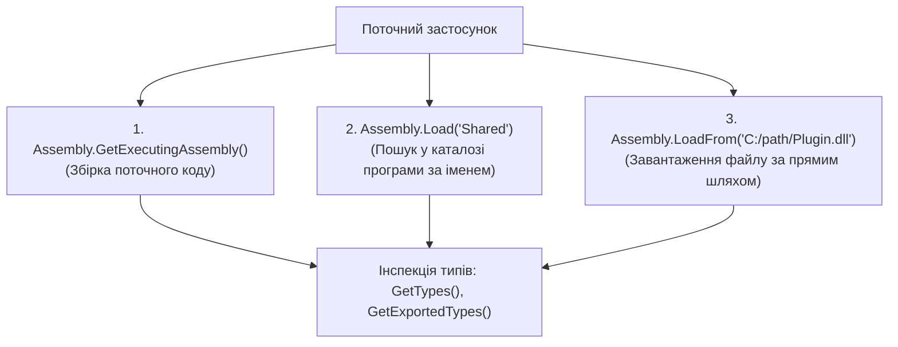

# Клас System.Reflection.Assembly: Робота зі збірками .NET

> **Простір імен**: `System.Reflection`  
> **Збірка**: `System.Private.CoreLib.dll`  
> **Офіційна документація**: [System.Reflection.Assembly Class (Microsoft Learn)](https://learn.microsoft.com/en-us/dotnet/api/system.reflection.assembly)

Клас `Assembly` представляє двійкову збірку .NET (`.dll` або `.exe`), яка є фундаментальною одиницею розгортання, версіонування, безпеки та повторного використання коду в екосистемі CLR.

---

## 1. Архітектура фізичної збірки в .NET

Збірка .NET містить:
1. **Маніфест збірки (Assembly Manifest)**: містить метадані про саму збірку (назву, версію, культуру, відкритий ключ та список залежностей від інших збірок).
2. **Таблиці метаданих типів**: описують усі класи, інтерфейси, структури, їхні методи, поля та атрибути (згідно зі стандартом ECMA-335).
3. **IL-код (Intermediate Language)**: скомпільовані інструкції, які JIT-компілятор перетворює у машинний код процесора під час виконання.
4. **Ресурси**: вбудовані файли (зображення, XML, текстові файли), що зберігаються всередині бінарника.

---

## 2. Способи завантаження та дослідження збірок

---

## 3. Властивості класу Assembly (Properties)

| Властивість | Сигнатура | Опис призначення | Статус у курсі | Посилання на приклад | Посилання на MSDN |
| :--- | :--- | :--- | :---: | :--- | :--- |
| **`FullName`** | `string? FullName { get; }` | Повне кваліфіковане ім'я збірки (Name, Version, Culture, PublicKeyToken) | Використано | [05-AssemblyDemo/Program.cs](../../05-AssemblyDemo/Program.cs#L18) | [Assembly.FullName](https://learn.microsoft.com/en-us/dotnet/api/system.reflection.assembly.fullname) |
| **`Location`** | `string Location { get; }` | Фізичний шлях до файлу збірки на диску (якщо збірка завантажена з файлу) | Використано | [05-AssemblyDemo/Program.cs](../../05-AssemblyDemo/Program.cs#L20) | [Assembly.Location](https://learn.microsoft.com/en-us/dotnet/api/system.reflection.assembly.location) |

---

## 4. Методи класу Assembly (Methods)

| Метод | Сигнатура | Опис призначення | Статус у курсі | Посилання на приклад | Посилання на MSDN |
| :--- | :--- | :--- | :---: | :--- | :--- |
| **`GetExecutingAssembly`** | `static Assembly GetExecutingAssembly()` | Повертає дескриптор збірки, в якій розміщено код методу, що виконується зараз | Використано | [05-AssemblyDemo/Program.cs](../../05-AssemblyDemo/Program.cs#L16) | [Assembly.GetExecutingAssembly](https://learn.microsoft.com/en-us/dotnet/api/system.reflection.assembly.getexecutingassembly) |
| **`Assembly.Load`** | `static Assembly Load(string assemblyString)` | Завантажує збірку в пам'ять за її коротким або повним іменем | Використано | [05-AssemblyDemo/Program.cs](../../05-AssemblyDemo/Program.cs#L26) | [Assembly.Load](https://learn.microsoft.com/en-us/dotnet/api/system.reflection.assembly.load) |
| **`Assembly.LoadFrom`** | `static Assembly LoadFrom(string assemblyFile)` | Завантажує збірку з файлу на диску за заданим шляхом | Використано | [05-AssemblyDemo/Program.cs](../../05-AssemblyDemo/Program.cs#L38) | [Assembly.LoadFrom](https://learn.microsoft.com/en-us/dotnet/api/system.reflection.assembly.loadfrom) |
| **`GetTypes`** | `Type[] GetTypes()` | Повертає масив усіх типів у збірці (включно з внутрішніми `internal` та `private`) | Використано | [05-AssemblyDemo/Program.cs](../../05-AssemblyDemo/Program.cs#L50) | [Assembly.GetTypes](https://learn.microsoft.com/en-us/dotnet/api/system.reflection.assembly.gettypes) |
| **`GetExportedTypes`** | `Type[] GetExportedTypes()` | Повертає лише відкриті публічні типи (`public`), видимі ззовні збірки | Використано | [05-AssemblyDemo/Program.cs](../../05-AssemblyDemo/Program.cs#L62) | [Assembly.GetExportedTypes](https://learn.microsoft.com/en-us/dotnet/api/system.reflection.assembly.getexportedtypes) |
| **`GetName`** | `AssemblyName GetName()` | Отримує екземпляр `AssemblyName` з повною інформацією про версію та культуру | Використано | [05-AssemblyDemo/Program.cs](../../05-AssemblyDemo/Program.cs#L74) | [Assembly.GetName](https://learn.microsoft.com/en-us/dotnet/api/system.reflection.assembly.getname) |
| **`GetType(string)`** | `Type? GetType(string name)` | Шукає тип всередині збірки за його текстовим ім'ям без завантаження зовнішніх збірок | Використано | [03-TypeGetTypeDemo/Program.cs](../../03-TypeGetTypeDemo/Program.cs#L24) | [Assembly.GetType](https://learn.microsoft.com/en-us/dotnet/api/system.reflection.assembly.gettype) |
| **`GetEntryAssembly`** | `static Assembly? GetEntryAssembly()` | Повертає виконувану збірку процесу, що містить точку входу програми (`Main`) | Загальний BCL | Довідник | [Assembly.GetEntryAssembly](https://learn.microsoft.com/en-us/dotnet/api/system.reflection.assembly.getentryassembly) |
| **`GetCallingAssembly`** | `static Assembly GetCallingAssembly()` | Повертає збірку методу, який викликав поточний метод | Загальний BCL | Довідник | [Assembly.GetCallingAssembly](https://learn.microsoft.com/en-us/dotnet/api/system.reflection.assembly.getcallingassembly) |
| **`GetManifestResourceNames`** | `string[] GetManifestResourceNames()` | Повертає імена всіх ресурсів, вбудованих у файл збірки | Загальний BCL | Довідник | [Assembly.GetManifestResourceNames](https://learn.microsoft.com/en-us/dotnet/api/system.reflection.assembly.getmanifestresourcenames) |
| **`GetManifestResourceStream`**| `Stream? GetManifestResourceStream(string name)` | Відкриває двійковий потік для читання вбудованого ресурсу з маніфесту | Загальний BCL | Довідник | [Assembly.GetManifestResourceStream](https://learn.microsoft.com/en-us/dotnet/api/system.reflection.assembly.getmanifestresourcestream) |
