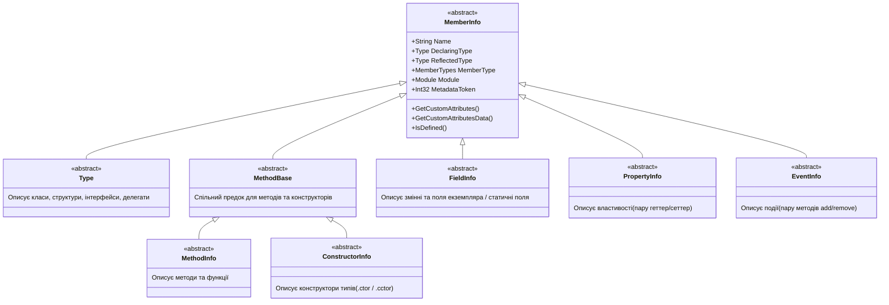

# Клас System.Reflection.MemberInfo: Базовий дескриптор членів програми

> **Простір імен**: `System.Reflection`  
> **Збірка**: `System.Private.CoreLib.dll`  
> **Базовий тип**: `System.Object`  
> **Офіційна документація**: [System.Reflection.MemberInfo Class (Microsoft Learn)](https://learn.microsoft.com/en-us/dotnet/api/system.reflection.memberinfo)

Абстрактний клас `MemberInfo` є кореневим предком для всього сімейства класів рефлексії .NET, що описують елементи коду. Оскільки він є спільним інтерфейсом, усі його властивості та методи автоматично успадковуються конкретними дескрипторами типів, методів, полів, властивостей, конструкторів та подій.

---

## 1. Сімейство похідних класів MemberInfo

`MemberInfo` інкапсулює базову інформацію про елемент програми (назву, тип оголошення, токен метаданих, атрибути). Від нього успадковано такі спеціалізовані класи:

### Спеціалізація класів-нащадків:
1. **`Type`** — описує декларацію самого типу (класу, структури, інтерфейсу, перерахування, делегата).
2. **`FieldInfo`** — описує поле екземпляра або статичне поле (`_speed`, `_logger`).
3. **`PropertyInfo`** — описує властивість (`Speed`, `LicensePlate`) як пару методів `get`/`set`.
4. **`MethodInfo`** — описує звичайний або статичний метод (`Accelerate`, `Stop`).
5. **`ConstructorInfo`** — описує конструктор для створення об'єкта (`.ctor`).
6. **`EventInfo`** — описує подію для підписки делегатів (`SpeedLimitExceeded`).

---

## 2. Відмінність між DeclaringType та ReflectedType

- **`DeclaringType` (Тип оголошення)**: тип, у вихідному коді якого фізично задекларовано цей член.
- **`ReflectedType` (Тип відбиття)**: об'єкт `Type`, через який цей член було отримано за допомогою рефлексії (наприклад, похідний клас, що успадкував метод від предка).

---

## 3. Властивості класу MemberInfo (Properties)

Нижче наведено перелік властивостей класу `MemberInfo`, які є спільними для всіх його нащадків (`Type`, `MethodInfo`, `FieldInfo` тощо):

| Властивість | Сигнатура | Опис призначення | Статус у курсі | Приклад у коді | Документація MSDN |
| :--- | :--- | :--- | :---: | :--- | :--- |
| **`Name`** | `string Name { get; }` | Текстова назва члена (назва методу, поля, властивості або типу) | Використано | [04-TypePropertiesDemo/Program.cs](../../04-TypePropertiesDemo/Program.cs#L14) | [MemberInfo.Name](https://learn.microsoft.com/en-us/dotnet/api/system.reflection.memberinfo.name) |
| **`DeclaringType`** | `Type? DeclaringType { get; }` | Клас або інтерфейс, у якому безпосередньо оголошено цей член | Використано | [06-GetInterfacesDemo/Program.cs](../../06-GetInterfacesDemo/Program.cs#L48) | [MemberInfo.DeclaringType](https://learn.microsoft.com/en-us/dotnet/api/system.reflection.memberinfo.declaringtype) |
| **`ReflectedType`** | `Type? ReflectedType { get; }` | Тип об'єкта, через який цей член було отримано при виклику рефлексії | Загальний BCL | Довідник | [MemberInfo.ReflectedType](https://learn.microsoft.com/en-us/dotnet/api/system.reflection.memberinfo.reflectedtype) |
| **`MemberType`** | `MemberTypes MemberType { get; }` | Перерахування категорії члена (`Method`, `Field`, `Property`, `Constructor`, `Event`, `TypeInfo`) | Загальний BCL | Довідник | [MemberInfo.MemberType](https://learn.microsoft.com/en-us/dotnet/api/system.reflection.memberinfo.membertype) |
| **`Module`** | `Module Module { get; }` | Модуль у файлі збірки, в якому скомпільовано цей член програми | Загальний BCL | Довідник | [MemberInfo.Module](https://learn.microsoft.com/en-us/dotnet/api/system.reflection.memberinfo.module) |
| **`MetadataToken`** | `int MetadataToken { get; }` | 32-бітний двійковий метатокен стандарту ECMA-335, що ідентифікує запис у таблиці метаданих збірки | Загальний BCL | Довідник | [MemberInfo.MetadataToken](https://learn.microsoft.com/en-us/dotnet/api/system.reflection.memberinfo.metadatatoken) |

---

## 4. Методи класу MemberInfo (Methods)

Методи класу `MemberInfo` призначені для інспекції користувацьких атрибутів, застосованих до відповідного елемента коду:

| Метод | Сигнатура | Опис призначення | Статус у курсі | Приклад у коді | Документація MSDN |
| :--- | :--- | :--- | :---: | :--- | :--- |
| **`IsDefined`** | `bool IsDefined(Type attributeType, bool inherit)` | Перевіряє, чи застосовано до даного члена атрибут вказаного типу | Загальний BCL | Довідник | [MemberInfo.IsDefined](https://learn.microsoft.com/en-us/dotnet/api/system.reflection.memberinfo.isdefined) |
| **`GetCustomAttributes`** | `object[] GetCustomAttributes(bool inherit)` | Повертає масив створених екземплярів атрибутів, застосованих до цього члена | Загальний BCL | Довідник | [MemberInfo.GetCustomAttributes](https://learn.microsoft.com/en-us/dotnet/api/system.reflection.memberinfo.getcustomattributes) |
| **`GetCustomAttributesData`** | `IList<CustomAttributeData> GetCustomAttributesData()` | Зчитує метадані атрибутів із двійкового потоку `#Blob` без створення екземплярів | Загальний BCL | Довідник | [MemberInfo.GetCustomAttributesData](https://learn.microsoft.com/en-us/dotnet/api/system.reflection.memberinfo.getcustomattributesdata) |
