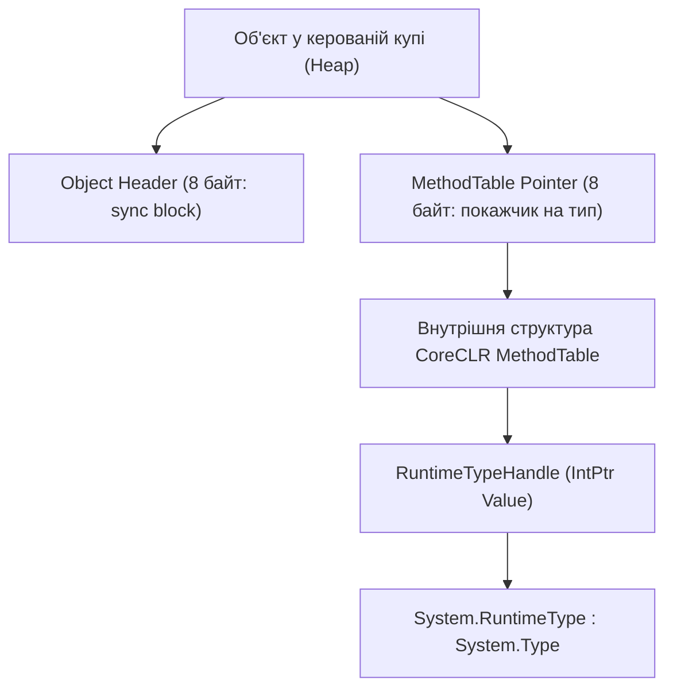

# Клас System.Type: Фундамент рефлексії .NET

> **Простір імен**: `System`  
> **Збірка**: `System.Private.CoreLib.dll` (або `mscorlib.dll`)  
> **Базовий тип**: `System.Reflection.MemberInfo`  
> **Офіційна документація**: [System.Type Class (Microsoft Learn)](https://learn.microsoft.com/en-us/dotnet/api/system.type)

Клас `System.Type` є центральним вузлом усієї моделі рефлексії платформи .NET. Він представляє декларації типів: класів, інтерфейсів, масивів, структур, перерахувань, делегатів і параметрів узагальнень.

---

## 1. Внутрішня будова та зв'язок з середовищем CoreCLR

У керованій пам'яті кожен об'єкт типу посилань містить у своєму стандартному заголовку (Object Header + MethodTable Pointer) 64-бітний покажчик на внутрішню структуру середовища виконання — **MethodTable**. 

Коли програма запитує об'єкт `System.Type`, середовище CLR створює або повертає з внутрішнього кешу спеціальний керований екземпляр класу `RuntimeType` (внутрішній спадкоємець `System.Type`), який зв'язаний із цією `MethodTable` через структуру `RuntimeTypeHandle`.

---

## 2. Три способи отримання екземпляра Type

| Спосіб | Час обчислення | Коли використовувати | Приклад у коді | Документація MSDN |
| :--- | :--- | :--- | :--- | :--- |
| **`typeof(T)`** | Етап компіляції (Compile-time) | Тип відомий заздалегідь під час написання коду. Швидко, без створення об'єкта. | [01-TypeofDemo/Program.cs](../../01-TypeofDemo/Program.cs#L14-L24) | [typeof operator](https://learn.microsoft.com/en-us/dotnet/csharp/language-reference/operators/type-testing-and-cast#typeof-operator) |
| **`obj.GetType()`** | Час виконання (Runtime) | Є готовий екземпляр об'єкта; потрібно дізнатися його фактичний поліморфний тип. | [02-ObjectGetTypeDemo/Program.cs](../../02-ObjectGetTypeDemo/Program.cs#L15-L25) | [Object.GetType](https://learn.microsoft.com/en-us/dotnet/api/system.object.gettype) |
| **`Type.GetType(string)`** | Час виконання (Runtime) | Тип невідомий під час збірки; ім'я читається з конфігураційного файлу чи мережі. | [03-TypeGetTypeDemo/Program.cs](../../03-TypeGetTypeDemo/Program.cs#L14-L28) | [Type.GetType](https://learn.microsoft.com/en-us/dotnet/api/system.type.gettype) |

---

## 3. Властивості класу System.Type (Properties)

Властивості `System.Type` дозволяють отримати характеристики типу (імена, модифікатори, структуру пам'яті):

| Властивість | Сигнатура | Опис призначення | Статус у курсі | Посилання на приклад | Посилання на MSDN |
| :--- | :--- | :--- | :---: | :--- | :--- |
| **`Name`** | `string Name { get; }` | Повертає коротке ім'я типу без простору імен (наприклад, `Car`) | Використано | [03-TypeGetTypeDemo/Program.cs](../../03-TypeGetTypeDemo/Program.cs#L45) | [Type.Name](https://learn.microsoft.com/en-us/dotnet/api/system.type.name) |
| **`FullName`** | `string? FullName { get; }` | Повне кваліфіковане ім'я включно з простором імен (наприклад, `Shared.Common.Car`) | Використано | [03-TypeGetTypeDemo/Program.cs](../../03-TypeGetTypeDemo/Program.cs#L43) | [Type.FullName](https://learn.microsoft.com/en-us/dotnet/api/system.type.fullname) |
| **`AssemblyQualifiedName`** | `string? AssemblyQualifiedName { get; }` | Повне унікальне ім'я типу з версією, культурою та токеном відкритого ключа збірки | Використано | [03-TypeGetTypeDemo/Program.cs](../../03-TypeGetTypeDemo/Program.cs#L32) | [Type.AssemblyQualifiedName](https://learn.microsoft.com/en-us/dotnet/api/system.type.assemblyqualifiedname) |
| **`Namespace`** | `string? Namespace { get; }` | Простір імен, у якому задекларовано тип | Використано | [04-TypePropertiesDemo/Program.cs](../../04-TypePropertiesDemo/Program.cs#L15) | [Type.Namespace](https://learn.microsoft.com/en-us/dotnet/api/system.type.namespace) |
| **`BaseType`** | `Type? BaseType { get; }` | Прямий базовий клас, від якого безпосередньо успадковано цей тип | Використано | [04-TypePropertiesDemo/Program.cs](../../04-TypePropertiesDemo/Program.cs#L54) | [Type.BaseType](https://learn.microsoft.com/en-us/dotnet/api/system.type.basetype) |
| **`IsClass`** | `bool IsClass { get; }` | Визначає, чи є тип посилальним класом (не структурою і не інтерфейсом) | Використано | [04-TypePropertiesDemo/Program.cs](../../04-TypePropertiesDemo/Program.cs#L18) | [Type.IsClass](https://learn.microsoft.com/en-us/dotnet/api/system.type.isclass) |
| **`IsValueType`** | `bool IsValueType { get; }` | Визначає, чи є тип типом значення (`struct` або `enum`) | Використано | [04-TypePropertiesDemo/Program.cs](../../04-TypePropertiesDemo/Program.cs#L20) | [Type.IsValueType](https://learn.microsoft.com/en-us/dotnet/api/system.type.isvaluetype) |
| **`IsInterface`** | `bool IsInterface { get; }` | Визначає, чи є тип описом інтерфейсу | Використано | [04-TypePropertiesDemo/Program.cs](../../04-TypePropertiesDemo/Program.cs#L30) | [Type.IsInterface](https://learn.microsoft.com/en-us/dotnet/api/system.type.isinterface) |
| **`IsAbstract`** | `bool IsAbstract { get; }` | Визначає, чи є тип абстрактним (не можна створити екземпляр напряму) | Використано | [04-TypePropertiesDemo/Program.cs](../../04-TypePropertiesDemo/Program.cs#L32) | [Type.IsAbstract](https://learn.microsoft.com/en-us/dotnet/api/system.type.isabstract) |
| **`IsSealed`** | `bool IsSealed { get; }` | Визначає, чи є клас запечатаним (`sealed`), тобто забороненим для спадкування | Використано | [04-TypePropertiesDemo/Program.cs](../../04-TypePropertiesDemo/Program.cs#L42) | [Type.IsSealed](https://learn.microsoft.com/en-us/dotnet/api/system.type.issealed) |
| **`IsEnum`** | `bool IsEnum { get; }` | Визначає, чи є тип перерахуванням | Використано | [04-TypePropertiesDemo/Program.cs](../../04-TypePropertiesDemo/Program.cs#L44) | [Type.IsEnum](https://learn.microsoft.com/en-us/dotnet/api/system.type.isenum) |
| **`TypeHandle`** | `RuntimeTypeHandle TypeHandle { get; }` | Отримує нативний дескриптор внутрішньої структури `MethodTable` у CLR | Використано | [01-TypeofDemo/Program.cs](../../01-TypeofDemo/Program.cs#L28) | [Type.TypeHandle](https://learn.microsoft.com/en-us/dotnet/api/system.type.typehandle) |

---

## 4. Методи класу System.Type (Methods)

Методи `System.Type` забезпечують перевірку спорідненості типів, інтерфейсних контрактів та пошук вкладених типів:

| Метод | Сигнатура | Опис призначення | Статус у курсі | Посилання на приклад | Посилання на MSDN |
| :--- | :--- | :--- | :---: | :--- | :--- |
| **`GetInterfaces`** | `Type[] GetInterfaces()` | Повертає масив усіх інтерфейсів, що реалізовані цим типом або його предками | Використано | [06-GetInterfacesDemo/Program.cs](../../06-GetInterfacesDemo/Program.cs#L16) | [Type.GetInterfaces](https://learn.microsoft.com/en-us/dotnet/api/system.type.getinterfaces) |
| **`IsAssignableFrom`** | `bool IsAssignableFrom(Type? c)` | Перевіряє, чи можна екземпляр типу `c` присвоїти змінній поточного типу | Використано | [06-GetInterfacesDemo/Program.cs](../../06-GetInterfacesDemo/Program.cs#L28) | [Type.IsAssignableFrom](https://learn.microsoft.com/en-us/dotnet/api/system.type.isassignablefrom) |
| **`GetInterfaceMap`** | `InterfaceMapping GetInterfaceMap(Type interfaceType)` | Повертає точне зіставлення методів інтерфейсу з методами даного класу | Використано | [06-GetInterfacesDemo/Program.cs](../../06-GetInterfacesDemo/Program.cs#L42) | [Type.GetInterfaceMap](https://learn.microsoft.com/en-us/dotnet/api/system.type.getinterfacemap) |
| **`IsSubclassOf`** | `bool IsSubclassOf(Type c)` | Перевіряє, чи походить поточний клас від класу `c` (ігнорує інтерфейси) | Загальний BCL | Довідник | [Type.IsSubclassOf](https://learn.microsoft.com/en-us/dotnet/api/system.type.issubclassof) |
| **`IsInstanceOfType`** | `bool IsInstanceOfType(object? o)` | Перевіряє, чи є переданий об'єкт екземпляром даного типу (аналог оператора `is`) | Загальний BCL | Довідник | [Type.IsInstanceOfType](https://learn.microsoft.com/en-us/dotnet/api/system.type.isinstanceoftype) |
| **`GetNestedTypes`** | `Type[] GetNestedTypes()` | Повертає список вкладених типів, задекларованих всередині цього типу | Загальний BCL | Довідник | [Type.GetNestedTypes](https://learn.microsoft.com/en-us/dotnet/api/system.type.getnestedtypes) |
| **`GetEnumNames`** | `string[] GetEnumNames()` | Повертає масив назв усіх констант перерахування | Загальний BCL | Довідник | [Type.GetEnumNames](https://learn.microsoft.com/en-us/dotnet/api/system.type.getenumnames) |
| **`GetEnumValues`** | `Array GetEnumValues()` | Повертає масив числових значень усіх констант перерахування | Загальний BCL | Довідник | [Type.GetEnumValues](https://learn.microsoft.com/en-us/dotnet/api/system.type.getenumvalues) |
