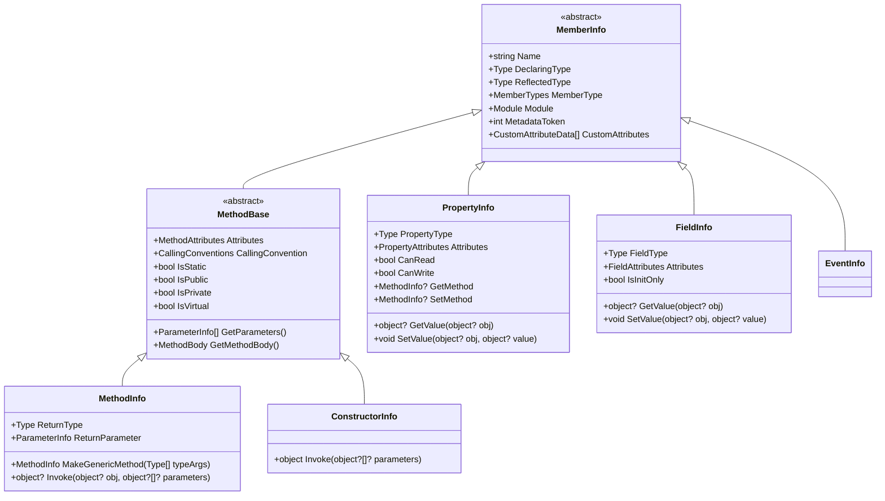
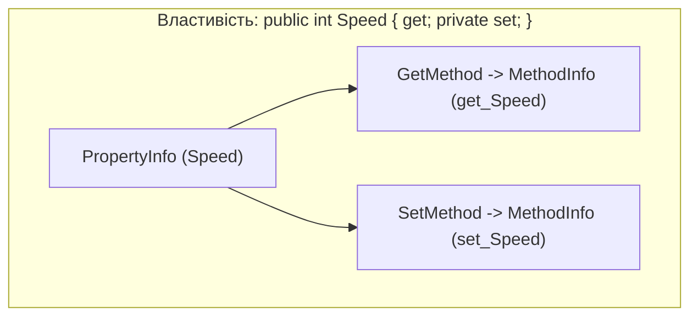

# 02. Члени типу, параметри та бітові прапорці BindingFlags (Members, BindingFlags & Encapsulation)

Будь-який тип у .NET є складеною конструкцією, що містить поля, властивості, методи, конструктори та події. Рефлексія представляє всі ці складові через ієрархію класів, що походять від спільного абстрактного предка — **`System.Reflection.MemberInfo`**.

---

## 1. Понятійний апарат: Члени типу в метаданих CLR

### 1.1. Що таке `MemberInfo`?
**`MemberInfo`** — це базовий абстрактний клас бібліотеки базових типів (BCL), що надає узагальнений поліморфний інтерфейс до будь-якого члена типу, задекларованого у збірці.

- **Звідки береться `MemberInfo`?** Кожен об'єкт нащадка `MemberInfo` (`MethodInfo`, `FieldInfo`, `PropertyInfo`) є керованою обгорткою над конкретним рядком у таблицях метаданих збірки (`MethodDef` таблиця `0x06`, `FieldDef` таблиця `0x04`, `Property` таблиця `0x17`, `Event` таблиця `0x14`).
- **Навіщо потрібен?** Дозволяє уніфіковано читати загальні атрибути члена: назву (`Name`), тип, де його оголошено (`DeclaringType`), тип, через який до нього звернулися (`ReflectedType`), токен метаданих (`MetadataToken`) та колекцію атрибутів (`CustomAttributes`).

### 1.2. Ієрархія класів `MemberInfo`



---

## 2. Бітова алгебра `System.Reflection.BindingFlags`

Методи пошуку членів (`GetMembers`, `GetMethod`, `GetProperty`, `GetField`, `GetConstructor`) приймають параметром перерахування `BindingFlags`.

### 2.1. Що таке `BindingFlags`?
**`BindingFlags`** — це перерахування, позначене атрибутом `[Flags]`, у якому кожному прапорцю відповідає окремий біт 32-бітного цілого числа. Значення комбінуються за допомогою побітового АБО (`|`), а механізм зв'язування CLR (Default Binder) перевіряє відповідність через побітове І (`&`).

### 2.2. Чому стандартний пошук повертає `null`?
Якщо викликати метод без передачі прапорців, наприклад `type.GetMethod("MyMethod")`, CLR застосовує стандартну внутрішню маску пошуку:
$$\text{DefaultMask} = \text{BindingFlags.Public} \mid \text{BindingFlags.Instance} \mid \text{BindingFlags.Static}$$

Якщо шуканий метод або поле має модифікатор доступу `private`, `protected` або `internal`, пошук **завжди поверне `null`**, оскільки прапорець `BindingFlags.NonPublic` не був переданий!

### 2.3. Золоте правило BindingFlags
> [!IMPORTANT]
> Для успішного пошуку члена типу необхідно завжди комбінувати **щонайменше один прапорець видимості** (`Public` або `NonPublic`) та **щонайменше один прапорець контексту** (`Instance` або `Static`). Без цієї комбінації пошуковий фільтр CLR буде несумісним із жодним членом.

```csharp
// Пошук приватного поля екземпляра:
FieldInfo? field = type.GetField("_speed", BindingFlags.NonPublic | BindingFlags.Instance);

// Пошук публічного статичного методу:
MethodInfo? method = type.GetMethod("CalculateTax", BindingFlags.Public | BindingFlags.Static);
```

### 2.4. Реєстр та семантика прапорців `BindingFlags`

| Прапорець | Бітове значення | Призначення та поведінка |
| :--- | :---: | :--- |
| `BindingFlags.Public` | `0x10` | Включає у вибірку відкриті члени з модифікатором `public`. |
| `BindingFlags.NonPublic` | `0x20` | Включає закриті члени (`private`, `protected`, `internal`, `private protected`). |
| `BindingFlags.Instance` | `0x04` | Включає члени екземпляра (потребують створеного об'єкта для читання чи виклику). |
| `BindingFlags.Static` | `0x08` | Включає статичні члени класу (не прив'язані до конкретного екземпляра). |
| `BindingFlags.DeclaredOnly` | `0x02` | **Обмежує пошук лише поточним типом.** Відкидає всі члени, успадковані від предків у ланцюжку спадкування (наприклад, методи `ToString()`, `GetHashCode()`). |
| `BindingFlags.FlattenHierarchy` | `0x40` | Включає статичні члени по всьому дереву успадкування вгору (за замовчуванням успадковані статичні члени не повертаються). |
| `BindingFlags.IgnoreCase` | `0x01` | Ігнорує регістр символів під час пошуку за іменем (наприклад, рядок `"speed"` знайде поле `Speed`). |

---

## 3. Дослідження та модифікація полів: `FieldInfo`

Поле — це безпосередня комірка пам'яті всередині об'єкта або глобальної пам'яті класу.

```csharp
// Зчитування приватного поля екземпляра
FieldInfo speedField = typeof(Car).GetField("_currentSpeed", BindingFlags.NonPublic | BindingFlags.Instance)!;
int currentSpeed = (int)speedField.GetValue(myCar)!;

// Примусовий запис значення в приватне поле (порушення інкапсуляції)
speedField.SetValue(myCar, 120);
```

### 3.1. Ключові властивості та методи `FieldInfo`

| Член | Тип | Призначення | Посилання на приклад |
| :--- | :---: | :--- | :--- |
| `FieldType` | `Type` | Тип даних, що зберігається в полі (наприклад, `typeof(int)`). | [07-GetFieldsPropertiesDemo/Program.cs](../07-GetFieldsPropertiesDemo/Program.cs#L14-L24) |
| `IsInitOnly` | `bool` | `true`, якщо поле позначено модифікатором `readonly`. | [07-GetFieldsPropertiesDemo/Program.cs](../07-GetFieldsPropertiesDemo/Program.cs#L22-L26) |
| `IsLiteral` | `bool` | `true`, якщо поле є константою `const` (значення вшито у метадані збірки). | [07-GetFieldsPropertiesDemo/Program.cs](../07-GetFieldsPropertiesDemo/Program.cs#L22-L26) |
| `IsStatic` | `bool` | `true`, якщо поле статичне. | [07-GetFieldsPropertiesDemo/Program.cs](../07-GetFieldsPropertiesDemo/Program.cs#L20-L24) |
| `GetValue(object? obj)` | `object?` | Читає значення поля. Для статичних полів аргумент `obj` передається як `null`. | [07-GetFieldsPropertiesDemo/Program.cs](../07-GetFieldsPropertiesDemo/Program.cs#L35-L45) |
| `SetValue(object? obj, object? val)` | `void` | Записує нове значення в поле об'єкта. | [07-GetFieldsPropertiesDemo/Program.cs](../07-GetFieldsPropertiesDemo/Program.cs#L46-L55) |

---

## 4. Дослідження властивостей: `PropertyInfo`

Властивість у C# — це синтаксичний цукор над одним або двома методами-аксесорами (`get_PropertyName()` та `set_PropertyName()`).



### 4.1. Ключові члени `PropertyInfo`

| Член | Тип | Опис поведінки | Посилання на приклад |
| :--- | :---: | :--- | :--- |
| `PropertyType` | `Type` | Тип значення властивості. | [07-GetFieldsPropertiesDemo/Program.cs](../07-GetFieldsPropertiesDemo/Program.cs#L28-L35) |
| `CanRead` / `CanWrite` | `bool` | Наявність гетера та сетера відповідно. | [07-GetFieldsPropertiesDemo/Program.cs](../07-GetFieldsPropertiesDemo/Program.cs#L30-L33) |
| `GetMethod` / `SetMethod` | `MethodInfo?` | Прямий доступ до методів гетера та сетера (можуть бути закритими `private`). | [07-GetFieldsPropertiesDemo/Program.cs](../07-GetFieldsPropertiesDemo/Program.cs#L32-L35) |
| `GetValue(object? obj)` | `object?` | Викликає `GetMethod` на переданому екземплярі та повертає результат. | [07-GetFieldsPropertiesDemo/Program.cs](../07-GetFieldsPropertiesDemo/Program.cs#L38-L45) |
| `SetValue(object? obj, object? val)` | `void` | Викликає `SetMethod` на переданому екземплярі для запису значення. | [07-GetFieldsPropertiesDemo/Program.cs](../07-GetFieldsPropertiesDemo/Program.cs#L46-L55) |

---

## 5. Дослідження та динамічний виклик методів: `MethodInfo`

Метод представляє виконуваний блок коду в збірці.

```csharp
MethodInfo accelerateMethod = typeof(Car).GetMethod(
    "Accelerate", 
    BindingFlags.Public | BindingFlags.Instance, 
    new Type[] { typeof(int) })!;

// Динамічний виклик методу на об'єкті:
accelerateMethod.Invoke(myCar, new object[] { 50 });
```

### 5.1. Довідник членів `MethodInfo`

| Член | Опис і застосування | Посилання на приклад |
| :--- | :--- | :--- |
| `ReturnType` | Тип значення, що повертає метод (для `void` повертає `typeof(void)`). | [08-GetMethodsDemo/Program.cs](../08-GetMethodsDemo/Program.cs#L15-L20) |
| `GetParameters()` | Повертає масив описів параметрів методу `ParameterInfo[]`. | [08-GetMethodsDemo/Program.cs](../08-GetMethodsDemo/Program.cs#L25-L35) |
| `IsGenericMethod` | Визначає, чи метод є узагальненим шаблоном (`T Method<T>()`). | [12-GenericsReflectionDemo/Program.cs](../12-GenericsReflectionDemo/Program.cs#L30-L35) |
| `MakeGenericMethod(Type[])` | Закриває відкритий узагальнений метод конкретними типами аргументів. | [12-GenericsReflectionDemo/Program.cs](../12-GenericsReflectionDemo/Program.cs#L35-L42) |
| `Invoke(object?, object?[]?)` | Здійснює динамічний виклик методу з передачею аргументів. | [08-GetMethodsDemo/Program.cs](../08-GetMethodsDemo/Program.cs#L45-L55) |

---

## 6. Інспекція параметрів: `ParameterInfo`

Клас `ParameterInfo` описує окремий аргумент у сигнатурі методу чи конструктора. Це ключовий компонент для побудови Dependency Injection контейнерів.

### 6.1. Ключові властивості `ParameterInfo`

| Властивість | Тип | Семантичне значення | Посилання на приклад |
| :--- | :---: | :--- | :--- |
| `ParameterType` | `Type` | Тип аргументу. Для `ref`/`out` параметрів повертає `ByRef` тип (`int&`). | [09-GetParameterInfoDemo/Program.cs](../09-GetParameterInfoDemo/Program.cs#L15-L25) |
| `Name` | `string?` | Назва параметра у вихідному коді C#. | [09-GetParameterInfoDemo/Program.cs](../09-GetParameterInfoDemo/Program.cs#L16-L20) |
| `Position` | `int` | Нульовий індекс параметра у списку аргументів. | [09-GetParameterInfoDemo/Program.cs](../09-GetParameterInfoDemo/Program.cs#L18-L22) |
| `IsIn` / `IsOut` | `bool` | Прапорці модифікаторів `in` та `out`. | [09-GetParameterInfoDemo/Program.cs](../09-GetParameterInfoDemo/Program.cs#L25-L30) |
| `HasDefaultValue` | `bool` | `true`, якщо параметр є необов'язковим (має значення за замовчуванням). | [09-GetParameterInfoDemo/Program.cs](../09-GetParameterInfoDemo/Program.cs#L32-L38) |
| `DefaultValue` | `object?` | Конкретне константне значення за замовчуванням із таблиці метаданих `Constant`. | [09-GetParameterInfoDemo/Program.cs](../09-GetParameterInfoDemo/Program.cs#L35-L40) |

---

## 7. Конструктори та інстанціювання: `ConstructorInfo`

`ConstructorInfo` є похідним від `MethodBase` і представляє спеціальний службовий метод `.ctor` (конструктор екземпляра) або `.cctor` (статичний конструктор типу).

```csharp
// Пошук конструктора, що приймає string та int:
ConstructorInfo ctor = typeof(Car).GetConstructor(new Type[] { typeof(string), typeof(int) })!;

// Створення об'єкта через виклик конструктора:
Car car = (Car)ctor.Invoke(new object[] { "Tesla Model S", 2024 });
```

- Посилання на приклад роботи з конструкторами: [10-GetConstructorInfoDemo/Program.cs](../10-GetConstructorInfoDemo/Program.cs#L12-L35).
- Посилання на використання конструкторів у DI-контейнері: [19-DependencyInjection/Container.cs](../19-DependencyInjection/Container.cs#L220-L260).

---

## 8. Дослідження та динамічна підписка на події: `EventInfo`

Подія в C# — це синтаксичний механізм реалізації патерну «Видавець-Підписник» (Publisher-Subscriber), побудований поверх делегатів.

### 8.1. Що таке `EventInfo` в метаданих CLR?
**`EventInfo`** — це клас рефлексії, що представляє рядок таблиці метаданих `Event` (`0x14`). Подія в метаданих CLR не є фізичним сховищем даних. Вона є декларативною сутністю, яка пов'язує:
1. Тип делегата (`EventHandlerType`).
2. Метод підписки (`AddMethod`, у коді C# генерується як `add_EventName(Delegate handler)`).
3. Метод відписки (`RemoveMethod`, генерується як `remove_EventName(Delegate handler)`).
4. Опціональний метод генерації (`RaiseMethod`, генерується в окремих мовах CTS як `raise_EventName(...)`).

### 8.2. Динамічне зв'язування подій у рантаймі
Коли типи підписника та видавця завантажуються динамічно (наприклад, у плагінній системі), розробник не може написати `publisher.OnAlert += handler`. Натомість використовується `EventInfo`:

```csharp
// 1. Отримання EventInfo за іменем:
EventInfo eventInfo = typeof(Car).GetEvent("SpeedLimitExceeded", BindingFlags.Public | BindingFlags.Instance)!;

// 2. Створення сумісного делегата під час виконання:
MethodInfo handlerMethod = typeof(MonitoringService).GetMethod("OnSpeedAlert", BindingFlags.Public | BindingFlags.Instance)!;
Delegate handlerDelegate = Delegate.CreateDelegate(eventInfo.EventHandlerType!, monitoringService, handlerMethod);

// 3. Динамічна підписка через метод AddEventHandler:
eventInfo.AddEventHandler(myCar, handlerDelegate);

// 4. Динамічна відписка після завершення роботи:
eventInfo.RemoveEventHandler(myCar, handlerDelegate);
```

### 8.3. Ключові члени `EventInfo`

| Член | Тип | Призначення та семантика | Посилання на приклад |
| :--- | :---: | :--- | :--- |
| `EventHandlerType` | `Type?` | Тип делегата, що визначає сигнатуру підписника події (наприклад, `typeof(EventHandler<SpeedLimitEventArgs>)`). | [11-GetEventsDemo/Program.cs](../11-GetEventsDemo/Program.cs#L20-L25) |
| `IsMulticast` | `bool` | `true`, якщо делегат події є багатоадресним (`System.MulticastDelegate`). У C# практично всі події є багатоадресними. | [11-GetEventsDemo/Program.cs](../11-GetEventsDemo/Program.cs#L22-L26) |
| `AddMethod` | `MethodInfo?` | Пряме посилання на службовий метод додавання обробника `add_EventName`. | [11-GetEventsDemo/Program.cs](../11-GetEventsDemo/Program.cs#L26-L30) |
| `RemoveMethod` | `MethodInfo?` | Пряме посилання на службовий метод видалення обробника `remove_EventName`. | [11-GetEventsDemo/Program.cs](../11-GetEventsDemo/Program.cs#L28-L32) |
| `AddEventHandler(object?, Delegate?)` | `void` | Реєструє екземпляр делегата в списку виклику події цільового об'єкта. | [11-GetEventsDemo/Program.cs](../11-GetEventsDemo/Program.cs#L45-L55) |
| `RemoveEventHandler(object?, Delegate?)` | `void` | Вилучає екземпляр делегата зі списку виклику події цільового об'єкта. | [11-GetEventsDemo/Program.cs](../11-GetEventsDemo/Program.cs#L58-L68) |
