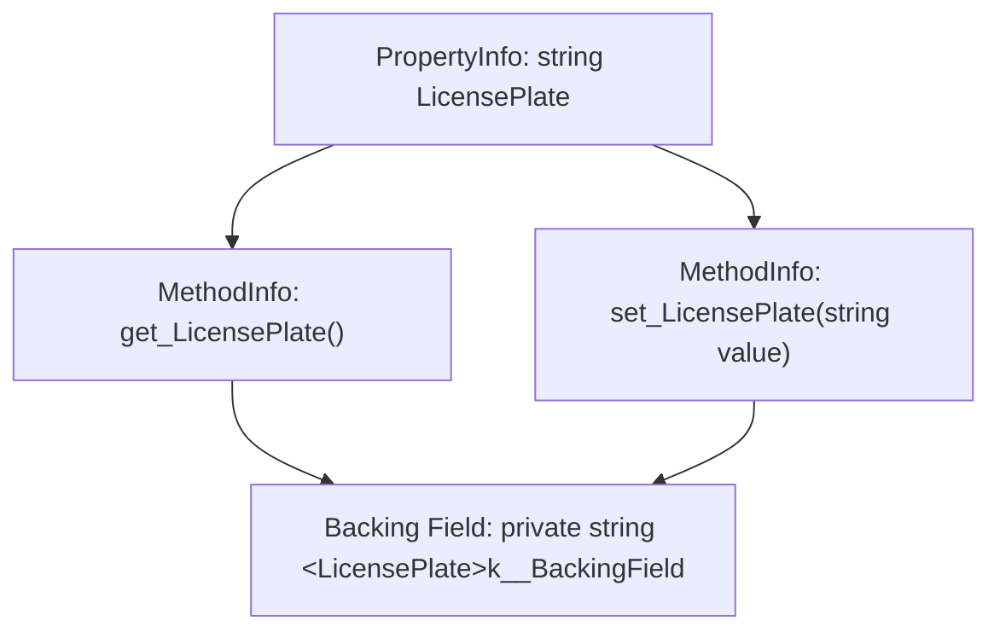

# Клас System.Reflection.PropertyInfo: Дослідження властивостей

> **Простір імен**: `System.Reflection`  
> **Збірка**: `System.Private.CoreLib.dll`  
> **Базовий тип**: `System.Reflection.MemberInfo`  
> **Офіційна документація**: [PropertyInfo Class (Microsoft Learn)](https://learn.microsoft.com/en-us/dotnet/api/system.reflection.propertyinfo)

Клас `PropertyInfo` представляє метадані властивості в .NET. У платформі CLR властивість не є окремою коміркою пам'яті, а абстракцією над парою спеціальних методів доступу — геттером (`get_PropertyName`) та сеттером (`set_PropertyName`). Вона успадковує `MemberInfo` та надає спеціалізовані методи інспекції цих методів доступу.

---

## 1. Внутрішня структура властивості в CLR

---

## 2. Властивості класу PropertyInfo (Properties)

| Властивість | Сигнатура | Опис призначення | Статус у курсі | Приклад у коді | Документація MSDN |
| :--- | :--- | :--- | :---: | :--- | :--- |
| **`PropertyType`** | `Type PropertyType { get; }` | Тип значення, що повертає або приймає властивість | Використано | [07-GetFieldsPropertiesDemo/Program.cs](../../07-GetFieldsPropertiesDemo/Program.cs#L64) | [PropertyInfo.PropertyType](https://learn.microsoft.com/en-us/dotnet/api/system.reflection.propertyinfo.propertytype) |
| **`CanRead`** | `bool CanRead { get; }` | Визначає, чи доступна властивість для читання (наявність аксесора `get`) | Використано | [07-GetFieldsPropertiesDemo/Program.cs](../../07-GetFieldsPropertiesDemo/Program.cs#L66) | [PropertyInfo.CanRead](https://learn.microsoft.com/en-us/dotnet/api/system.reflection.propertyinfo.canread) |
| **`CanWrite`** | `bool CanWrite { get; }` | Визначає, чи доступна властивість для запису (наявність аксесора `set` або `init`) | Використано | [07-GetFieldsPropertiesDemo/Program.cs](../../07-GetFieldsPropertiesDemo/Program.cs#L68) | [PropertyInfo.CanWrite](https://learn.microsoft.com/en-us/dotnet/api/system.reflection.propertyinfo.canwrite) |

---

## 3. Методи класу PropertyInfo (Methods)

| Метод | Сигнатура | Опис призначення | Статус у курсі | Приклад у коді | Документація MSDN |
| :--- | :--- | :--- | :---: | :--- | :--- |
| **`GetValue`** | `object? GetValue(object? obj)` | Викликає `get`-аксесор та повертає поточне значення властивості | Використано | [07-GetFieldsPropertiesDemo/Program.cs](../../07-GetFieldsPropertiesDemo/Program.cs#L70) | [PropertyInfo.GetValue](https://learn.microsoft.com/en-us/dotnet/api/system.reflection.propertyinfo.getvalue) |
| **`SetValue`** | `void SetValue(object? obj, object? value)` | Викликає `set`-аксесор та записує нове значення властивості | Використано | [07-GetFieldsPropertiesDemo/Program.cs](../../07-GetFieldsPropertiesDemo/Program.cs#L76) | [PropertyInfo.SetValue](https://learn.microsoft.com/en-us/dotnet/api/system.reflection.propertyinfo.setvalue) |
| **`GetGetMethod`** | `MethodInfo? GetGetMethod(bool nonPublic)` | Отримує дескриптор `MethodInfo` для методу читання геттера | Загальний BCL | Довідник | [PropertyInfo.GetGetMethod](https://learn.microsoft.com/en-us/dotnet/api/system.reflection.propertyinfo.getgetmethod) |
| **`GetSetMethod`** | `MethodInfo? GetSetMethod(bool nonPublic)` | Отримує дескриптор `MethodInfo` для методу запису сеттера | Загальний BCL | Довідник | [PropertyInfo.GetSetMethod](https://learn.microsoft.com/en-us/dotnet/api/system.reflection.propertyinfo.getsetmethod) |
| **`GetIndexParameters`**| `ParameterInfo[] GetIndexParameters()`| Повертає параметри індексатора, якщо властивість є індексатором (`this[int key]`) | Загальний BCL | Довідник | [PropertyInfo.GetIndexParameters](https://learn.microsoft.com/en-us/dotnet/api/system.reflection.propertyinfo.getindexparameters) |
