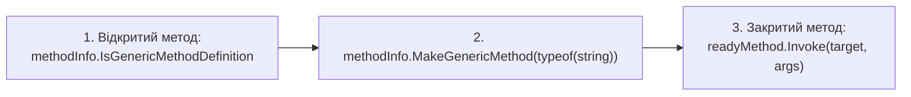

# Рефлексія узагальнених методів (Generic Methods Reflection)

> **Ключовий клас**: `System.Reflection.MethodInfo`  
> **Офіційна документація**: [How to: Examine and Instantiate Generic Methods with Reflection](https://learn.microsoft.com/en-us/dotnet/framework/reflection-and-codedom/how-to-examine-and-instantiate-generic-methods-with-reflection)

Узагальнені методи містять власні параметри типізації, незалежні від класу, в якому вони оголошені. Для їхнього динамічного виклику через рефлексію необхідно спочатку закрити тип через `MakeGenericMethod`.

---

## 1. Схема конструювання узагальненого методу

---

## 2. Властивості методу для узагальнень (Generic Properties)

| Властивість | Сигнатура | Опис призначення | Статус у курсі | Приклад у коді | Документація MSDN |
| :--- | :--- | :--- | :---: | :--- | :--- |
| **`IsGenericMethod`** | `bool IsGenericMethod { get; }` | Визначає, чи є метод узагальненим | Використано | [12-GenericsReflectionDemo/Program.cs](../../12-GenericsReflectionDemo/Program.cs#L48) | [MethodBase.IsGenericMethod](https://learn.microsoft.com/en-us/dotnet/api/system.reflection.methodbase.isgenericmethod) |
| **`IsGenericMethodDefinition`** | `bool IsGenericMethodDefinition { get; }` | Визначає, чи є метод відкритим визначенням (шаблоном без підставлених типів) | Використано | [12-GenericsReflectionDemo/Program.cs](../../12-GenericsReflectionDemo/Program.cs#L50) | [MethodBase.IsGenericMethodDefinition](https://learn.microsoft.com/en-us/dotnet/api/system.reflection.methodbase.isgenericmethoddefinition) |
| **`ContainsGenericParameters`** | `bool ContainsGenericParameters { get; }` | Визначає, чи залишилися незакриті параметри типізації в сигнатурі методу | Загальний BCL | Довідник | [MethodBase.ContainsGenericParameters](https://learn.microsoft.com/en-us/dotnet/api/system.reflection.methodbase.containsgenericparameters) |

---

## 3. Методи методу для узагальнень (Generic Methods)

| Метод | Сигнатура | Опис призначення | Статус у курсі | Приклад у коді | Документація MSDN |
| :--- | :--- | :--- | :---: | :--- | :--- |
| **`GetGenericArguments`** | `Type[] GetGenericArguments()` | Повертає масив параметрів типізації узагальненого методу | Використано | [12-GenericsReflectionDemo/Program.cs](../../12-GenericsReflectionDemo/Program.cs#L52) | [MethodInfo.GetGenericArguments](https://learn.microsoft.com/en-us/dotnet/api/system.reflection.methodinfo.getgenericarguments) |
| **`MakeGenericMethod`** | `MethodInfo MakeGenericMethod(params Type[] typeArguments)` | Підставляє конкретні типи замість параметрів узагальнення і повертає готовий до виклику `MethodInfo` | Використано | [12-GenericsReflectionDemo/Program.cs](../../12-GenericsReflectionDemo/Program.cs#L58) | [MethodInfo.MakeGenericMethod](https://learn.microsoft.com/en-us/dotnet/api/system.reflection.methodinfo.makegenericmethod) |
| **`GetGenericMethodDefinition`** | `MethodInfo GetGenericMethodDefinition()` | Повертає вихідне відкрите визначення з раніше сконструйованого методу | Загальний BCL | Довідник | [MethodInfo.GetGenericMethodDefinition](https://learn.microsoft.com/en-us/dotnet/api/system.reflection.methodinfo.getgenericmethoddefinition) |
