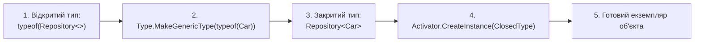

# Рефлексія узагальнених типів (Generic Types Reflection)

> **Ключовий клас**: `System.Type`  
> **Офіційна документація**: [Generics and Reflection (.NET Guide)](https://learn.microsoft.com/en-us/dotnet/framework/reflection-and-codedom/how-to-examine-and-instantiate-generic-types-with-reflection)

Рефлексія узагальнених типів дозволяє аналізувати шаблони класів (`Open Generics`), динамічно закривати їх конкретними типами аргументів у рантаймі та перевіряти обмеження (`Generic Constraints`) і варіантність (`Variance`).

---

## 1. Схема роботи з відкритими та закритими типами

---

## 2. Властивості типу для узагальнень (Generic Properties)

| Властивість | Сигнатура | Опис призначення | Статус у курсі | Приклад у коді | Документація MSDN |
| :--- | :--- | :--- | :---: | :--- | :--- |
| **`IsGenericType`** | `bool IsGenericType { get; }` | Визначає, чи є тип узагальненим | Використано | [12-GenericsReflectionDemo/Program.cs](../../12-GenericsReflectionDemo/Program.cs#L14) | [Type.IsGenericType](https://learn.microsoft.com/en-us/dotnet/api/system.type.isgenerictype) |
| **`IsGenericTypeDefinition`** | `bool IsGenericTypeDefinition { get; }` | Визначає, чи є тип відкритим шаблоном (наприклад, `IRepository<>`) | Використано | [12-GenericsReflectionDemo/Program.cs](../../12-GenericsReflectionDemo/Program.cs#L16) | [Type.IsGenericTypeDefinition](https://learn.microsoft.com/en-us/dotnet/api/system.type.isgenerictypedefinition) |
| **`ContainsGenericParameters`** | `bool ContainsGenericParameters { get; }` | Визначає, чи залишаються в типі або його членах незакриті параметри узагальнення | Використано | [13.2-VarianceReflectionInspectionDemo/Program.cs](../../13.2-VarianceReflectionInspectionDemo/Program.cs#L95) | [Type.ContainsGenericParameters](https://learn.microsoft.com/en-us/dotnet/api/system.type.containsgenericparameters) |
| **`GenericParameterAttributes`** | `GenericParameterAttributes GenericParameterAttributes { get; }` | Прапорці коваріантності (`Covariant`), контраваріантності (`Contravariant`) та обмежень (`ReferenceTypeConstraint`, `DefaultConstructorConstraint`) | Використано | [13.2-VarianceReflectionInspectionDemo/Program.cs](../../13.2-VarianceReflectionInspectionDemo/Program.cs#L101) | [Type.GenericParameterAttributes](https://learn.microsoft.com/en-us/dotnet/api/system.type.genericparameterattributes) |

---

## 3. Методи типу для узагальнень (Generic Methods of Type)

| Метод | Сигнатура | Опис призначення | Статус у курсі | Приклад у коді | Документація MSDN |
| :--- | :--- | :--- | :---: | :--- | :--- |
| **`GetGenericTypeDefinition`** | `Type GetGenericTypeDefinition()` | Повертає дескриптор відкритого типу з закритого типу | Використано | [12-GenericsReflectionDemo/Program.cs](../../12-GenericsReflectionDemo/Program.cs#L22) | [Type.GetGenericTypeDefinition](https://learn.microsoft.com/en-us/dotnet/api/system.type.getgenerictypedefinition) |
| **`GetGenericArguments`** | `Type[] GetGenericArguments()` | Повертає масив типів-аргументів (для закритих типів) або параметрів типізації (для відкритих типів) | Використано | [12-GenericsReflectionDemo/Program.cs](../../12-GenericsReflectionDemo/Program.cs#L28) | [Type.GetGenericArguments](https://learn.microsoft.com/en-us/dotnet/api/system.type.getgenericarguments) |
| **`MakeGenericType`** | `Type MakeGenericType(params Type[] typeArguments)` | Підставляє масив типів замість параметрів типізації та конструює закритий тип | Використано | [12-GenericsReflectionDemo/Program.cs](../../12-GenericsReflectionDemo/Program.cs#L36) | [Type.MakeGenericType](https://learn.microsoft.com/en-us/dotnet/api/system.type.makegenerictype) |
| **`GetGenericParameterConstraints`** | `Type[] GetGenericParameterConstraints()` | Повертає масив обмежень на тип для даного параметра узагальнення | Використано | [13.2-VarianceReflectionInspectionDemo/Program.cs](../../13.2-VarianceReflectionInspectionDemo/Program.cs#L125) | [Type.GetGenericParameterConstraints](https://learn.microsoft.com/en-us/dotnet/api/system.type.getgenericparameterconstraints) |
| **`IsAssignableFrom`** | `bool IsAssignableFrom(Type? c)` | Перевіряє сумісність екземплярів типів з урахуванням коваріантності (`out`) та контраваріантності (`in`) | Використано | [13.2-VarianceReflectionInspectionDemo/Program.cs](../../13.2-VarianceReflectionInspectionDemo/Program.cs#L137) | [Type.IsAssignableFrom](https://learn.microsoft.com/en-us/dotnet/api/system.type.isassignablefrom) |
