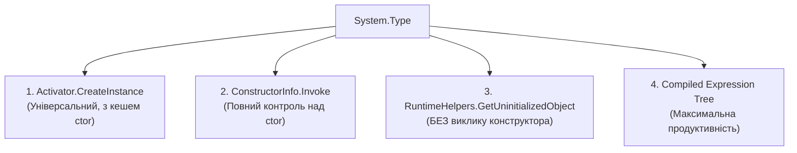

# 03. Пізнє зв'язування, динамічна активація та дженерики (Late Binding & Generics Reflection)

**Пізнє зв'язування (Late Binding)** — це архітектурний підхід, за якого типи, інтерфейси, методи та властивості визначаються й зв'язуються безпосередньо під час виконання програми (runtime), а не на етапі компіляції (compile-time).

---

## ⚡ 1. Раннє (Early) проти Пізнього (Late) зв'язування

| Критерій | Раннє зв'язування (Early Binding) | Пізнє зв'язування (Late Binding) |
| :--- | :--- | :--- |
| **Визначення адреси коду** | На етапі компіляції або JIT-компіляції | Під час виконання програми через пошук у метаданих |
| **Перевірка типів** | Строга компіляційна (Compile-time Type Safety) | Відкладена до моменту виклику (Runtime Type Checking) |
| **Швидкодія** | Прямий виклик через вказівник або фіксований VTable offset | Пошук рядків/токенів, перевірка аргументів, виклик через службовий стаб |
| **Гнучкість** | Жорстка прив'язка до інтерфейсу/класу | Можливість завантажувати сторонні плагіни, модулі, сценарії |

---

## 🚀 2. Чотири способи створення об'єктів у рантаймі

.NET надає кілька механізмів динамічного створення екземплярів для різних сценаріїв:



### 2.1. Порівняння фабричних механізмів

| Механізм | Поведінка | Коли використовувати |
| :--- | :--- | :--- |
| **`Activator.CreateInstance(Type)`** | Шукає конструктор, валідує аргументи та створює об'єкт. Кешує внутрішній ctor-stub. | Стандартний вибір для простого створення об'єктів. |
| **`ConstructorInfo.Invoke(object[])`** | Дозволяє явно обрати приватний, захищений або специфічний конструктор. | Створення власних IoC/DI контейнерів. |
| **`RuntimeHelpers.GetUninitializedObject(Type)`** | **Створює об'єкт у купі БЕЗ виклику будь-якого конструктора!** Виділяє пам'ять та занулює поля. | Рушії бінарної десеріалізації (ORM, Protobuf, JSON), де конструктор не повинен перезаписувати дані. |
| **Compiled Expression Tree** | Компілює вираз `Expression.New(ctor)` у машинний код через `DynamicMethod`. | Високонавантажені фабрики, де потрібна швидкість прямого `new T()`. |

🔗 Переглянути демонстрацію створення об'єктів можна в [11-LateBindingDemo/Program.cs](../11-LateBindingDemo/Program.cs#L14-L23).

---

## 🛡️ 3. Анатомія винятку `TargetInvocationException`

Коли метод, викликаний через `MethodInfo.Invoke` або `ConstructorInfo.Invoke`, викидає виняток усередині свого коду, CLR **не прокидає оригінальний виняток напряму**. Вона пакує його у спеціальну обгортку:

$$\text{TargetInvocationException} \longrightarrow \text{InnerException (Реальний бізнес-виняток)}$$

### 3.1. Правильне перехоплення та повторний викид (Rethrowing without losing stack trace)
Якщо вам потрібно перекинути виняток далі так, ніби він виник у клієнтському коді, використовуйте `ExceptionDispatchInfo`:

```csharp
try
{
    method.Invoke(instance, args);
}
catch (TargetInvocationException ex) when (ex.InnerException != null)
{
    // Зберігає оригінальний стек викликів бізнес-логіки:
    System.Runtime.ExceptionServices.ExceptionDispatchInfo.Capture(ex.InnerException).Throw();
}
```

🔗 Переглянути обробку винятків пізнього зв'язування можна в [11-LateBindingDemo/Program.cs](../11-LateBindingDemo/Program.cs#L37-L49).

---

## 🧬 4. Внутрішній устрій рефлексії дженериків (Generics Internals)

У середовищі CLR дженерики — це повноцінні рантайм-сутності першого класу (на відміну від Java, де працює Type Erasure). CLR знає про параметри типів навіть під час виконання!

### 4.1. Відкриті проти Закритих дженериків
1. **Відкритий тип (Generic Type Definition)**:
   - Представляє шаблон у таблиці метаданих `TypeDef`.
   - Має аргументи типу як змінні (`T`, `TKey`, `TValue`).
   - Приклад: `typeof(List<>)` або `typeof(Dictionary<,>)`.
   - **Неможливо інстанціювати напряму!** `Activator.CreateInstance(typeof(List<>))` кине `ArgumentException`.
2. **Закритий тип (Constructed / Closed Generic Type)**:
   - Всі параметри типу замінено реальними типами: `List<Car>` або `Dictionary<string, int>`.
   - Має власний рядок у таблиці метаданих `TypeSpec` і свою структуру `MethodTable` у пам'яті.

### 4.2. Модель спеціалізації коду CLR (Canonical Code Sharing)
Як CLR економить оперативну пам'ять для узагальнених класів:
- **Типи значень (Value Types)**: JIT генерує **окремий native-код для кожного типу** (`List<int>`, `List<double>`, `List<DateTime>`). Це запобігає boxing/unboxing та забезпечує максимальну швидкодію роботи з пам'яттю.
- **Посилальні типи (Reference Types)**: Усі посилальні типи (`List<string>`, `List<Car>`, `List<object>`) ділять **один і той самий машинний код** за допомогою внутрішнього канонічного типу `__Canon`! Вони мають різні `MethodTable`, але спільні вказівники на тіла методів.

---

## 📋 5. Довідник методів роботи з дженериками

| Метод / Властивість | Сигнатура | Призначення | Посилання на приклад |
| :--- | :--- | :--- | :---: |
| `IsGenericType` | `bool IsGenericType { get; }` | Визначає, чи є тип узагальненим (як відкритий, так і закритий). | [](../12-GenericsReflectionDemo/Program.cs#L8-L17) |
| `IsGenericTypeDefinition` | `bool IsGenericTypeDefinition { get; }` | `true`, якщо тип є незакритим шаблоном (`typeof(List<>)`). | [](../12-GenericsReflectionDemo/Program.cs#L10-L15) |
| `GetGenericArguments()` | `Type[] GetGenericArguments()` | Для закритого типу повертає реальні типи-аргументи. Для відкритого — параметри-замінники `T`. | [](../12-GenericsReflectionDemo/Program.cs#L16-L19) |
| `GetGenericTypeDefinition()` | `Type GetGenericTypeDefinition()` | Отримує вихідний відкритий шаблон із закритого типу (`List<int>` -> `List<>`). | [](../12-GenericsReflectionDemo/Program.cs) |
| `MakeGenericType(...)` | `Type MakeGenericType(params Type[] typeArgs)` | **Динамічно конструює закритий тип у runtime!** Наприклад: створення `Dictionary<string, Car>` за текстовими конфігураціями. | [](../12-GenericsReflectionDemo/Program.cs#L20-L28) |
| `MakeGenericMethod(...)` | `MethodInfo MakeGenericMethod(params Type[] typeArgs)` | **Динамічно конструює та закриває відкритий узагальнений метод!** Дозволяє викликати методи на зразок `repository.GetById<T>(id)`. | [](../12-GenericsReflectionDemo/Program.cs#L35-L42) |
| `GetGenericParameterConstraints()` | `Type[] GetGenericParameterConstraints()` | Повертає масив типів та інтерфейсів, якими обмежений узагальнений параметр (`where T : class, ICar, new()`). | [](../12-GenericsReflectionDemo/Program.cs#L45-L55) |
