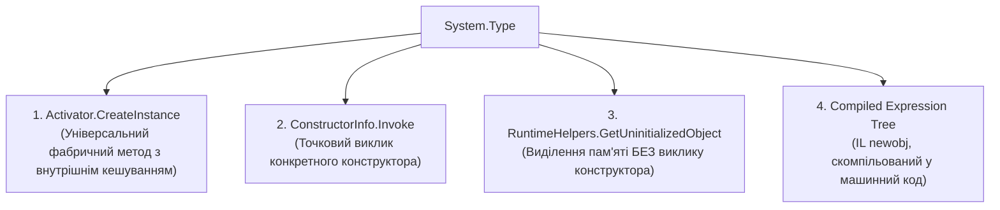

# 03. Пізнє зв'язування, динамічна активація та дженерики (Late Binding & Generics Reflection)

В об'єктно-орієнтованому програмуванні та архітектурі середовища CLR взаємодія між компонентами може організовуватися за двома принципово різними моделями зв'язування: **раннім (Early Binding)** та **пізнім (Late Binding)**.

---

## 1. Понятійний апарат: Раннє проти Пізнього зв'язування

### 1.1. Що таке раннє зв'язування (Early Binding)?
**Раннє зв'язування (Early Binding / Static Binding)** — це механізм виклику коду, за якого перевірка типів, валідація сигнатур методів та визначення адреси виклику відбуваються **на етапі компіляції** програми.

- **Як працює в CLR?** Компілятор C# (`csc.exe`) перевіряє наявність методу в класі або інтерфейсі та генерує пряму IL-інструкцію `call` (для статичних і невіртуальних методів) або `callvirt` (із фіксованим індексом у таблиці віртуальних методів VTable).
- **Навіщо потрібне?**
  1. *Абсолютна типобезпека (Type Safety)*: помилки в назвах або типах аргументів унеможливлюються на етапі збирання проєкту.
  2. *Максимальна продуктивність*: процесор викликає інструкцію за прямою або індексованою адресою. JIT-компілятор отримує можливість виконати інлайнінг (вбудовування тіла методу безпосередньо в місце виклику), повністю прибираючи витрати на виклик процедури.
- **Обмеження**: вимагає жорсткої compile-time залежності від збірки, де визначено тип. Не дозволяє без перекомпіляції підключати нові модулі, плагіни або обробляти динамічні конфігурації.

### 1.2. Що таке пізнє зв'язування (Late Binding)?
**Пізнє зв'язування (Late Binding / Dynamic Binding)** — це механізм взаємодії, за якого тип даних, склад його членів та адреси виконання методів визначаються **під час виконання програми (runtime)** на основі текстових імен, метаданих або конфігураційних файлів.

- **Як працює в CLR?** Програма завантажує збірку в пам'ять, знаходить рядок у таблицях метаданих, перевіряє сумісність типів через диспетчер зв'язування (CLR Binder) і викликає цільовий код через спеціальний адаптер виклику.
- **Навіщо потрібне?**
  1. *Плагінні та модульні архітектури*: завантаження сторонніх `.dll` розширень, які не існували на момент компіляції основної програми.
  2. *Фреймворки та IoC/DI контейнери*: створення об'єктів за конфігураціями та автоматичне зв'язування залежностей.
  3. *Серіалізатори та ORM*: мапінг рядків із баз даних чи JSON на довільні класи без генерації хардкодних конструкцій.
- **Недоліки**: накладні витрати на пошук у метаданих і перевірку типів, втрата JIT-інлайнінгу, відсутність попередження про помилки від компілятора.

### 1.3. Порівняльна таблиця характеристик

| Критерій | Раннє зв'язування (Early Binding) | Пізнє зв'язування (Late Binding) |
| :--- | :--- | :--- |
| **Етап перевірки типів** | Компіляція (Compile-time) | Виконання (Runtime) |
| **Механізм виклику** | Прямий перехід за адресою або через фіксований слот VTable (`call`, `callvirt`) | Пошук у таблицях метаданих, валідація аргументів, виклик через диспетчерський стаб |
| **Вплив на продуктивність** | Нульовий оверхед, повна оптимізація та JIT-інлайнінг | Оверхед на пошук, валідацію типів та boxing аргументів |
| **Стійкість до помилок** | Помилки виявляються компілятором до запуску | Помилки призводять до винятків (`MissingMethodException`, `TargetInvocationException`) під час роботи |
| **Архітектурна гнучкість** | Жорстке зв'язування (Tight Coupling) | Максимальна слабка зв'язність (Loose Coupling), динамічна розширюваність |

---

## 2. Механізми динамічного створення об'єктів

Платформа .NET надає чотири підходи до динамічного інстанціювання типів під час виконання:



### 2.1. Порівняльний аналіз фабричних методів

| Механізм | Спосіб дії | Сценарії застосування | Посилання на приклад |
| :--- | :--- | :--- | :--- |
| **`Activator.CreateInstance(Type)`** | Шукає публічний конструктор за замовчуванням, валідує параметри та створює екземпляр. Має внутрішній LRU-кеш для конструкторів без аргументів. | Загальний випадок створення об'єктів за типом у бізнес-коді. | [14-LateBindingDemo/Program.cs](../14-LateBindingDemo/Program.cs#L14-L23) |
| **`ConstructorInfo.Invoke(object[])`** | Дозволяє точково обрати приватний, захищений або специфічний перевантажений конструктор та передати аргументи. | Побудова IoC/DI контейнерів, де потрібен повний контроль над вибором конструктора. | [10-GetConstructorInfoDemo/Program.cs](../10-GetConstructorInfoDemo/Program.cs#L20-L35) |
| **`RuntimeHelpers.GetUninitializedObject(Type)`** | **Виділяє блок пам'яті в керованій купі БЕЗ виклику будь-якого конструктора!** Усі поля ініціалізуються нульовими бітами (`null`, `0`, `false`). | Двійкова десеріалізація (ORM, Protobuf, форматтери), де виконання коду конструктора порушило б відновлюваний стан об'єкта. | [14-LateBindingDemo/Program.cs](../14-LateBindingDemo/Program.cs#L25-L35) |
| **Compiled Expression Tree** | Компілює вираз виклику `Expression.New(ctor)` у прямий машинний код через `DynamicMethod`. | Високонавантажені сервери та фабрики об'єктів, де неприпустимий оверхед рефлексії. | [15-ReflectionPerformanceDemo/Program.cs](../15-ReflectionPerformanceDemo/Program.cs#L55-L63) |

---

## 3. Анатомія винятку `TargetInvocationException`

Коли цільовий метод або конструктор, викликаний через `MethodInfo.Invoke` чи `ConstructorInfo.Invoke`, викидає виняток усередині свого коду, середовище CLR **не прокидає цей виняток безпосередньо в стек виклику**.

Вона пакує оригінальну помилку в системну обгортку **`System.Reflection.TargetInvocationException`**:

$$\text{TargetInvocationException} \longrightarrow \text{InnerException (Фактичний бізнес-виняток)}$$

### 3.1. Чому це відбувається?
Це зроблено для розділення відповідальності:
- Винятки рівня рефлексії (наприклад, `TargetParameterCountException` або `ArgumentException`) свідчать про те, що виклик не зміг розпочатися через невідповідність сигнатури.
- `TargetInvocationException` свідчить про те, що сама рефлексія спрацювала успішно, але цільовий бізнес-код усередині методу завершився аварійно.

### 3.2. Правильний перехоплення та збереження стеку викликів
Якщо потрібно перекинути оригінальний виняток далі так, щоб не втратити початковий стек викликів (stack trace), використовується `System.Runtime.ExceptionServices.ExceptionDispatchInfo`:

```csharp
try
{
    method.Invoke(instance, parameters);
}
catch (TargetInvocationException ex) when (ex.InnerException != null)
{
    // Зберігає первинний стек помилки бізнес-методу:
    ExceptionDispatchInfo.Capture(ex.InnerException).Throw();
}
```

- Посилання на практичний приклад: [14-LateBindingDemo/Program.cs](../14-LateBindingDemo/Program.cs#L37-L49).

---

## 4. Внутрішній устрій рефлексії дженериків (Generics Internals)

У середовищі .NET CLR узагальнені типи (Generics) є повноцінними сутностями часу виконання першого класу. На відміну від Java, де реалізовано механізм затирання типів (Type Erasure), у .NET інформація про типи-параметри повністю зберігається у двійкових метаданих модуля.

### 4.1. Відкриті проти Закритих узагальнених типів
1. **Відкритий тип (Generic Type Definition)**:
   - Шаблон типу, зареєстрований у таблиці метаданих `TypeDef`.
   - Замість реальних типів містить абстрактні параметри-замінники (`T`, `TKey`, `TValue`).
   - Приклад у C#: `typeof(List<>)` або `typeof(Dictionary<,>)`.
   - **Не може бути інстанційований!** Виклик `Activator.CreateInstance(typeof(List<>))` кине виняток `ArgumentException`.
2. **Закритий тип (Constructed / Closed Generic Type)**:
   - Повноцінний тип, у якому всі параметри-шаблони замінено конкретними типами (`List<Car>`, `Dictionary<string, int>`).
   - Отримує власний запис у таблиці метаданих `TypeSpec` та унікальну структуру `MethodTable` в оперативній пам'яті.
   - Може інстанціюватися та використовуватися без жодних обмежень.

### 4.2. Модель спеціалізації та канонічний поділ коду (Canonical Code Sharing)
Як CLR керує машинним кодом для узагальнень, щоб зберігати швидкість і не роздувати оперативну пам'ять:
- **Типи значень (Value Types)**: JIT-компілятор створює **окремий блок нативного машинного коду під кожну унікальну структуру** (`List<int>`, `List<double>`, `List<DateTime>`). Це унеможливлює витрати на boxing/unboxing та забезпечує пряме розміщення даних у кеші процесора.
- **Посилальні типи (Reference Types)**: Усі посилальні типи (`List<string>`, `List<Car>`, `List<object>`) використовують **один і той самий машинний код**, скомпільований для внутрішнього канонічного типу CLR — `System.__Canon`! Вони мають різні дескриптори `MethodTable`, але їхні таблиці VTable посилаються на спільний скомпільований JIT-код.

---

## 5. Довідник методів роботи з дженериками через рефлексію

| Метод / Властивість | Сигнатура | Призначення та внутрішня дія | Посилання на приклад |
| :--- | :--- | :--- | :--- |
| `IsGenericType` | `bool IsGenericType { get; }` | Повертає `true`, якщо тип побудовано на основі узагальненого шаблону (як відкритого, так і закритого). | [12-GenericsReflectionDemo/Program.cs](../12-GenericsReflectionDemo/Program.cs#L8-L17) |
| `IsGenericTypeDefinition` | `bool IsGenericTypeDefinition { get; }` | Повертає `true`, якщо тип є відкритим шаблоном (`typeof(List<>)`). | [12-GenericsReflectionDemo/Program.cs](../12-GenericsReflectionDemo/Program.cs#L10-L15) |
| `GetGenericArguments()` | `Type[] GetGenericArguments()` | Для закритого типу повертає реальні типи-аргументи (`[typeof(string), typeof(int)]`). Для відкритого — параметри-замінники `T`. | [12-GenericsReflectionDemo/Program.cs](../12-GenericsReflectionDemo/Program.cs#L16-L19) |
| `GetGenericTypeDefinition()` | `Type GetGenericTypeDefinition()` | Повертає вихідний відкритий шаблон із закритого типу (`List<int>` -> `List<>`). | [12-GenericsReflectionDemo/Program.cs](../12-GenericsReflectionDemo/Program.cs#L18-L22) |
| `MakeGenericType(...)` | `Type MakeGenericType(params Type[] typeArgs)` | **Динамічно конструює закритий тип під час виконання!** Дозволяє створити `List<Car>` або `Dictionary<string, Car>` за конфігураційними даними. | [12-GenericsReflectionDemo/Program.cs](../12-GenericsReflectionDemo/Program.cs#L20-L28) |
| `MakeGenericMethod(...)` | `MethodInfo MakeGenericMethod(params Type[] typeArgs)` | **Динамічно закриває відкритий узагальнений метод!** Наприклад, конструює виклик `repository.GetById<Car>(id)`. | [12-GenericsReflectionDemo/Program.cs](../12-GenericsReflectionDemo/Program.cs#L35-L42) |
| `GetGenericParameterConstraints()` | `Type[] GetGenericParameterConstraints()` | Повертає масив типів та інтерфейсів, якими обмежений узагальнений параметр (відповідає виразу `where T : class, ICar, new()`). | [12-GenericsReflectionDemo/Program.cs](../12-GenericsReflectionDemo/Program.cs#L45-L55) |

---

## 6. Відкриті дженерики, реєстрація в DI та варіативність (Open Generics Resolution & Variance)

### 6.1. Проблема відкритих дженериків у IoC/DI контейнерах
У реальних проектах шаблон репозиторію або обробників команд реєструється один раз для відкритого типу:
`services.AddTransient(typeof(IRepository<>), typeof(SqlRepository<>));`

Коли клієнт запитує конкретний закритий інтерфейс `container.Resolve<IRepository<Car>>()`, контейнер має виконати такі кроки через рефлексію:
1. Визначити, що запитаний тип є закритим дженериком (`requestedType.IsGenericType && !requestedType.IsGenericTypeDefinition`).
2. Отримати його відкритий шаблон: `openInterface = requestedType.GetGenericTypeDefinition()`.
3. Знайти зареєстровану відкриту реалізацію `openImplementation = _registrations[openInterface]`.
4. Вилучити конкретні аргументи типів: `Type[] genericArgs = requestedType.GetGenericArguments()`.
5. Сконструювати конкретний закритий тип реалізації: `Type closedImplType = openImplementation.MakeGenericType(genericArgs)`.
6. Інстанціювати `closedImplType` (наприклад, `SqlRepository<Car>`).

### 6.2. Понятійний апарат: Варіативність дженериків (Variance)
Варіативність визначає, як сумісність вихідних типів впливає на сумісність сконструйованих узагальнених типів. У CLR варіативність підтримується виключно для узагальнених **інтерфейсів** та **делегатів**, і лише для **посилальних типів** (Reference Types).

1. **Коваріантність (`out T`, Covariance)**:
   - **Визначення**: Дозволяє використовувати більш специфічний (похідний) тип замість менш специфічного (базового). Зберігає відношення наслідування: якщо `SportsCar : Car`, то `IReadOnlyRepository<SportsCar>` можна присвоїти змінній `IReadOnlyRepository<Car>`.
   - **Метадані CLR**: Параметр типу позначається бітовим прапорцем `GenericParameterAttributes.Covariant` (`+`).
   - **Правило безпеки типів**: Параметр `T` може знаходитися лише у вихідній позиції (значення, що повертаються методами або властивостями типу `T`).
2. **Контраваріантність (`in T`, Contravariance)**:
   - **Визначення**: Дозволяє використовувати менш специфічний (базовий) тип замість більш специфічного (похідного). Розвертає відношення наслідування у зворотний бік: якщо `SportsCar : Car`, то `IConsumer<Car>` можна присвоїти змінній `IConsumer<SportsCar>`.
   - **Метадані CLR**: Параметр типу позначається бітовим прапорцем `GenericParameterAttributes.Contravariant` (`-`).
   - **Правило безпеки типів**: Параметр `T` може знаходитися лише у вхідній позиції (аргументи методів).
3. **Інваріантність (Invariance)**:
   - Параметр типу не позначено ані `in`, ані `out`. Тип можна замінити лише точно таким самим типом даних. Прапорець метаданих: `GenericParameterAttributes.None`.

### 6.3. Як інспектувати варіативність через рефлексію

```csharp
Type interfaceType = typeof(IReadOnlyRepository<>);
Type typeParam = interfaceType.GetGenericArguments()[0];

// Перевірка прапорців варіативності в метаданих:
GenericParameterAttributes variance = typeParam.GenericParameterAttributes & GenericParameterAttributes.VarianceMask;

if (variance == GenericParameterAttributes.Covariant)
{
    Console.WriteLine($"Параметр {typeParam.Name} є КОВАРІАНТНИМ (out T)");
}
else if (variance == GenericParameterAttributes.Contravariant)
{
    Console.WriteLine($"Параметр {typeParam.Name} є КОНТРАВАРІАНТНИМ (in T)");
}

// Перевірка сумісності типів з урахуванням коваріантності:
bool isAssignable = typeof(IReadOnlyRepository<Car>).IsAssignableFrom(typeof(IReadOnlyRepository<SportsCar>));
// isAssignable == true завдяки коваріантності out T!
```

- Посилання на практичну реалізацію варіантності в ООП: [13.1-CovarianceAndContravarianceDemo/Program.cs](../13.1-CovarianceAndContravarianceDemo/Program.cs).
- Посилання на інспекцію метаданих варіантності через рефлексію: [13.2-VarianceReflectionInspectionDemo/Program.cs](../13.2-VarianceReflectionInspectionDemo/Program.cs).
