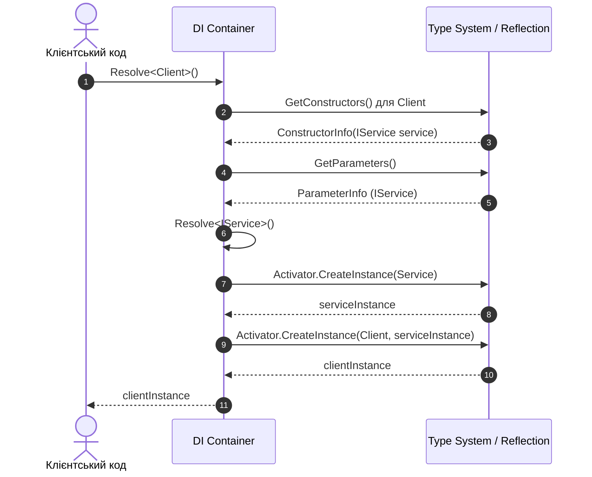

# Рефлексія на практиці: Власний DI-контейнер та серіалізація (Practical Patterns)

Рефлексія рідко використовується для повсякденної бізнес-логіки через втрату компіляційної типобезпеки та оверхед на виклики. Проте вона є фундаментом для створення:
1. **Фреймворків інверсії керування (IoC / DI)** (таких як `Microsoft.Extensions.DependencyInjection`, Autofac).
2. **Серіалізаторів даних** (JSON, XML, CSV).
3. **ORM-систем** (Entity Framework Core, Dapper).
4. **Валідаційних рушіїв** (FluentValidation, DataAnnotations).

---

## 1. Архітектура власного IoC/DI контейнера

Як працює контейнер залежностей під капотом:
1. **Реєстрація типів:** Контейнер зберігає карту пар `(Type ServiceType, Type ImplementationType)`.
2. **Розв'язання (Resolution):**
   - Знаходиться публічний конструктор типу реалізації.
   - Аналізуються параметри конструктора (`ctor.GetParameters()`).
   - Для кожного параметра рекурсивно викликається метод вирішення залежностей.
   - Створюється екземпляр через `Activator.CreateInstance(implType, resolvedParams)`.



---

## 2. Користувацькі валідаційні атрибути

Атрибути дозволяють декларативно прив'язувати метадані до членів класу:

```csharp
[AttributeUsage(AttributeTargets.Property)]
public class MinValueAttribute : Attribute
{
    public int MinValue { get; }

    public MinValueAttribute(int minValue)
    {
        MinValue = minValue;
    }
}
```

### Валідатор на базі рефлексії:
```csharp
public static class MinValueValidator
{
    public static bool Validate(object entity)
    {
        Type type = entity.GetType();
        foreach (PropertyInfo prop in type.GetProperties())
        {
            var attr = prop.GetCustomAttribute<MinValueAttribute>();
            if (attr != null && prop.PropertyType == typeof(int))
            {
                int val = (int)(prop.GetValue(entity) ?? 0);
                if (val < attr.MinValue)
                {
                    Console.WriteLine($"Помилка: Властивість {prop.Name} має значення {val}, мінімум: {attr.MinValue}");
                    return false;
                }
            }
        }
        return true;
    }
}
```

---

## 3. Власний серіалізатор (Custom Object-to-XML/JSON)

Шляхом проходу по властивостях `type.GetProperties()` формується текстове представлення об'єкта (наприклад, XML або JSON):

```csharp
public static string SerializeToXml(object obj)
{
    Type type = obj.GetType();
    var sb = new StringBuilder();
    sb.AppendLine($"<{type.Name}>");

    foreach (PropertyInfo prop in type.GetProperties())
    {
        object? value = prop.GetValue(obj);
        sb.AppendLine($"  <{prop.Name}>{value}</{prop.Name}>");
    }

    sb.AppendLine($"</{type.Name}>");
    return sb.ToString();
}
```
