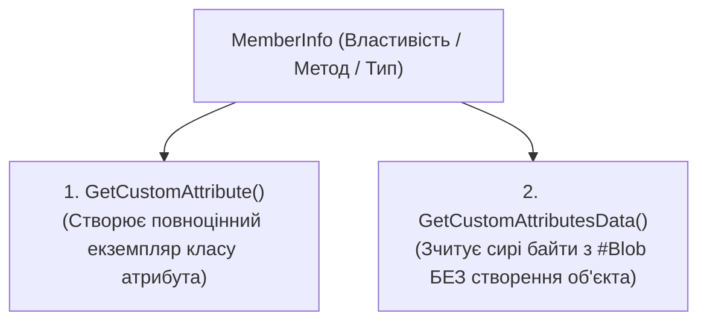
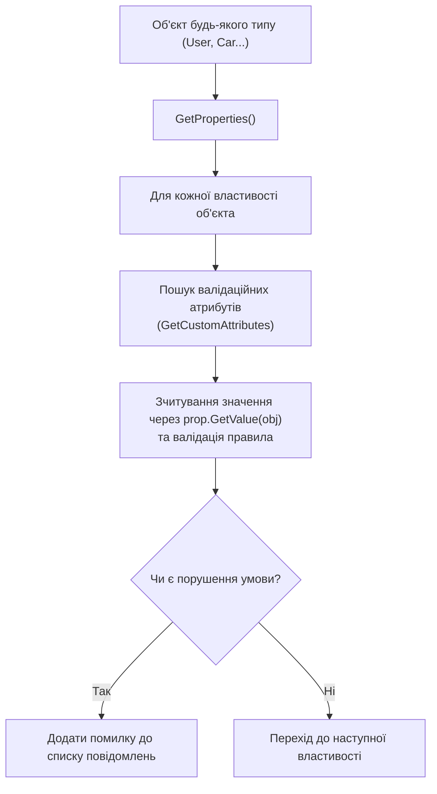

# 04. Метадані, атрибути та валідаційні рушії (Attributes & Metadata Engines)

**Атрибути (Attributes)** у .NET — це механізм декларативного метапрограмування, який дозволяє додавати описову інформацію безпосередньо до елементів програмного коду (збірок, модулів, типів, методів, властивостей, параметрів).

---

## 1. Понятійний апарат: Атрибути в системі типів CLR

### 1.1. Що таке атрибут?
**Атрибут** — це спеціалізований клас, похідний від абстрактного базового класу `System.Attribute`, екземпляр якого компілятор серіалізує в двійкові метадані збірки як додаткову характеристику цільового програмного елемента.

- **Звідки беруться атрибути?** Компілятор Roslyn перехоплює конструкції у квадратних дужках `[AttributeName(args)]`, знаходить відповідний клас і його конструктор, перевіряє передані аргументи і записує їх у таблиці метаданих збірки.
- **Навіщо потрібні атрибути?** Вони реалізують концепцію розділення відповідальності (Separation of Concerns). Замість вбудовування валідаційних перевірок, SQL-зіставлень або конфігурацій серіалізації всередину бізнес-методів, розробник декларативно маркує члени класу. Фреймворки (Entity Framework, ASP.NET Core, System.Text.Json) зчитують ці мітки через рефлексію та автоматизують рутинні операції.

### 1.2. Фізичне збереження атрибутів у збірці (ECMA-335)

Коли компілятор обробляє рядок виду `[MinValue(18, ErrorMessage = "Вам має бути не менше 18 років")]`, він виконує такі кроки:
1. Додає запис у спеціальну таблицю метаданих **`CustomAttribute` (ідентифікатор `0x0C`)**:
   - `Parent`: 32-бітний токен елемента-носія (наприклад, токен `PropertyDef` для властивості `Age`).
   - `Type`: 32-бітний токен конструктора атрибута (токен `MethodDef` або `MemberRef`).
   - `Value`: 4-байтне зміщення в бінарний потік **`#Blob`**.
2. **Серіалізація в двійковий потік `#Blob`**:
   - **Пролог (Prolog)**: перші два байти завжди містять константу `0x0001` (версія формату атрибутів згідно зі стандартом CLI).
   - **Позиційні параметри**: значення аргументів конструктора записуються в бінарному вигляді у суворому порядку їхнього оголошення (наприклад, 4 байти `int32` для числа 18).
   - **Іменовані параметри**: 2 байти кількості іменованих властивостей/полів, після яких ідуть пари: маркер поля або властивості (`0x53` чи `0x54`), тип даних, ім'я рядком та його серіалізоване значення.

```
+------------------+-------------------------------+-----------------------+
| Пролог (0x0001)  | Аргументи конструктора (18)   | Іменовані властивості |
+------------------+-------------------------------+-----------------------+
```

---

## 2. Два рівні зчитування атрибутів через рефлексію

Платформа .NET надає два принципово різні механізми вилучення атрибутів із метаданих:



### 2.1. Порівняльний аналіз підходів

| Критерій | `GetCustomAttribute<T>()` | `GetCustomAttributesData()` |
| :--- | :--- | :--- |
| **Створення об'єкта** | **Так**, викликає конструктор атрибута через внутрішній `Activator` | **Ні**, парсить бінарні дані з `#Blob` без виклику конструкторів |
| **Використання пам'яті** | Аллокує об'єкти в керованій купі (GC pressure) | Повертає легко вагові дескриптори `CustomAttributeData` |
| **Безпека виконання** | Якщо конструктор атрибута кине виняток — рефлексія впаде | Повністю безпечно: не виконує сторонній користувацький код |
| **Сфера застосування** | Звичайний прикладний бізнес-код, рушії валідації, ORM | Статичні аналізатори коду, компілятори, інструменти AOT-компіляції |

- Посилання на приклад використання `GetCustomAttributesData`: [17-CreateCustomAttributes/MinValueValidator.cs](../17-CreateCustomAttributes/MinValueValidator.cs#L45-L65).

---

## 3. Створення власних атрибутів та мета-атрибут `[AttributeUsage]`

Клас атрибута обов'язково повинен успадковувати `System.Attribute` та анотуватися системним мета-атрибутом `[AttributeUsage]`:

```csharp
[AttributeUsage(
    AttributeTargets.Property | AttributeTargets.Field, // Обмеження: тільки для полів та властивостей
    AllowMultiple = false,                              // Заборона дублювання на одному члені
    Inherited = true)]                                  // Дозволити успадкування нащадками
public class MinValueAttribute : Attribute
{
    public int Value { get; }
    public string? ErrorMessage { get; set; }

    public MinValueAttribute(int value) => Value = value;
}
```

### 3.1. Параметри мета-атрибута `AttributeUsage`
- **`AttributeTargets`**: бітова маска цілей, до яких дозволено застосовувати атрибут:
  - `Class`, `Struct`, `Interface`, `Enum` — типи даних.
  - `Method`, `Constructor`, `Property`, `Field`, `Event` — члени типів.
  - `Parameter`, `ReturnValue`, `GenericParameter` — параметри методів та узагальнень.
  - `Assembly`, `Module` — модулі та збірки цілком.
  - `All` — дозволено застосовувати до будь-якої конструкції C#.
- **`AllowMultiple`**: якщо `true`, атрибут можна вішати на один і той самий елемент кілька разів (наприклад, як `[Authorize(Roles = "...")]`).
- **`Inherited`**: якщо `true`, атрибут автоматично успадковується класами-нащадками та перевизначеними методами.

---

## 4. Декларативний рушій валідації (Validation Engine)

Використовуючи рефлексію та атрибути, можна повністю відмовитися від ручних імперативних перевірок у контролерах або сервісах:



- Посилання на практичну реалізацію валідаційного рушія: [17-CreateCustomAttributes/MinValueValidator.cs](../17-CreateCustomAttributes/MinValueValidator.cs#L10-L43).

---

## 5. Рефлексивний XML/JSON серіалізатор

Рушії серіалізації використовують рефлексію для перетворення довільного графа об'єктів у текстовий формат без жорсткого прив'язування до типу.

### 5.1. Алгоритм роботи рефлексивного серіалізатора
1. **Визначення кореня**: вичитується назва типу або атрибут `[XmlRoot("CustomName")]`.
2. **Обхід полів та властивостей**: через `type.GetProperties(BindingFlags.Public | BindingFlags.Instance)` формується перелік збережуваних даних.
3. **Фільтрація за атрибутами**: властивості з атрибутом на кшталт `[JsonIgnore]` або `[XmlIgnore]` відкидаються.
4. **Витяг значень**: через `prop.GetValue(obj)` вилучаються значення та записуються у форматі `<PropertyName>Value</PropertyName>`.

- Посилання на реалізацію XML-серіалізатора та десеріалізатора: [18-SerializationDeserialization/XmlConverter.cs](../18-SerializationDeserialization/XmlConverter.cs).
