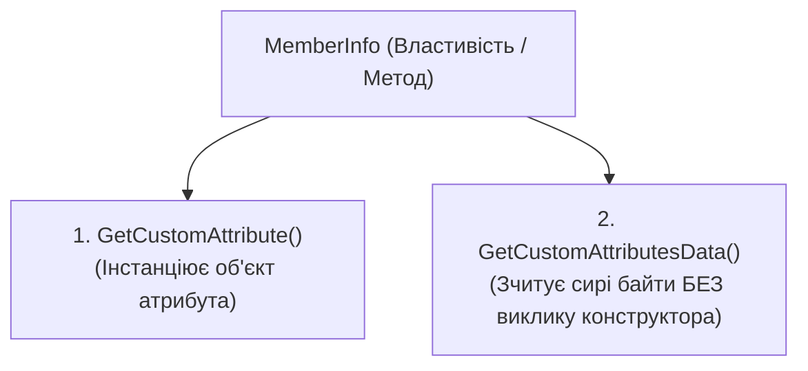
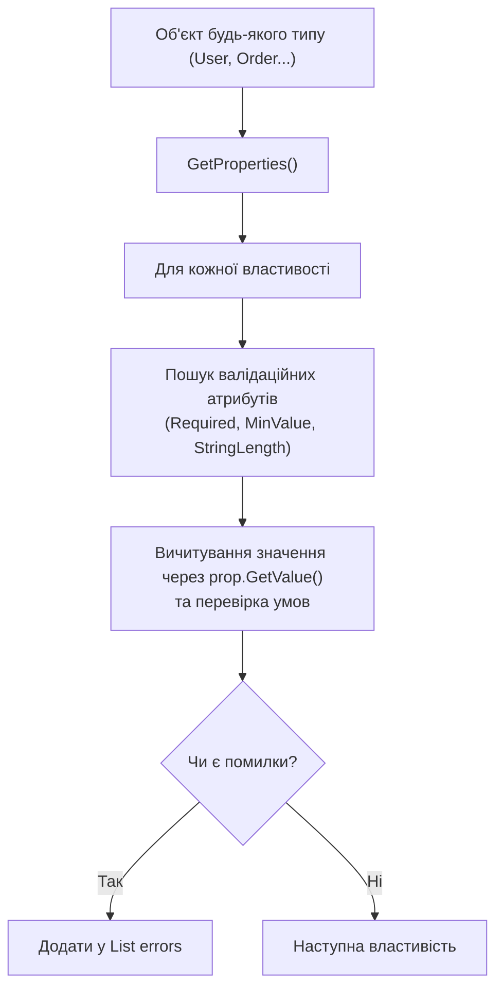

# 04. Метадані, атрибути та валідаційні рушії (Attributes & Metadata Engines)

**Атрибути (Attributes)** у .NET — це декларативні мітки метаданих, які вбудовуються у скомпільовану збірку для опису класів, методів, властивостей, параметрів або модулів. Вони є основою для побудови декларативних фреймворків: валідаторів (DataAnnotations), ORM (Entity Framework), серіалізаторів (System.Text.Json) та DI-контейнерів.

---

## 🔬 1. Як атрибути зберігаються у фізичному файлі збірки

Коли компілятор C# зустрічає атрибут (наприклад, `[MinValue(18)]`), він виконує такі дії:
1. Знаходить відповідний конструктор класу атрибута.
2. Додає запис у таблицю метаданих **`CustomAttribute` (`0x0C`)**:
   - `Parent`: токен цільового члена (наприклад, `PropertyDef` для властивості `Age`).
   - `Type`: токен конструктора атрибута (`MethodDef` або `MemberRef`).
   - `Value`: зміщення в двійковий потік **`#Blob`**.
3. **Серіалізація в `#Blob`**:
   - Пролог: 2 байти `0x0001` (заголовок версії середовища).
   - Позиційні аргументи: значення, передані в конструктор у строгому порядку (наприклад, `18` як 4-байтний `int32`).
   - Іменовані аргументи: 2 байти кількості, за якими слідують пари `Field/Property`, тип, назва властивості та значення.

```
+----------------+-------------------------------+-----------------------+
| Пролог (0x0001)| Аргументи конструктора (18)   | Іменовані властивості |
+----------------+-------------------------------+-----------------------+
```

---

## ⚖️ 2. Два рівні зчитування атрибутів через рефлексію

Платформа .NET надає два кардинально різні підходи до читання атрибутів:



### 2.1. Порівняльний аналіз підходів

| Критерій | `GetCustomAttribute<T>()` | `GetCustomAttributesData()` |
| :--- | :--- | :--- |
| **Виклик конструктора** | **Так**, викликає `Activator.CreateInstance` для атрибута | **Ні**, парсить бінарні дані з `#Blob` без створення екземпляра |
| **Швидкодія та пам'ять** | Виділяє об'єкти в купі (Heap Allocation) | Повертає легко вагові структури `CustomAttributeData` |
| **Безпека виконання** | Якщо конструктор атрибута кидає виняток — рефлексія падає | Безпечно аналізує метадані навіть для пошкодженого коду |
| **Застосування** | Звичайний бізнес-код, серіалізація, валідація | Статичні аналізатори, розробка IDE, компілятори, інструменти AOT |

🔗 Переглянути інспекцію сирих метаданих можна в [13-CreateCustomAttributes/MinValueValidator.cs](../13-CreateCustomAttributes/MinValueValidator.cs#L45-L65).

---

## 🏷️ 3. Створення власного атрибута: `[AttributeUsage]`

Клас власного атрибута обов'язково наслідується від `System.Attribute` та анотується мета-атрибутом `[AttributeUsage]`:

```csharp
[AttributeUsage(
    AttributeTargets.Property | AttributeTargets.Field, // Обмеження: тільки поля та властивості
    AllowMultiple = false,                              // Заборона дублювання на одному члені
    Inherited = true)]                                  // Дозволити успадкування атрибута в нащадках
public class MinValueAttribute : Attribute
{
    public int Value { get; }
    public string? ErrorMessage { get; set; }

    public MinValueAttribute(int value) => Value = value;
}
```

### 3.1. Прапорці `AttributeTargets`
- `AttributeTargets.Class`, `Struct`, `Interface`, `Enum`
- `AttributeTargets.Method`, `Constructor`, `Property`, `Field`, `Event`
- `AttributeTargets.Parameter`, `ReturnValue`, `GenericParameter`
- `AttributeTargets.Assembly`, `Module`
- `AttributeTargets.All` — дозволено ставити абсолютно на будь-яку конструкцію.

---

## ⚙️ 4. Декларативний рушій валідації (Validation Engine)

Замість написання спагетті-перевірок `if (user.Age < 18 || string.IsNullOrEmpty(user.Name))` у кожному контролері, рефлексія дозволяє написати єдиний універсальний валідатор:



🔗 Переглянути повну реалізацію валідатора можна в [13-CreateCustomAttributes/MinValueValidator.cs](../13-CreateCustomAttributes/MinValueValidator.cs#L10-L43).

---

## 📦 5. Рефлексивний XML/JSON серіалізатор

Рушії серіалізації використовують рефлексію для:
1. **Зіставлення імен (Mapping)**: читання атрибута `[XmlElementName("custom_name")]` для заміни імені тегу.
2. **Ігнорування чутливих полів**: перевірка `prop.GetCustomAttribute<XmlIgnorePropertyAttribute>() != null` для захисту паролів і секретних ключів.
3. **Конвертації типів**: автоматичний парсинг рядків у примітивні типи (`int`, `double`, `bool`, `DateTime`) через `Convert.ChangeType`.

🔗 Переглянути серіалізатор можна в [14-SerializationDeserialization/XmlConverter.cs](../14-SerializationDeserialization/XmlConverter.cs#L10-L75).

---

## 📋 6. Довідник методів роботи з атрибутами

| Метод | Клас | Опис і поведінка | Посилання на приклад |
| :--- | :--- | :--- | :---: |
| `GetCustomAttribute<T>()` | `CustomAttributeExtensions` | Повертає типізований атрибут або `null`. Інстанціює екземпляр у пам'яті. | [](../13-CreateCustomAttributes/MinValueValidator.cs#L22-L35) |
| `GetCustomAttributes<T>()` | `CustomAttributeExtensions` | Повертає всі атрибути типу `T` (використовується при `AllowMultiple = true`). | [](../13-CreateCustomAttributes/MinValueValidator.cs) |
| `Attribute.IsDefined(...)` | `Attribute` | Швидка перевірка факту наявності атрибута без виклику його конструктора. | [](../14-SerializationDeserialization/XmlConverter.cs#L28-L34) |
| `GetCustomAttributesData()` | `MemberInfo` | Повертає список сирих метаданих `CustomAttributeData` з позиційними та іменованими аргументами. | [](../13-CreateCustomAttributes/MinValueValidator.cs#L45-L65) |
