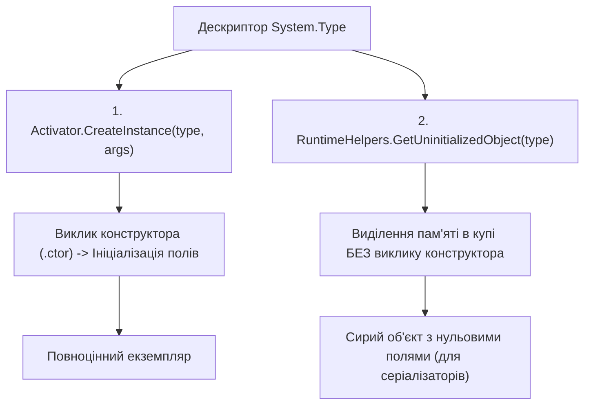

# Клас System.Activator та RuntimeHelpers: Динамічна активація об'єктів

> **Простір імен**: `System`, `System.Runtime.CompilerServices`  
> **Збірка**: `System.Private.CoreLib.dll`  
> **Офіційна документація**: [Activator Class (Microsoft Learn)](https://learn.microsoft.com/en-us/dotnet/api/system.activator)

Клас `Activator` містить статичні службові методи для локального створення екземплярів об'єктів на основі їхнього дескриптора `Type`. Клас `RuntimeHelpers` надає низькорівневі примітиви CLR, зокрема аллокацію пам'яті в обхід конструкторів.

---

## 1. Створення об'єкта через Activator vs RuntimeHelpers

---

## 2. Статичні методи класів Activator та RuntimeHelpers (Methods)

| Метод | Сигнатура | Опис призначення | Статус у курсі | Приклад у коді | Документація MSDN |
| :--- | :--- | :--- | :---: | :--- | :--- |
| **`CreateInstance(Type, object?[])`** | `static object? CreateInstance(Type type, params object?[]? args)` | Знаходить найбільш підходящий конструктор та створює екземпляр об'єкта | Використано | [14-LateBindingDemo/Program.cs](../../14-LateBindingDemo/Program.cs#L14) | [Activator.CreateInstance](https://learn.microsoft.com/en-us/dotnet/api/system.activator.createinstance) |
| **`CreateInstance<T>()`** | `static T CreateInstance<T>()` | Створює екземпляр типу `T` через його відкритий конструктор без параметрів | Використано | [14-LateBindingDemo/Program.cs](../../14-LateBindingDemo/Program.cs#L22) | [Activator.CreateInstance](https://learn.microsoft.com/en-us/dotnet/api/system.activator.createinstance) |
| **`CreateInstance(Type, bool)`** | `static object? CreateInstance(Type type, bool nonPublic)` | Створює екземпляр типу, дозволяючи виклик приватних конструкторів при `nonPublic = true` | Використано | [14-LateBindingDemo/Program.cs](../../14-LateBindingDemo/Program.cs#L28) | [Activator.CreateInstance](https://learn.microsoft.com/en-us/dotnet/api/system.activator.createinstance) |
| **`GetUninitializedObject`** | `static object GetUninitializedObject(Type type)` | Аллокує пам'ять під екземпляр у керованій купі без виконання конструктора класу | Використано | [14-LateBindingDemo/Program.cs](../../14-LateBindingDemo/Program.cs#L36) | [RuntimeHelpers.GetUninitializedObject](https://learn.microsoft.com/en-us/dotnet/api/system.runtime.compilerservices.runtimehelpers.getuninitializedobject) |
