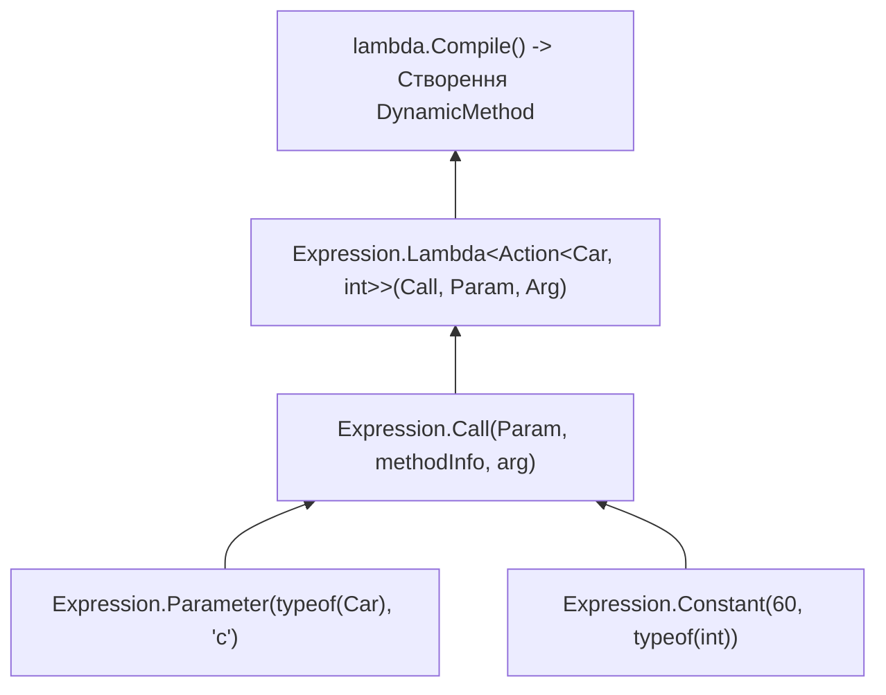

# Клас System.Linq.Expressions.Expression: Дерева виразів та динамічна компіляція

> **Простір імен**: `System.Linq.Expressions`  
> **Збірка**: `System.Linq.Expressions.dll`  
> **Базовий тип**: `System.Object`  
> **Офіційна документація**: [Expression Class (Microsoft Learn)](https://learn.microsoft.com/en-us/dotnet/api/system.linq.expressions.expression)

Клас `Expression` містить фабричні методи для створення вузлів абстрактного синтаксичного дерева (AST). Дерева виразів представляють код як структуру даних, яку можна інспектувати, трансформувати або скомпілювати у машинний код через `.Compile()`.

---

## 1. Фабричні методи побудови дерева виразів

---

## 2. Фабричні та компіляційні методи класу Expression (Methods)

| Метод | Сигнатура | Опис призначення | Статус у курсі | Приклад у коді | Документація MSDN |
| :--- | :--- | :--- | :---: | :--- | :--- |
| **`Parameter`** | `static ParameterExpression Parameter(Type type, string? name)` | Створює вузол вхідного параметра методу чи лямбди | Використано | [15.1-ExpressionTreesBuildingDemo/Program.cs](../../15.1-ExpressionTreesBuildingDemo/Program.cs#L16) | [Expression.Parameter](https://learn.microsoft.com/en-us/dotnet/api/system.linq.expressions.expression.parameter) |
| **`Constant`** | `static ConstantExpression Constant(object? value, Type type)` | Створює вузол фіксованої константи (числа, рядка) | Використано | [15.1-ExpressionTreesBuildingDemo/Program.cs](../../15.1-ExpressionTreesBuildingDemo/Program.cs#L19) | [Expression.Constant](https://learn.microsoft.com/en-us/dotnet/api/system.linq.expressions.expression.constant) |
| **`Multiply`** | `static BinaryExpression Multiply(Expression left, Expression right)` | Створює бінарну операцію множення | Використано | [15.1-ExpressionTreesBuildingDemo/Program.cs](../../15.1-ExpressionTreesBuildingDemo/Program.cs#L23) | [Expression.Multiply](https://learn.microsoft.com/en-us/dotnet/api/system.linq.expressions.expression.multiply) |
| **`Add`** | `static BinaryExpression Add(Expression left, Expression right)` | Створює бінарну операцію додавання | Використано | [15.1-ExpressionTreesBuildingDemo/Program.cs](../../15.1-ExpressionTreesBuildingDemo/Program.cs#L26) | [Expression.Add](https://learn.microsoft.com/en-us/dotnet/api/system.linq.expressions.expression.add) |
| **`Condition`** | `static ConditionalExpression Condition(Expression test, Expression ifTrue, Expression ifFalse)` | Створює тернарний умовний вузол (if-then-else) | Використано | [15.1-ExpressionTreesBuildingDemo/Program.cs](../../15.1-ExpressionTreesBuildingDemo/Program.cs#L71) | [Expression.Condition](https://learn.microsoft.com/en-us/dotnet/api/system.linq.expressions.expression.condition) |
| **`Property`** | `static MemberExpression Property(Expression expression, PropertyInfo property)` | Створює вузол звернення до властивості | Використано | [15.2-ExpressionTreesMemberAccessDemo/Program.cs](../../15.2-ExpressionTreesMemberAccessDemo/Program.cs#L27) | [Expression.Property](https://learn.microsoft.com/en-us/dotnet/api/system.linq.expressions.expression.property) |
| **`Call`** | `static MethodCallExpression Call(Expression instance, MethodInfo method, params Expression[] arguments)` | Створює вузол динамічного виклику методу | Використано | [15.2-ExpressionTreesMemberAccessDemo/Program.cs](../../15.2-ExpressionTreesMemberAccessDemo/Program.cs#L53) | [Expression.Call](https://learn.microsoft.com/en-us/dotnet/api/system.linq.expressions.expression.call) |
| **`New`** | `static NewExpression New(ConstructorInfo constructor, params Expression[] arguments)` | Створює вузол виклику конструктора для інстанціювання типу | Використано | [15.2-ExpressionTreesMemberAccessDemo/Program.cs](../../15.2-ExpressionTreesMemberAccessDemo/Program.cs#L81) | [Expression.New](https://learn.microsoft.com/en-us/dotnet/api/system.linq.expressions.expression.new) |
| **`Lambda`** | `static Expression<TDelegate> Lambda<TDelegate>(Expression body, params ParameterExpression[] parameters)` | Створює типізоване кореневе лямбда-дерево | Використано | [15.0-ExpressionTreesBasicsDemo/Program.cs](../../15.0-ExpressionTreesBasicsDemo/Program.cs#L26) | [Expression.Lambda](https://learn.microsoft.com/en-us/dotnet/api/system.linq.expressions.expression.lambda) |
| **`Compile`** | `TDelegate Compile()` | Транслює AST-дерево в новий блок IL-коду в пам'яті через `DynamicMethod` і JIT-компілює його | Використано | [15.0-ExpressionTreesBasicsDemo/Program.cs](../../15.0-ExpressionTreesBasicsDemo/Program.cs#L83) | [LambdaExpression.Compile](https://learn.microsoft.com/en-us/dotnet/api/system.linq.expressions.lambdaexpression.compile) |
| **`Convert`** | `static UnaryExpression Convert(Expression expression, Type type)` | Створює вузол явного приведення типу даних | Використано | [15.1-ExpressionTreesBuildingDemo/Program.cs](../../15.1-ExpressionTreesBuildingDemo/Program.cs#L57) | [Expression.Convert](https://learn.microsoft.com/en-us/dotnet/api/system.linq.expressions.expression.convert) |
| **`GreaterThanOrEqual`** | `static BinaryExpression GreaterThanOrEqual(Expression left, Expression right)` | Операція логічного порівняння `>=` | Використано | [15.1-ExpressionTreesBuildingDemo/Program.cs](../../15.1-ExpressionTreesBuildingDemo/Program.cs#L64) | [Expression.GreaterThanOrEqual](https://learn.microsoft.com/en-us/dotnet/api/system.linq.expressions.expression.greaterthanorequal) |
| **`Block`** | `static BlockExpression Block(params Expression[] expressions)` | Створює блок із послідовності виразів зі змінними | Загальний BCL | Довідник | [Expression.Block](https://learn.microsoft.com/en-us/dotnet/api/system.linq.expressions.expression.block) |
