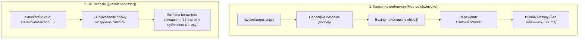

# Атрибут System.Runtime.CompilerServices.UnsafeAccessor: JIT Intrinsics (.NET 8+)

> **Простір імен**: `System.Runtime.CompilerServices`  
> **Збірка**: `System.Private.CoreLib.dll` (.NET 8.0 та новіші)  
> **Офіційна документація**: [UnsafeAccessorAttribute Class (Microsoft Learn)](https://learn.microsoft.com/en-us/dotnet/api/system.runtime.compilerservices.unsafeaccessorattribute)

Атрибут `[UnsafeAccessor]` — це механізм середовища виконання та компілятора (Compiler & JIT Intrinsic), який забезпечує прямий доступ до приватних полів, методів і конструкторів зі швидкістю нативного виклику без жодних накладних витрат класичної рефлексії.

---

## 1. Архітектурне порівняння: UnsafeAccessor проти MethodInfo.Invoke

---

## 2. Перерахування UnsafeAccessorKind

| Значення | Опис операції | Приклад сигнатури методу | Приклад у коді | Посилання на MSDN |
| :--- | :--- | :--- | :--- | :--- |
| **`Field`** | Читання та запис у приватне поле екземпляра за посиланням `ref` | `extern static ref int GetSpeed(Car car);` | [16-UnsafeAccessorDemo/Program.cs](../../16-UnsafeAccessorDemo/Program.cs#L22) | [UnsafeAccessorKind.Field](https://learn.microsoft.com/en-us/dotnet/api/system.runtime.compilerservices.unsafeaccessorkind) |
| **`Method`** | Прямий виклик приватного методу екземпляра | `extern static void CallReset(Car car);` | [16-UnsafeAccessorDemo/Program.cs](../../16-UnsafeAccessorDemo/Program.cs#L30) | [UnsafeAccessorKind.Method](https://learn.microsoft.com/en-us/dotnet/api/system.runtime.compilerservices.unsafeaccessorkind) |
| **`Constructor`** | Прямий виклик приватного конструктора типу | `extern static Car Create(string m, int s);` | [16-UnsafeAccessorDemo/Program.cs](../../16-UnsafeAccessorDemo/Program.cs#L38) | [UnsafeAccessorKind.Constructor](https://learn.microsoft.com/en-us/dotnet/api/system.runtime.compilerservices.unsafeaccessorkind) |
| **`StaticField`** | Доступ до приватного статичного поля класу | `extern static ref int GetStaticCounter();` | [16-UnsafeAccessorDemo/Program.cs](../../16-UnsafeAccessorDemo/Program.cs#L46) | [UnsafeAccessorKind.StaticField](https://learn.microsoft.com/en-us/dotnet/api/system.runtime.compilerservices.unsafeaccessorkind) |
| **`StaticMethod`** | Виклик приватного статичного методу класу | `extern static void CallStaticInit();` | [16-UnsafeAccessorDemo/Program.cs](../../16-UnsafeAccessorDemo/Program.cs#L54) | [UnsafeAccessorKind.StaticMethod](https://learn.microsoft.com/en-us/dotnet/api/system.runtime.compilerservices.unsafeaccessorkind) |
