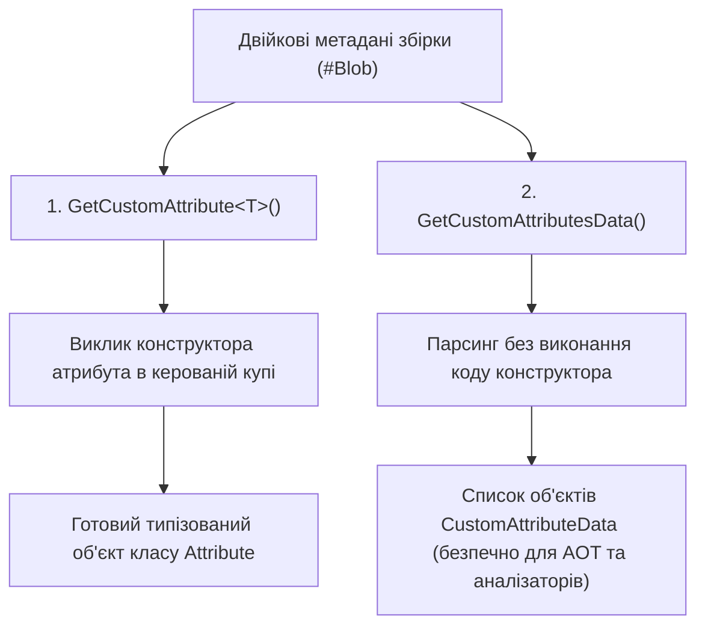

# Класи System.Attribute, AttributeUsageAttribute та CustomAttributeData

> **Простір імен**: `System`, `System.Reflection`  
> **Збірка**: `System.Private.CoreLib.dll`  
> **Офіційна документація**: [Attributes in C# (Microsoft Learn)](https://learn.microsoft.com/en-us/dotnet/csharp/advanced-topics/reflection-and-attributes/)

Атрибути в .NET дозволяють додавати декларативні метадані до елементів коду (класів, методів, властивостей, параметрів, полів та збірок). Ці метадані зберігаються у фізичному файлі збірки (таблиця метаданих `CustomAttribute` та двійковий потік `#Blob`) і можуть зчитуватися під час виконання.

---

## 1. Два підходи до зчитування атрибутів у CLR

1. **`GetCustomAttribute<T>()` / `GetCustomAttributes()`**: Створює повноцінний екземпляр класу атрибута в пам'яті. Якщо конструктор містить логіку або вимагає зовнішніх залежностей, вони будуть виконані.
2. **`GetCustomAttributesData()`**: Повертає структуру метаданих без виконання коду і без завантаження сторонніх збірок у домен виконання.

---

## 2. Властивості для роботи з атрибутами (Properties)

| Властивість | Сигнатура | Опис призначення | Статус у курсі | Приклад у коді | Документація MSDN |
| :--- | :--- | :--- | :---: | :--- | :--- |
| **`AttributeType`** | `Type AttributeType { get; }` | Тип атрибута, збережений у структурі `CustomAttributeData` | Використано | [17-CreateCustomAttributes/Program.cs](../../17-CreateCustomAttributes/Program.cs#L52) | [CustomAttributeData.AttributeType](https://learn.microsoft.com/en-us/dotnet/api/system.reflection.customattributedata.attributetype) |
| **`ConstructorArguments`** | `IList<CustomAttributeTypedArgument> ConstructorArguments { get; }` | Список позиційних параметрів, переданих у конструктор атрибута | Використано | [17-CreateCustomAttributes/Program.cs](../../17-CreateCustomAttributes/Program.cs#L56) | [CustomAttributeData.ConstructorArguments](https://learn.microsoft.com/en-us/dotnet/api/system.reflection.customattributedata.constructorarguments) |
| **`NamedArguments`** | `IList<CustomAttributeNamedArgument> NamedArguments { get; }` | Список іменованих аргументів (властивостей/полів), встановлених при застосуванні атрибута | Використано | [17-CreateCustomAttributes/Program.cs](../../17-CreateCustomAttributes/Program.cs#L60) | [CustomAttributeData.NamedArguments](https://learn.microsoft.com/en-us/dotnet/api/system.reflection.customattributedata.namedarguments) |
| **`ValidOn`** | `AttributeTargets ValidOn { get; }` | Бітова маска цілей коду (`Class`, `Method`, `Property`), до яких можна застосовувати атрибут | Використано | [17-CreateCustomAttributes/Program.cs](../../17-CreateCustomAttributes/Program.cs#L72) | [AttributeUsageAttribute.ValidOn](https://learn.microsoft.com/en-us/dotnet/api/system.attributeusageattribute.validon) |
| **`AllowMultiple`** | `bool AllowMultiple { get; }` | Прапорець, що дозволяє застосовувати той самий атрибут до одного члена коду неодноразово | Використано | [17-CreateCustomAttributes/Program.cs](../../17-CreateCustomAttributes/Program.cs#L74) | [AttributeUsageAttribute.AllowMultiple](https://learn.microsoft.com/en-us/dotnet/api/system.attributeusageattribute.allowmultiple) |
| **`Inherited`** | `bool Inherited { get; }` | Прапорець, що визначає, чи успадковується атрибут нащадками класів або перевизначеними методами | Використано | [17-CreateCustomAttributes/Program.cs](../../17-CreateCustomAttributes/Program.cs#L76) | [AttributeUsageAttribute.Inherited](https://learn.microsoft.com/en-us/dotnet/api/system.attributeusageattribute.inherited) |
| **`TypeId`** | `object TypeId { get; }` | Унікальний ідентифікатор типу атрибута (за замовчуванням дескриптор `Type`) | Загальний BCL | Довідник | [Attribute.TypeId](https://learn.microsoft.com/en-us/dotnet/api/system.attribute.typeid) |

---

## 3. Методи для роботи з атрибутами (Methods)

| Метод | Сигнатура | Опис призначення | Статус у курсі | Приклад у коді | Документація MSDN |
| :--- | :--- | :--- | :---: | :--- | :--- |
| **`GetCustomAttribute<T>`** | `static T? GetCustomAttribute<T>(this MemberInfo element, bool inherit) where T : Attribute` | Повертає один типізований екземпляр атрибута заданого типу `T` | Використано | [17-CreateCustomAttributes/Program.cs](../../17-CreateCustomAttributes/Program.cs#L22) | [CustomAttributeExtensions.GetCustomAttribute](https://learn.microsoft.com/en-us/dotnet/api/system.reflection.customattributeextensions.getcustomattribute) |
| **`GetCustomAttributesData`**| `IList<CustomAttributeData> GetCustomAttributesData()` | Повертає список дескрипторів метаданих атрибутів без інстанціювання їхніх об'єктів | Використано | [17-CreateCustomAttributes/Program.cs](../../17-CreateCustomAttributes/Program.cs#L45) | [MemberInfo.GetCustomAttributesData](https://learn.microsoft.com/en-us/dotnet/api/system.reflection.memberinfo.getcustomattributesdata) |
| **`IsDefined`** | `bool IsDefined(Type attributeType, bool inherit)` | Швидко перевіряє факт застосування атрибута без завантаження повної інформації про нього | Використано | [17-CreateCustomAttributes/Program.cs](../../17-CreateCustomAttributes/Program.cs#L30) | [MemberInfo.IsDefined](https://learn.microsoft.com/en-us/dotnet/api/system.reflection.memberinfo.isdefined) |
| **`GetCustomAttributes`** | `object[] GetCustomAttributes(Type attributeType, bool inherit)` | Повертає масив усіх створених об'єктів-атрибутів заданого типу | Загальний BCL | Довідник | [MemberInfo.GetCustomAttributes](https://learn.microsoft.com/en-us/dotnet/api/system.reflection.memberinfo.getcustomattributes) |
