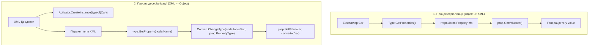

# Рефлексивна серіалізація та десеріалізація об'єктів

> **Контекст**: Власна імплементація серіалізатора (XML/JSON) на базі рефлексії  
> **Ключові класи**: `System.Type`, `System.Reflection.PropertyInfo`, `System.Convert`, `System.Activator`  
> **Офіційна документація**: [Serialization in .NET (Microsoft Learn)](https://learn.microsoft.com/en-us/dotnet/standard/serialization/)

Рефлексивна серіалізація — це архітектурний підхід, за якого серіалізатор динамічно інспектує структуру доменного об'єкта під час виконання програми, витягує значення відкритих властивостей і транслює їх у текстовий або двійковий формат (XML, JSON, Binary).

---

## 1. Архітектурний пайплайн рефлексивної серіалізації

---

## 2. Властивості, задіяні в процесі серіалізації (Properties)

| Властивість | Сигнатура | Опис призначення | Статус у курсі | Приклад у коді | Документація MSDN |
| :--- | :--- | :--- | :---: | :--- | :--- |
| **`PropertyType`** | `Type PropertyType { get; }` | Цільовий тип даних властивості, необхідний для виклику `Convert.ChangeType` | Використано | [18-SerializationDeserialization/Program.cs](../../18-SerializationDeserialization/Program.cs#L66) | [PropertyInfo.PropertyType](https://learn.microsoft.com/en-us/dotnet/api/system.reflection.propertyinfo.propertytype) |
| **`CanRead`** | `bool CanRead { get; }` | Перевірка наявності геттера перед спробою серіалізувати значення | Використано | [18-SerializationDeserialization/Program.cs](../../18-SerializationDeserialization/Program.cs#L28) | [PropertyInfo.CanRead](https://learn.microsoft.com/en-us/dotnet/api/system.reflection.propertyinfo.canread) |
| **`CanWrite`** | `bool CanWrite { get; }` | Перевірка наявності сеттера перед спробою встановити десеріалізоване значення | Використано | [18-SerializationDeserialization/Program.cs](../../18-SerializationDeserialization/Program.cs#L64) | [PropertyInfo.CanWrite](https://learn.microsoft.com/en-us/dotnet/api/system.reflection.propertyinfo.canwrite) |
| **`Name`** | `string Name { get; }` | Назва властивості, що використовується як ім'я XML/JSON вузла за замовчуванням | Використано | [18-SerializationDeserialization/Program.cs](../../18-SerializationDeserialization/Program.cs#L30) | [MemberInfo.Name](https://learn.microsoft.com/en-us/dotnet/api/system.reflection.memberinfo.name) |

---

## 3. Методи, задіяні в процесі серіалізації (Methods)

| Метод | Сигнатура | Опис призначення | Статус у курсі | Приклад у коді | Документація MSDN |
| :--- | :--- | :--- | :---: | :--- | :--- |
| **`GetProperties`** | `PropertyInfo[] GetProperties(BindingFlags bindingAttr)` | Зчитує всі відкриті або закриті властивості для побудови графу серіалізації | Використано | [18-SerializationDeserialization/Program.cs](../../18-SerializationDeserialization/Program.cs#L24) | [Type.GetProperties](https://learn.microsoft.com/en-us/dotnet/api/system.type.getproperties) |
| **`GetProperty`** | `PropertyInfo? GetProperty(string name)` | Знаходить властивість за назвою тегу під час десеріалізації | Використано | [18-SerializationDeserialization/Program.cs](../../18-SerializationDeserialization/Program.cs#L60) | [Type.GetProperty](https://learn.microsoft.com/en-us/dotnet/api/system.type.getproperty) |
| **`GetValue`** | `object? GetValue(object? obj)` | Зчитує актуальне значення властивості з об'єкта під час серіалізації | Використано | [18-SerializationDeserialization/Program.cs](../../18-SerializationDeserialization/Program.cs#L32) | [PropertyInfo.GetValue](https://learn.microsoft.com/en-us/dotnet/api/system.reflection.propertyinfo.getvalue) |
| **`SetValue`** | `void SetValue(object? obj, object? value)` | Записує перетворене значення у створений екземпляр під час десеріалізації | Використано | [18-SerializationDeserialization/Program.cs](../../18-SerializationDeserialization/Program.cs#L68) | [PropertyInfo.SetValue](https://learn.microsoft.com/en-us/dotnet/api/system.reflection.propertyinfo.setvalue) |
| **`CreateInstance`** | `static object? CreateInstance(Type type)` | Створює новий екземпляр цільового типу для заповнення десеріалізованими даними | Використано | [18-SerializationDeserialization/Program.cs](../../18-SerializationDeserialization/Program.cs#L54) | [Activator.CreateInstance](https://learn.microsoft.com/en-us/dotnet/api/system.activator.createinstance) |
| **`ChangeType`** | `static object? ChangeType(object? value, Type conversionType)` | Перетворює строкове значення XML-вузла у відповідний примітивний тип (`int`, `bool`, `DateTime`) | Використано | [18-SerializationDeserialization/Program.cs](../../18-SerializationDeserialization/Program.cs#L67) | [Convert.ChangeType](https://learn.microsoft.com/en-us/dotnet/api/system.convert.changetype) |
