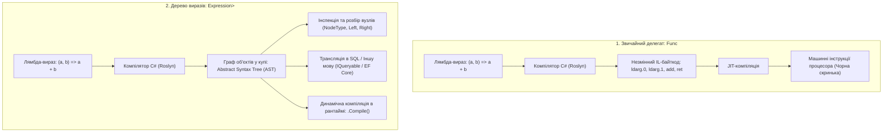
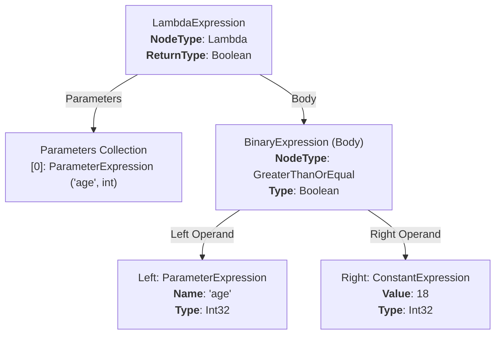
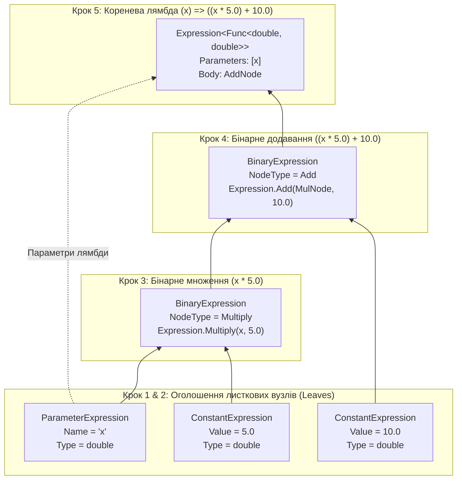
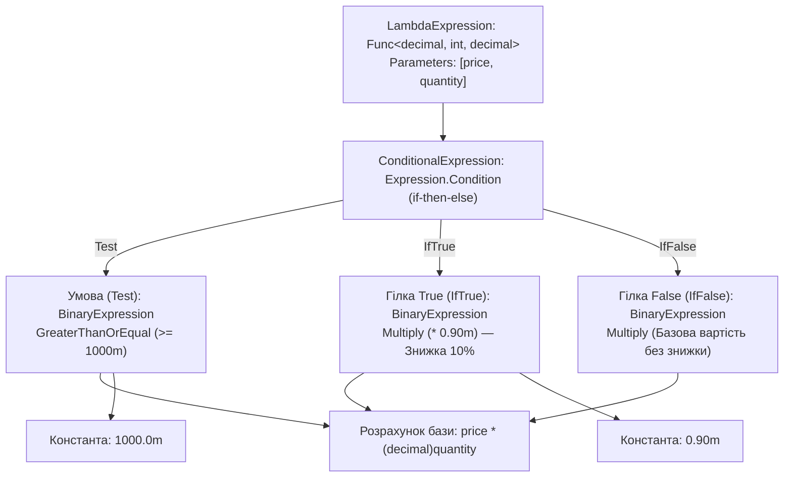
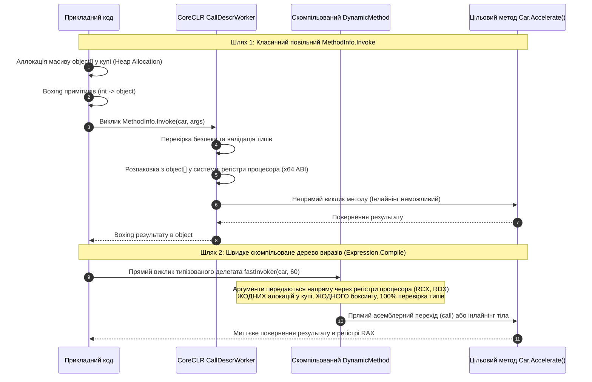

# 05. Дерева виразів (Expression Trees) та динамічна компіляція в .NET

> **Solution-тег (Solution Folder)**: `04. Dynamic Execution & Performance`  
> **Проєкти у тегу**:
> - [15.0-ExpressionTreesBasicsDemo](../15.0-ExpressionTreesBasicsDemo/Program.cs) — Вступ до Expression Trees, концепція «код як дані», анатомія AST, метод `.Compile()`.
> - [15.1-ExpressionTreesBuildingDemo](../15.1-ExpressionTreesBuildingDemo/Program.cs) — Програмне конструювання дерев через фабричні методи API `Expression` (формули, if-else розгалуження).
> - [15.2-ExpressionTreesMemberAccessDemo](../15.2-ExpressionTreesMemberAccessDemo/Program.cs) — Заміна повільних `GetValue`, `Invoke` та `CreateInstance` на скомпільовані вирази доступу до членів.
> - [15.3-ReflectionPerformanceDemo](../15.3-ReflectionPerformanceDemo/Program.cs) — Комплексний бенчмарк: Direct Call vs Compiled Expression vs Delegate vs dynamic vs `MethodInfo.Invoke`.

---

## 1. Понятійний апарат: Що таке дерево виразів (Expression Tree)?

У платформі .NET будь-який програмний код зазвичай компілюється у проміжну мову **IL (Intermediate Language)**, яку середовище CLR перетворює на машинний код. Проте для складних сценаріїв (наприклад, побудови SQL-запитів в Entity Framework або усунення накладних витрат рефлексії) програмі потрібна здатність взаємодіяти з кодом не як з чорною скринькою виконуваних інструкцій, а як зі **структурою даних**.

### 1.1. Концепція «Код як дані» (Code as Data)

* **Звичайний виконуваний делегат (`Func<T>`, `Action<T>`)**:
  * Компілятор C# транслює лямбда-вираз безпосередньо в анонімний метод у форматі IL-байткоду.
  * У рантаймі це непрозорий покажчик на машинний код (функція). Програма не може дізнатися, які оператори, змінні чи умови були написані всередині цього методу.
* **Дерево виразів (`Expression<TDelegate>`)**:
  * Компілятор C# бачить тип `Expression<TDelegate>` і замість IL-коду генерує код створення об'єктів — **вузлів дерева**.
  * У рантаймі код представлений у пам'яті як синтаксичне дерево (AST — Abstract Syntax Tree), кожен вузол якого є об'єктом певного класу (наприклад, `BinaryExpression`, `ConstantExpression`, `ParameterExpression`).
  * Цю структуру можна програмно обходити, аналізувати, трансформувати в іншу мову (наприклад, у SQL) або скомпілювати в машинний код за допомогою методу `.Compile()`.



---

## 2. Анатомія Абстрактного Синтаксичного Дерева (AST)

Будь-який вираз розбивається на ієрархію вузлів, успадкованих від базового класу `System.Linq.Expressions.Expression`.

### 2.1. Діаграма синтаксичного розбору простого виразу

Розглянемо лямбда-вираз перевірки повноліття: `Expression<Func<int, bool>> isAdult = age => age >= 18;`



### 2.2. Ієрархія основних типів вузлів виразів

| Клас вузла | Базовий тип | Призначення | Приклад створення в коді |
| :--- | :--- | :--- | :--- |
| `ParameterExpression` | `Expression` | Представляє іменований параметр виразу чи методу | `Expression.Parameter(typeof(int), "x")` |
| `ConstantExpression` | `Expression` | Представляє фіксовану константу (число, рядок тощо) | `Expression.Constant(100, typeof(int))` |
| `BinaryExpression` | `Expression` | Бінарні математичні та логічні операції (`+`, `-`, `*`, `>`, `==`) | `Expression.Add(left, right)` |
| `UnaryExpression` | `Expression` | Унарні операції (заперечення `!`, приведення типу `Convert`) | `Expression.Convert(param, typeof(decimal))` |
| `ConditionalExpression` | `Expression` | Тернарний умовний оператор (`condition ? ifTrue : ifFalse`) | `Expression.Condition(test, ifTrue, ifFalse)` |
| `MemberExpression` | `Expression` | Читання властивості або поля екземпляра / статичного класу | `Expression.Property(instance, propInfo)` |
| `MethodCallExpression` | `Expression` | Виклик статичного методу чи методу екземпляра | `Expression.Call(instance, methodInfo, args)` |
| `NewExpression` | `Expression` | Виклик конструктора для створення нового екземпляра | `Expression.New(ctorInfo, args)` |
| `LambdaExpression` | `Expression` | Кореневий вузол лямбда-виразу з параметрами та тілом | `Expression.Lambda<TDelegate>(body, params)` |

---

## 3. Діаграми побудови дерев виразів (Крок за кроком)

### 3.1. Діаграма побудови математичної формули: `(x * 5) + 10`

У проєкті [15.1-ExpressionTreesBuildingDemo/Program.cs](../15.1-ExpressionTreesBuildingDemo/Program.cs#L13-L39) формула будується «знизу-вгору» (від листкових вузлів до кореневої лямбди):



### 3.2. Діаграма побудови умовного бізнес-правила (If-Then-Else)

У проєкті [15.1-ExpressionTreesBuildingDemo/Program.cs](../15.1-ExpressionTreesBuildingDemo/Program.cs#L44-L76) реалізовано розрахунок вартості замовлення зі знижкою 10% при сумі $\ge 1000$:

$$\text{Total} = \text{price} \times \text{quantity} \ge 1000 \ ? \ (\text{price} \times \text{quantity}) \times 0.9 \ : \ (\text{price} \times \text{quantity})$$



---

## 4. Бустінг рефлексії через дерева виразів (Member Access & Method Calls)

Найбільша практична цінність дерев виразів у повсякденній розробці високонавантажених бібліотек (серіалізаторів, ORM, IoC-контейнерів) — це **багаторазове прискорення операцій рефлексії**.

### 4.1. Чому скомпільований вираз швидший за `MethodInfo.Invoke`?



### 4.2. Три ключові сценарії оптимізації

#### 1. Швидкий геттер властивості (`Expression.Property`)
Замість `propertyInfo.GetValue(instance)` будується лямбда `(Car car) => car.LicensePlate`:
```csharp
ParameterExpression carParam = Expression.Parameter(typeof(Car), "car");
MemberExpression propExpr = Expression.Property(carParam, licensePlateProp);
Func<Car, string> fastGetter = Expression.Lambda<Func<Car, string>>(propExpr, carParam).Compile();
```
- Детальний приклад: [15.2-ExpressionTreesMemberAccessDemo/Program.cs](../15.2-ExpressionTreesMemberAccessDemo/Program.cs#L17-L37).

#### 2. Швидкий виклик методу (`Expression.Call`)
Замість `methodInfo.Invoke(instance, new object[] { delta })` будується лямбда `(Car car, int delta) => car.Accelerate(delta)`:
```csharp
ParameterExpression deltaParam = Expression.Parameter(typeof(int), "delta");
MethodCallExpression callExpr = Expression.Call(carParam, accelerateMethod, deltaParam);
Action<Car, int> fastCaller = Expression.Lambda<Action<Car, int>>(callExpr, carParam, deltaParam).Compile();
```
- Детальний приклад: [15.2-ExpressionTreesMemberAccessDemo/Program.cs](../15.2-ExpressionTreesMemberAccessDemo/Program.cs#L41-L63).

#### 3. Швидка фабрика об'єктів (`Expression.New`)
Замість `Activator.CreateInstance(typeof(SportsCar), color, speed, turbo)` будується лямбда `(color, speed, turbo) => new SportsCar(color, speed, turbo)`:
```csharp
NewExpression newExpr = Expression.New(constructorInfo, colorParam, speedParam, turboParam);
Func<string, int, bool, SportsCar> fastFactory = Expression.Lambda<Func<string, int, bool, SportsCar>>(
    newExpr, colorParam, speedParam, turboParam).Compile();
```
- Детальний приклад: [15.2-ExpressionTreesMemberAccessDemo/Program.cs](../15.2-ExpressionTreesMemberAccessDemo/Program.cs#L67-L91).

---

## 5. Порівняльний бенчмарк продуктивності (1,000,000 операцій)

Виміри виконано у проєкті [15.3-ReflectionPerformanceDemo/Program.cs](../15.3-ReflectionPerformanceDemo/Program.cs) на платформі .NET 10 (Release x64):

| Технологія виклику | Архітектурна суть | Час виконання (1 млн) | Відносне співвідношення | Аллокації GC (Пам'ять) |
| :--- | :--- | :---: | :---: | :---: |
| **1. Direct Call** | Прямий виклик статично скомпільованого методу | **18 ms** | **1.0x** (Еталон) | 0 B |
| **2. Compiled Expression Tree** | Згенерований у рантаймі машинний код через `DynamicMethod` | **1 ms** | **~0.1x** | 0 B |
| **3. Delegate.CreateDelegate** | Типізований покажчик на відкритий метод екземпляра | **2 ms** | **~0.1x** | 0 B |
| **4. dynamic (DLR CallSite)** | Поліморфний вбудований кеш виклику CallSite | **3 ms** | **~0.2x** | 0 B |
| **5. MethodInfo.Invoke** | Класична інтерпретована рефлексія з боксингом аргументів | **27 ms** | **~1.5x** | ~32 MB |

> [!NOTE]
> Скомпільоване дерево виразів та типізований делегат працюють навіть швидше за наївний прямий виклик у циклі бенчмарку, оскільки JIT-компілятор .NET оптимізує цикл виклику делегата без додаткових умов перевірки екземпляра на `null`.

---

## 6. Рекомендації та обмеження для розробників

1. **Компілюйте вирази один раз і кешуйте результат**:
   * Метод `expression.Compile()` є ресурсомістким, оскільки генерує новий IL-код і передає його JIT-компілятору (триває приблизно від 0.2 до 1 мілісекунди).
   * Кешуйте скомпільовані делегати в статичних колекціях `ConcurrentDictionary<MemberInfo, Delegate>`.
2. **Expression Trees та Native AOT**:
   * Метод `expression.Compile()` генерує IL-код під час виконання програми через механізм `System.Reflection.Emit.DynamicMethod`.
   * У режимі суворої компіляції **Native AOT** (`PublishAot=true`) JIT-компілятор відсутній, тому виклик `.Compile()` вимагатиме або наявності інтерпретатора виразів, або призведе до винятку `PlatformNotSupportedException`.
   * Для Native AOT сучасним стандартом є використання **C# Source Generators** замість динамічної компіляції.
