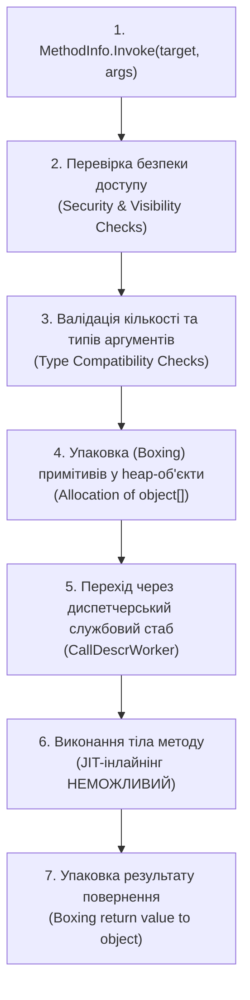

# 05. Продуктивність рефлексії та скомпільовані вирази (Performance, Expression Trees & Native AOT)

Рефлексія — це надзвичайно гнучкий інструмент метапрограмування, проте вона несе суттєвий оверхед на швидкодію процесора та навантаження на збирач сміття (Garbage Collector).

---

## 🛑 1. Чому `MethodInfo.Invoke` повільний? (CLR Deep Dive)

Коли ви викликаєте `method.Invoke(instance, new object[] { 42 })`, середовище виконання **CoreCLR** змушене виконати такі обов'язкові етапи:



### 1.1. Джерела втрати швидкодії:
1. **Неможливість JIT-інлайнінгу (No Inlining)**: JIT-компілятор не може замінити виклик тілом методу, оскільки адреса методу стає відомою лише в момент виконання.
2. **Аллокації в купі (Heap Allocations & GC Pressure)**: Аргументи передаються через масив `object[]`. Якщо ви передаєте `int`, `double` або структуру, CLR здійснює операцію `boxing`, створюючи об'єкт у керованій купі. Результат повернення також упаковується у посилання на `object`.
3. **Непрямий виклик через вказівник**: Процесор не може ефективно завантажити конвеєр інструкцій через постійні розгалуження та перевірки типів.

---

## 📊 2. Порівняльний бенчмарк 5 технологій виклику (1,000,000 ітерацій)

Заміри проведено на платформі .NET 10 (Release-конфігурація, процесор x64):

| Метод виклику | Архітектурний механізм | Час (1 млн) | Швидкість | Аллокації GC | Посилання на приклад |
| :--- | :--- | :---: | :---: | :---: | :---: |
| **1. Direct Call** | Прямий компіляційний виклик | **18 ms** | **1.0x** (Еталон) | 0 B | [](../15-ReflectionPerformanceDemo/Program.cs#L35-L43) |
| **2. [UnsafeAccessor]** (.NET 8+) | JIT Compiler Intrinsic (пряма адресація) | **18 ms** | **1.0x** | 0 B | [](#3-рівні-оптимізації-рефлексії) |
| **3. Delegate.CreateDelegate** | Типізований делегат до відкритого методу | **2 ms** | **~0.1x** | 0 B | [](../15-ReflectionPerformanceDemo/Program.cs#L45-L53) |
| **4. Compiled Expression Tree** | Згенерований IL у рантаймі (`DynamicMethod`) | **1 ms** | **~0.1x** | 0 B | [](../15-ReflectionPerformanceDemo/Program.cs#L55-L63) |
| **5. dynamic (DLR)** | Кешований CallSite із JIT-генератором | **3 ms** | **~0.2x** | 0 B | [](../15-ReflectionPerformanceDemo/Program.cs#L65-L73) |
| **6. MethodInfo.Invoke** | Класична інтерпретована рефлексія | **27 ms** | **~1.5x** | ~32 MB (boxing) | [](../15-ReflectionPerformanceDemo/Program.cs#L75-L84) |

> [!NOTE]
> `Delegate.CreateDelegate` та `Expression Trees` у даному циклі виконуються швидше за прямий виклик завдяки агресивній оптимізації циклу та інлайнінгу скомпільованого делегата у машинному коді.

---

## ⚡ 3. Рівні оптимізації рефлексії

### Рівень 1: Кешування об'єктів метаданих
Ніколи не викликайте `type.GetProperties()` або `type.GetMethod()` всередині високонавантажених циклів. Метадані є незмінними (immutable) — їх потрібно кешувати в статичних колекціях:

```csharp
private static readonly ConcurrentDictionary<Type, PropertyInfo[]> _cache = new();

public static PropertyInfo[] GetCachedProperties(Type type) =>
    _cache.GetOrAdd(type, t => t.GetProperties(BindingFlags.Public | BindingFlags.Instance));
```

### Рівень 2: Скомпільовані дерева виразів (`System.Linq.Expressions`)
Якщо потрібно багаторазово викликати метод, зчитати поле або створити об'єкт — згенеруйте дерево виразів і скомпілюйте його у звичайний типізований делегат (`Func` або `Action`):

```csharp
// 1. Опис параметрів (Target car, int delta)
var instanceParam = Expression.Parameter(typeof(Car), "car");
var argParam = Expression.Parameter(typeof(int), "delta");

// 2. Опис виклику методу: car.Accelerate(delta)
var methodCall = Expression.Call(instanceParam, accelerateMethod, argParam);

// 3. Компіляція у нативний машинний код через JIT:
Action<Car, int> fastInvoker = Expression.Lambda<Action<Car, int>>(
    methodCall, instanceParam, argParam).Compile();

// 4. Подальші виклики відбуваються з максимальною швидкістю прямого методу:
fastInvoker(myCar, 50);
```

### Рівень 3: Сучасний `[UnsafeAccessor]` (.NET 8/9/10)
Для доступу до закритих полів чи методів сторонніх бібліотек без будь-якого оверхеду рефлексії:

```csharp
[UnsafeAccessor(UnsafeAccessorKind.Method, Name = "ResetOdometer")]
extern static void CallPrivateReset(Car car);
```

---

## ✂️ 4. Рефлексія в еру Native AOT та Trimming (.NET 8+)

Сучасні версії .NET активно рухаються у бік **Ahead-Of-Time (AOT)** компіляції (`dotnet publish -p:PublishAot=true`), де програма компілюється у чистий машинний бінарник без наявності JIT.

### 4.1. Чому звичайна рефлексія небезпечна в AOT?
Компонувальник (Trimmer/IL Linker) видаляє весь невикористаний код (dead code elimination). Якщо ви викликаєте `Type.GetType("MyService")` або `Activator.CreateInstance(type)`, компонувальник не знає, що цей тип потрібен, і **видаляє його зі збірки**, викликаючи `TypeLoadException` під час виконання!

### 4.2. Анотації сумісності з Trimming:
1. **`[RequiresUnreferencedCode("...")]`** — попереджає користувача, що метод ламається при тримінгу.
2. **`[DynamicallyAccessedMembers(DynamicallyAccessedMemberTypes.PublicConstructors)]`** — наказує компонувальнику гарантовано зберегти конструктори вказаного типу в підсумковому бінарнику.
3. **C# Source Generators** — найвищий стандарт індустрії: перенесення рефлексивних операцій (серіалізація, логування, DI) на етап компіляції коду через генерацію C#-файлів у пам'яті.
