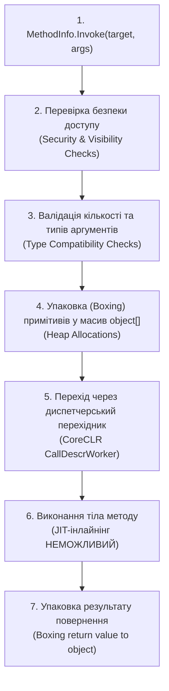

# 05. Продуктивність рефлексії та скомпільовані вирази (Performance, Expression Trees & Native AOT)

Рефлексія — це потужний інструмент динамічного метапрограмування, проте її використання супроводжується значними накладними витратами на обчислювальні ресурси процесора та навантаженням на збирач сміття (Garbage Collector).

---

## 1. Понятійний апарат: Чому `MethodInfo.Invoke` повільний?

Коли розробник викликає метод через `method.Invoke(instance, new object[] { 50 })`, середовище виконання **CoreCLR** змушене пройти кілька обов'язкових етапів:



### 1.1. Джерела втрати швидкодії
1. **Неможливість JIT-інлайнінгу (No Inlining)**: JIT-компілятор не може вбудувати машинний код методу в точку виклику, оскільки адреса методу обчислюється динамічно безпосередньо перед виконанням.
2. **Аллокації в керованій купі (Heap Allocations & GC Pressure)**:
   - Аргументи передаються через масив `object[]`. Створення масиву виділяє пам'ять у купі при кожному виклику.
   - Передача типів значень (`int`, `double`, `struct`) вимагає операції `boxing` — створення об'єкта-обгортки в купі.
   - Повернене значення типу значення також запаковується в об'єкт.
3. **Диспетчеризація через стаб (`CallDescrWorker`)**: CoreCLR повинна скопіювати аргументи з керованого масиву `object[]` у системні регістри процесора (згідно з системною конвенцією виклику x64: RCX, RDX, R8, R9) або в нативний стек процесора.
4. **Валідація безпеки та типів**: кожне звернення знову й знову перевіряє права доступу та сумісність типів параметрів.

---

## 2. Порівняльний бенчмарк технологій виклику (1,000,000 ітерацій)

Заміри проведено на платформі .NET 10 (Release-конфігурація, процесор x64):

| Метод виклику | Архітектурний механізм | Час (1 млн) | Відносне співвідношення | Аллокації GC | Посилання на приклад |
| :--- | :--- | :---: | :---: | :---: | :--- |
| **1. Direct Call** | Прямий компіляційний виклик за адресою | **18 ms** | **1.0x** (Еталон) | 0 B | [15-ReflectionPerformanceDemo/Program.cs](../15-ReflectionPerformanceDemo/Program.cs#L35-L43) |
| **2. [UnsafeAccessor]** (.NET 8+) | JIT Compiler Intrinsic (пряма асемблерна адресація) | **18 ms** | **1.0x** | 0 B | [16-UnsafeAccessorDemo/Program.cs](../16-UnsafeAccessorDemo/Program.cs) |
| **3. Delegate.CreateDelegate** | Типізований делегат до відкритого методу | **2 ms** | **~0.1x** | 0 B | [15-ReflectionPerformanceDemo/Program.cs](../15-ReflectionPerformanceDemo/Program.cs#L45-L53) |
| **4. Compiled Expression Tree** | Згенерований IL у рантаймі (`DynamicMethod`) | **1 ms** | **~0.1x** | 0 B | [15-ReflectionPerformanceDemo/Program.cs](../15-ReflectionPerformanceDemo/Program.cs#L55-L63) |
| **5. dynamic (DLR)** | Кешований CallSite із JIT-генератором поліморфного коду | **3 ms** | **~0.2x** | 0 B | [15-ReflectionPerformanceDemo/Program.cs](../15-ReflectionPerformanceDemo/Program.cs#L65-L73) |
| **6. MethodInfo.Invoke** | Класична інтерпретована рефлексія | **27 ms** | **~1.5x** | ~32 MB | [15-ReflectionPerformanceDemo/Program.cs](../15-ReflectionPerformanceDemo/Program.cs#L75-L84) |

> [!NOTE]
> `Delegate.CreateDelegate` та скомпільовані дерева виразів (`Expression Trees`) у даному циклі виконуються швидше за прямий виклик завдяки тому, що JIT-компілятор агресивно оптимізує цикл виклику делегата з фіксованими інваріантами.

---

## 3. Стратегії оптимізації рефлексії

### 3.1. Рівень 1: Кешування об'єктів метаданих
Ніколи не викликайте методи пошуку метаданих (`type.GetProperties()`, `type.GetMethod()`) всередині циклів або обробників запитів. Метадані типу в CLR є незмінними (immutable) — їх необхідно один раз зчитати та зберегти у потокобезпечній статичній колекції:

```csharp
private static readonly ConcurrentDictionary<Type, PropertyInfo[]> _propertiesCache = new();

public static PropertyInfo[] GetCachedProperties(Type type) =>
    _propertiesCache.GetOrAdd(type, t => t.GetProperties(BindingFlags.Public | BindingFlags.Instance));
```

### 3.2. Рівень 2: Скомпільовані дерева виразів (`System.Linq.Expressions`)
Якщо потрібно багаторазово викликати метод, зчитувати поле або створювати екземпляр за типом, класичну рефлексію слід замінити на генерацію коду в пам'яті через Expression Trees:

```csharp
// 1. Опис вхідних параметрів (Target instance, int delta)
var instanceParam = Expression.Parameter(typeof(Car), "car");
var argParam = Expression.Parameter(typeof(int), "delta");

// 2. Побудова виклику методу: car.Accelerate(delta)
var methodCall = Expression.Call(instanceParam, accelerateMethod, argParam);

// 3. Компіляція виразу в машинний код через механізм DynamicMethod:
Action<Car, int> fastInvoker = Expression.Lambda<Action<Car, int>>(
    methodCall, instanceParam, argParam).Compile();

// 4. Подальші виклики делегата мають продуктивність прямого звернення:
fastInvoker(myCar, 50);
```

- Посилання на реалізацію бенчмарку дерев виразів: [15-ReflectionPerformanceDemo/Program.cs](../15-ReflectionPerformanceDemo/Program.cs#L55-L63).

### 3.3. Рівень 3: Атрибут `[UnsafeAccessor]` (.NET 8+)
Починаючи з .NET 8, середовище CoreCLR підтримує атрибут `[UnsafeAccessor]`. Це внутрішній механізм компілятора та середовища виконання (Compiler & Runtime Intrinsic), який дозволяє отримувати доступ до закритих (`private`) полів, методів і конструкторів зі швидкістю нативного виклику без жодних накладних витрат класичної рефлексії (`FieldInfo`, `MethodInfo`, `ConstructorInfo`).

#### Як це працює?
Замість динамічного парсингу метаданих у рантаймі, JIT-компілятор під час компіляції методу підставляє пряме звернення до пам'яті (пряму машинну інструкцію `mov` для полів або `call` для методів).

#### Види доступу через `UnsafeAccessorKind`:
1. `UnsafeAccessorKind.Field`: читання та запис у приватне поле екземпляра (метод повертає посилання `ref TField`).
2. `UnsafeAccessorKind.StaticField`: доступ до приватного статичного поля.
3. `UnsafeAccessorKind.Method`: виклик приватного методу екземпляра.
4. `UnsafeAccessorKind.StaticMethod`: виклик приватного статичного методу.
5. `UnsafeAccessorKind.Constructor`: виклик приватного або внутрішнього конструктора для створення екземпляра без виклику `Activator`.

```csharp
// 1. Прямий доступ до приватного поля _speed (читання та зміна за посиланням):
[UnsafeAccessor(UnsafeAccessorKind.Field, Name = "_speed")]
extern static ref int GetSpeedField(Car car);

// 2. Прямий виклик приватного методу:
[UnsafeAccessor(UnsafeAccessorKind.Method, Name = "ResetOdometer")]
extern static void CallPrivateReset(Car car);

// 3. Інстанціювання через приватний конструктор:
[UnsafeAccessor(UnsafeAccessorKind.Constructor)]
extern static Car CreateCarWithPrivateCtor(string model, int maxSpeed);

// Використання:
GetSpeedField(myCar) = 150;     // прямий запис у приватне поле!
CallPrivateReset(myCar);         // виклик методу зі швидкістю 1:1 відносно відкритого виклику
Car stealthCar = CreateCarWithPrivateCtor("Prototype X", 380);
```

- Посилання на практичний бенчмарк та реалізацію всіх видів доступу: [16-UnsafeAccessorDemo/Program.cs](../16-UnsafeAccessorDemo/Program.cs).

---

## 4. Рефлексія в еру Native AOT та Trimming (.NET 8+)

Сучасна екосистема .NET стрімко рухається у бік компіляції безпосередньо у машинний бінарний код без участі JIT — **Native AOT (Ahead-Of-Time)** (`dotnet publish -p:PublishAot=true`).

### 4.1. Чому рефлексія конфліктує з AOT та Trimming?
Під час публікації компонувальник (.NET Trimmer / ILLink) проводить аналіз недосяжного коду (Dead Code Elimination) і фізично видаляє зі збірки всі класи та методи, до яких немає явних статичних звернень.

Якщо код містить динамічний виклик на кшталт `Type.GetType(configString)` або `Activator.CreateInstance(type)`, тример не може передбачити, які класи знадобляться програмі, і **видаляє їх**. Як наслідок, під час запуску скомпільованого бінарника виникає аварійний виняток `TypeLoadException` або `MissingMethodException`!

### 4.2. Анотації для забезпечення сумісності з Trimming
Для підготовки коду до Native AOT розробники використовують спеціальні атрибути валідації:
1. **`[RequiresUnreferencedCode("...")]`**: попереджає компонувальник і розробників про те, що метод використовує динамічну рефлексію і не гарантує коректну роботу в режимі обрізання коду (Trimming).
2. **`[DynamicallyAccessedMembers(DynamicallyAccessedMemberTypes.PublicConstructors)]`**: вказує компонувальнику примусово зберегти всі публічні конструктори цільового типу в підсумковому бінарнику, захищаючи їх від видалення.
3. **C# Source Generators**: сучасний промисловий стандарт заміни рефлексії. Генератори аналізують вихідний код проєкту під час збирання та створюють додаткові типізовані файли C# (наприклад, для серіалізації в `System.Text.Json`), забезпечуючи повну підтримку Native AOT та максимальну швидкодію без накладних витрат у рантаймі.
