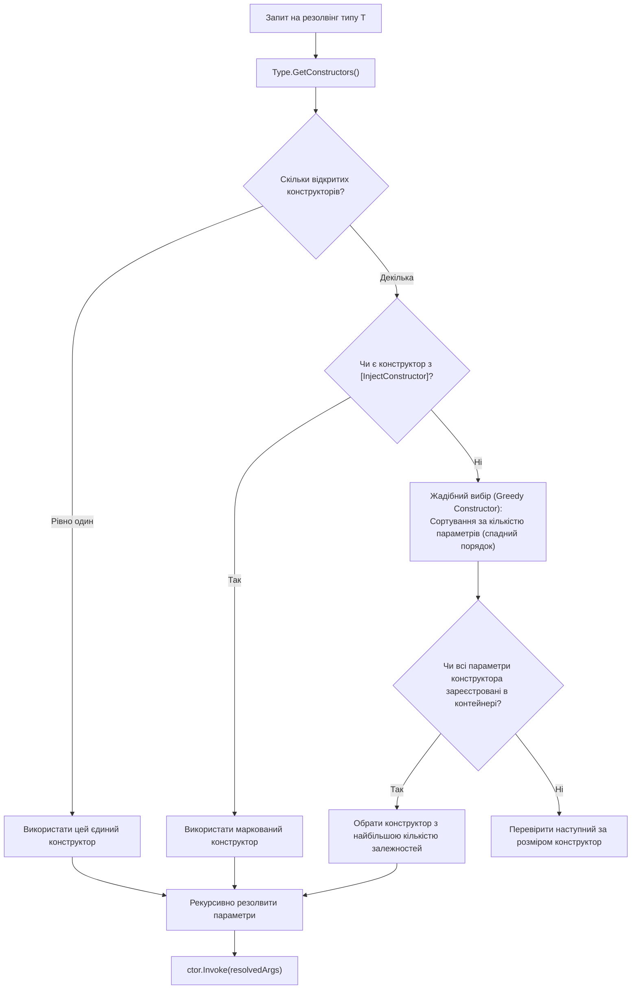

# Алгоритми резолвінгу конструкторів у Dependency Injection

> **Ключові класи**: `System.Type`, `System.Reflection.ConstructorInfo`, `System.Reflection.ParameterInfo`  
> **Офіційна документація**: [Dependency injection in .NET (Microsoft Learn)](https://learn.microsoft.com/en-us/dotnet/core/extensions/dependency-injection)

Під час автоматичного створення об'єкта IoC-контейнер має визначити, який саме конструктор слід викликати (якщо їх декілька) та які аргументи необхідно передати в кожен з його параметрів.

---

## 1. Стратегії вибору конструктора

---

## 2. Властивості, задіяні в резолвінгу конструкторів (Properties)

| Властивість | Сигнатура | Опис призначення | Статус у курсі | Приклад у коді | Документація MSDN |
| :--- | :--- | :--- | :---: | :--- | :--- |
| **`ParameterType`** | `Type ParameterType { get; }` | Тип даних залежності, яку необхідно знайти в контейнері | Використано | [19.1-DependencyInjectionDemo/SimpleContainer.cs](../../19.1-DependencyInjectionDemo/SimpleContainer.cs#L50) | [ParameterInfo.ParameterType](https://learn.microsoft.com/en-us/dotnet/api/system.reflection.parameterinfo.parametertype) |
| **`HasDefaultValue`** | `bool HasDefaultValue { get; }` | Визначає, чи є параметр опціональним з дефолтним значенням | Використано | [19.2-DependencyInjectionRealWorld/Container/AdvancedContainer.cs](../../19.2-DependencyInjectionRealWorld/Container/AdvancedContainer.cs#L95) | [ParameterInfo.HasDefaultValue](https://learn.microsoft.com/en-us/dotnet/api/system.reflection.parameterinfo.hasdefaultvalue) |
| **`DefaultValue`** | `object? DefaultValue { get; }` | Літеральне дефолтне значення параметра, якщо залежність не зареєстрована | Використано | [19.2-DependencyInjectionRealWorld/Container/AdvancedContainer.cs](../../19.2-DependencyInjectionRealWorld/Container/AdvancedContainer.cs#L96) | [ParameterInfo.DefaultValue](https://learn.microsoft.com/en-us/dotnet/api/system.reflection.parameterinfo.defaultvalue) |
| **`IsPublic`** | `bool IsPublic { get; }` | Перевірка відкритості конструктора для створення екземпляра ззовні | Загальний BCL | Довідник | [MethodBase.IsPublic](https://learn.microsoft.com/en-us/dotnet/api/system.reflection.methodbase.ispublic) |

---

## 3. Методи, задіяні в резолвінгу конструкторів (Methods)

| Метод | Сигнатура | Опис призначення | Статус у курсі | Приклад у коді | Документація MSDN |
| :--- | :--- | :--- | :---: | :--- | :--- |
| **`GetConstructors`** | `ConstructorInfo[] GetConstructors()` | Повертає масив усіх публічних конструкторів цільового класу | Використано | [19.1-DependencyInjectionDemo/SimpleContainer.cs](../../19.1-DependencyInjectionDemo/SimpleContainer.cs#L38) | [Type.GetConstructors](https://learn.microsoft.com/en-us/dotnet/api/system.type.getconstructors) |
| **`GetParameters`** | `ParameterInfo[] GetParameters()` | Повертає список формальних параметрів конструктора | Використано | [19.1-DependencyInjectionDemo/SimpleContainer.cs](../../19.1-DependencyInjectionDemo/SimpleContainer.cs#L45) | [MethodBase.GetParameters](https://learn.microsoft.com/en-us/dotnet/api/system.reflection.methodbase.getparameters) |
| **`Invoke`** | `object Invoke(object?[]? parameters)` | Виконує конструктор у пам'яті, створюючи готовий об'єкт | Використано | [19.1-DependencyInjectionDemo/SimpleContainer.cs](../../19.1-DependencyInjectionDemo/SimpleContainer.cs#L55) | [ConstructorInfo.Invoke](https://learn.microsoft.com/en-us/dotnet/api/system.reflection.constructorinfo.invoke) |
| **`GetCustomAttribute<T>`**| `static T? GetCustomAttribute<T>(this MemberInfo element)` | Перевіряє наявність маркерного атрибута на конструкторі (`[InjectConstructor]`) | Використано | [19.2-DependencyInjectionRealWorld/Container/AdvancedContainer.cs](../../19.2-DependencyInjectionRealWorld/Container/AdvancedContainer.cs#L78) | [CustomAttributeExtensions.GetCustomAttribute](https://learn.microsoft.com/en-us/dotnet/api/system.reflection.customattributeextensions.getcustomattribute) |
