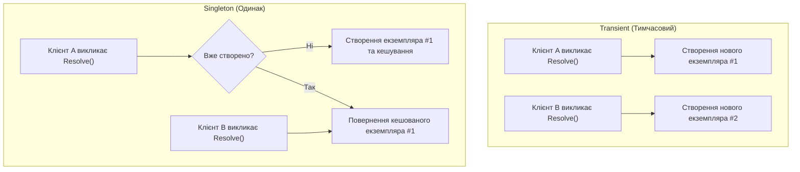
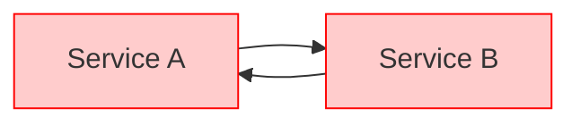

# Життєвий цикл сервісів та виявлення циклічних залежностей

> **Ключові концепції**: `ServiceLifetime` (`Transient`, `Singleton`), `Circular Dependency Detection`  
> **Офіційна документація**: [Service lifetimes in .NET (Microsoft Learn)](https://learn.microsoft.com/en-us/dotnet/core/extensions/dependency-injection#service-lifetimes)

Управління часом життя (Service Lifetime) та гарантія ациклічності графу залежностей — два критичні завдання будь-якого контейнера інверсії керування.

---

## 1. Порівняння часів життя сервісів (Lifetimes)



1. **`Transient`**: Кожен виклик `Resolve` або кожне інжектування в залежність породжує новий об'єкт у керованій купі. Рекомендовано для легковагових stateless сервісів.
2. **`Singleton`**: Екземпляр створюється один раз при першому зверненні (або передається готовим при реєстрації) і живе протягом усього часу роботи програми. Потребує забезпечення потокобезпечності.

---

## 2. Захист від циклічних залежностей (Cycle Detection)

Якщо сервіс `A` залежить від `B`, а сервіс `B` — від `A`, пряма рекурсивна рефлексія призведе до фатального `StackOverflowException`.



### Алгоритм захисту через стек активних викликів:
```csharp
private readonly HashSet<Type> _resolvingTypes = new();

public object Resolve(Type serviceType)
{
    // 1. Перевірка: якщо тип вже присутній у списку активного розв'язання — знайдено цикл!
    if (!_resolvingTypes.Add(serviceType))
    {
        throw new InvalidOperationException($"Виявлено циклічну залежність для типу: {serviceType.Name}");
    }

    try
    {
        // 2. Рекурсивне створення об'єкта та його залежностей
        return CreateInstance(serviceType);
    }
    finally
    {
        // 3. Обов'язкове звільнення типу зі стеку після завершення гілки
        _resolvingTypes.Remove(serviceType);
    }
}
```

---

## 3. Властивості та типи, задіяні в управлінні життєвим циклом (Properties & Types)

| Властивість / Тип | Сигнатура | Опис призначення | Статус у курсі | Приклад у коді | Документація MSDN |
| :--- | :--- | :--- | :---: | :--- | :--- |
| **`ServiceLifetime`** | `enum ServiceLifetime { Transient, Singleton }` | Перерахування, що визначає стратегію збереження та повторного використання екземпляра | Використано | [19.2-DependencyInjectionRealWorld/Container/AdvancedContainer.cs](../../19.2-DependencyInjectionRealWorld/Container/AdvancedContainer.cs#L14) | [ServiceLifetime Enum](https://learn.microsoft.com/en-us/dotnet/api/microsoft.extensions.dependencyinjection.servicelifetime) |
| **`ImplementationType`**| `Type ImplementationType { get; }` | Конкретний клас реалізації, зареєстрований для даного інтерфейсу | Використано | [19.2-DependencyInjectionRealWorld/Container/AdvancedContainer.cs](../../19.2-DependencyInjectionRealWorld/Container/AdvancedContainer.cs#L22) | [ServiceDescriptor.ImplementationType](https://learn.microsoft.com/en-us/dotnet/api/microsoft.extensions.dependencyinjection.servicedescriptor.implementationtype) |
| **`ImplementationInstance`**| `object? ImplementationInstance { get; }` | Кешований готовий екземпляр сервісу для `Singleton` часу життя | Використано | [19.2-DependencyInjectionRealWorld/Container/AdvancedContainer.cs](../../19.2-DependencyInjectionRealWorld/Container/AdvancedContainer.cs#L24) | [ServiceDescriptor.ImplementationInstance](https://learn.microsoft.com/en-us/dotnet/api/microsoft.extensions.dependencyinjection.servicedescriptor.implementationinstance) |

---

## 4. Методи, задіяні в управлінні життєвим циклом (Methods)

| Метод | Сигнатура | Опис призначення | Статус у курсі | Приклад у коді | Документація MSDN |
| :--- | :--- | :--- | :---: | :--- | :--- |
| **`RegisterTransient`** | `void RegisterTransient<TInterface, TImplementation>()` | Реєструє зіставлення типів з постійним створенням нових екземплярів при кожному зверненні | Використано | [19.1-DependencyInjectionDemo/SimpleContainer.cs](../../19.1-DependencyInjectionDemo/SimpleContainer.cs#L16) | [ServiceCollectionServiceExtensions.AddTransient](https://learn.microsoft.com/en-us/dotnet/api/microsoft.extensions.dependencyinjection.servicecollectionserviceextensions.addtransient) |
| **`RegisterSingleton`** | `void RegisterSingleton<TInterface, TImplementation>()` | Реєструє сервіс як одинак, кешуючи перший створений екземпляр для всіх наступних викликів | Використано | [19.1-DependencyInjectionDemo/SimpleContainer.cs](../../19.1-DependencyInjectionDemo/SimpleContainer.cs#L21) | [ServiceCollectionServiceExtensions.AddSingleton](https://learn.microsoft.com/en-us/dotnet/api/microsoft.extensions.dependencyinjection.servicecollectionserviceextensions.addsingleton) |
| **`HashSet<T>.Add`** | `bool Add(T item)` | Додає тип до активного набору відстеження; повертає `false`, якщо тип уже розв'язується | Використано | [19.1-DependencyInjectionDemo/SimpleContainer.cs](../../19.1-DependencyInjectionDemo/SimpleContainer.cs#L32) | [HashSet.Add](https://learn.microsoft.com/en-us/dotnet/api/system.collections.generic.hashset-1.add) |
| **`HashSet<T>.Remove`** | `bool Remove(T item)` | Видаляє тип з набору після успішної побудови гілки графу | Використано | [19.1-DependencyInjectionDemo/SimpleContainer.cs](../../19.1-DependencyInjectionDemo/SimpleContainer.cs#L61) | [HashSet.Remove](https://learn.microsoft.com/en-us/dotnet/api/system.collections.generic.hashset-1.remove) |
