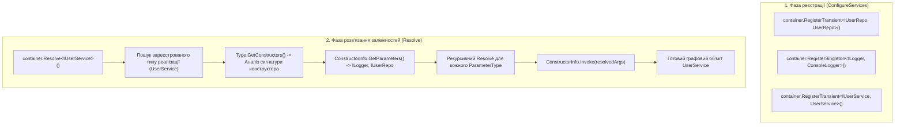

# 06. Frameworks & Dependency Injection: Загальний огляд та зріз методів

> **Solution-тег (Solution Folder)**: `06. Frameworks & Dependency Injection`  
> **Проєкти у тегу**:
> - [19.1-DependencyInjectionDemo](../../19.1-DependencyInjectionDemo/Program.cs) — Навчальний прозорий IoC-контейнер (~70 рядків коду) з рекурсивним резолвінгом конструкторів та виявленням циклічних залежностей.
> - [19.2-DependencyInjectionRealWorld](../../19.2-DependencyInjectionRealWorld/Program.cs) — Промисловий modular IoC-контейнер з жадібним вибором конструкторів (greedy constructor), підтримкою атрибута `[InjectConstructor]`, In-Memory базою даних, репозиторіями та сервісами.

---

## 1. Концептуальний зріз розділу

Контейнери інверсії керування (IoC / Dependency Injection) — це вершина практичного застосування рефлексії в корпоративній розробці на платформі .NET. Вони автоматизують створення графів об'єктів та керування часом їхнього життя:

### Ключові теми та відповідні документи:
- [ConstructorResolution.md](ConstructorResolution.md) — алгоритми інспекції та вибору конструкторів: єдиний конструктор, маркований через `[InjectConstructor]` або жадібний вибір (greedy constructor).
- [DependencyInjectionLifecycle.md](DependencyInjectionLifecycle.md) — керування життєвим циклом об'єктів (`Transient` vs `Singleton`) та захист від циклічних залежностей за допомогою стеку активних викликів.

---

## 2. Зведена матриця методів рефлексії для IoC/DI

| Клас | Метод / Властивість | Статус у курсі | Опис призначення | Приклад у коді | Документація MSDN |
| :--- | :--- | :---: | :--- | :--- | :--- |
| `Type` | `GetConstructors()` | Використано | Повертає масив усіх відкритих екземплярних конструкторів типу | [19.1-DependencyInjectionDemo/SimpleContainer.cs](../../19.1-DependencyInjectionDemo/SimpleContainer.cs#L38) | [Type.GetConstructors](https://learn.microsoft.com/en-us/dotnet/api/system.type.getconstructors) |
| `Type` | `IsInterface` | Використано | Перевіряє, чи є тип інтерфейсом, перед реєстрацією сервісу | [19.1-DependencyInjectionDemo/SimpleContainer.cs](../../19.1-DependencyInjectionDemo/SimpleContainer.cs#L22) | [Type.IsInterface](https://learn.microsoft.com/en-us/dotnet/api/system.type.isinterface) |
| `Type` | `IsAbstract` | Використано | Запобігає спробі інстанціювання абстрактних класів | [19.2-DependencyInjectionRealWorld/Container/AdvancedContainer.cs](../../19.2-DependencyInjectionRealWorld/Container/AdvancedContainer.cs#L42) | [Type.IsAbstract](https://learn.microsoft.com/en-us/dotnet/api/system.type.isabstract) |
| `Type` | `IsAssignableFrom` | Використано | Валідує, чи реалізує клас відповідний інтерфейс сервісу | [19.2-DependencyInjectionRealWorld/Container/AdvancedContainer.cs](../../19.2-DependencyInjectionRealWorld/Container/AdvancedContainer.cs#L48) | [Type.IsAssignableFrom](https://learn.microsoft.com/en-us/dotnet/api/system.type.isassignablefrom) |
| `ConstructorInfo`| `GetParameters()` | Використано | Зчитує метадані залежностей (параметрів), що необхідні для виклику конструктора | [19.1-DependencyInjectionDemo/SimpleContainer.cs](../../19.1-DependencyInjectionDemo/SimpleContainer.cs#L45) | [MethodBase.GetParameters](https://learn.microsoft.com/en-us/dotnet/api/system.reflection.methodbase.getparameters) |
| `ConstructorInfo`| `Invoke(object?[])`| Використано | Створює новий екземпляр типу, підставляючи розв'язані залежності | [19.1-DependencyInjectionDemo/SimpleContainer.cs](../../19.1-DependencyInjectionDemo/SimpleContainer.cs#L55) | [ConstructorInfo.Invoke](https://learn.microsoft.com/en-us/dotnet/api/system.reflection.constructorinfo.invoke) |
| `ParameterInfo` | `ParameterType` | Використано | Визначає `Type` кожної залежності для подальшого рекурсивного розв'язання | [19.1-DependencyInjectionDemo/SimpleContainer.cs](../../19.1-DependencyInjectionDemo/SimpleContainer.cs#L50) | [ParameterInfo.ParameterType](https://learn.microsoft.com/en-us/dotnet/api/system.reflection.parameterinfo.parametertype) |
| `ParameterInfo` | `HasDefaultValue` | Використано | Дозволяє підставляти дефолтне значення параметра, якщо сервіс не зареєстровано | [19.2-DependencyInjectionRealWorld/Container/AdvancedContainer.cs](../../19.2-DependencyInjectionRealWorld/Container/AdvancedContainer.cs#L95) | [ParameterInfo.HasDefaultValue](https://learn.microsoft.com/en-us/dotnet/api/system.reflection.parameterinfo.hasdefaultvalue) |
| `ParameterInfo` | `DefaultValue` | Використано | Зчитує дефолтне значення опціонального параметра | [19.2-DependencyInjectionRealWorld/Container/AdvancedContainer.cs](../../19.2-DependencyInjectionRealWorld/Container/AdvancedContainer.cs#L96) | [ParameterInfo.DefaultValue](https://learn.microsoft.com/en-us/dotnet/api/system.reflection.parameterinfo.defaultvalue) |
| `MemberInfo` | `GetCustomAttribute<T>()`| Використано | Виявляє конструктор, спеціально помічений атрибутом `[InjectConstructor]` | [19.2-DependencyInjectionRealWorld/Container/AdvancedContainer.cs](../../19.2-DependencyInjectionRealWorld/Container/AdvancedContainer.cs#L78) | [CustomAttributeExtensions.GetCustomAttribute](https://learn.microsoft.com/en-us/dotnet/api/system.reflection.customattributeextensions.getcustomattribute) |
| `ConstructorInfo`| `IsPublic` | Загальний BCL | Перевіряє модифікатор видимості конструктора | Довідник | [MethodBase.IsPublic](https://learn.microsoft.com/en-us/dotnet/api/system.reflection.methodbase.ispublic) |
| `Type` | `MakeGenericType` | Загальний BCL | Дозволяє розв'язувати відкриті узагальнені сервіси на зразок `IRepository<T>` | Довідник | [Type.MakeGenericType](https://learn.microsoft.com/en-us/dotnet/api/system.type.makegenerictype) |

---

## 3. Статистичний зріз охоплення API

- **Методів та властивостей досліджено в прикладах**: 10
- **Загальних методів API BCL задокументовано додатково**: 2
- **Сумарно в довіднику розділу**: 12 API елементів
- **Відсоток фокусного практичного охоплення**: ~83%
